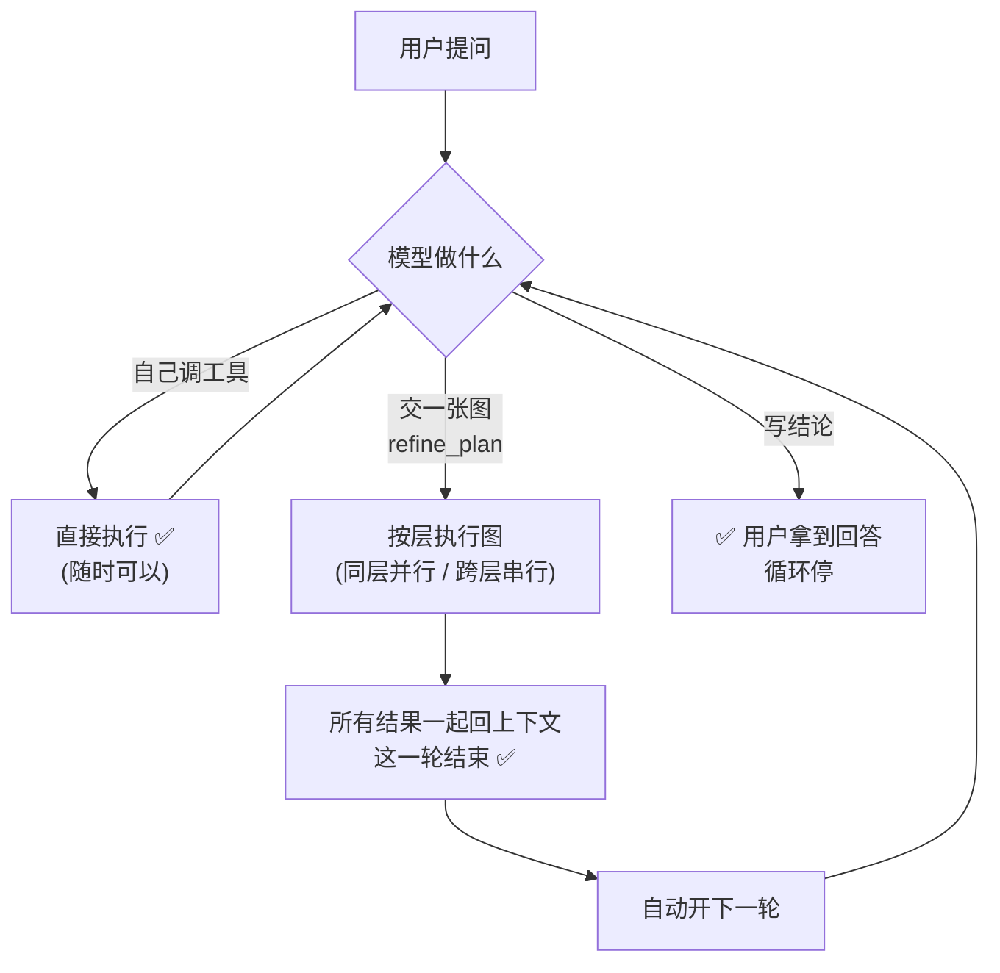
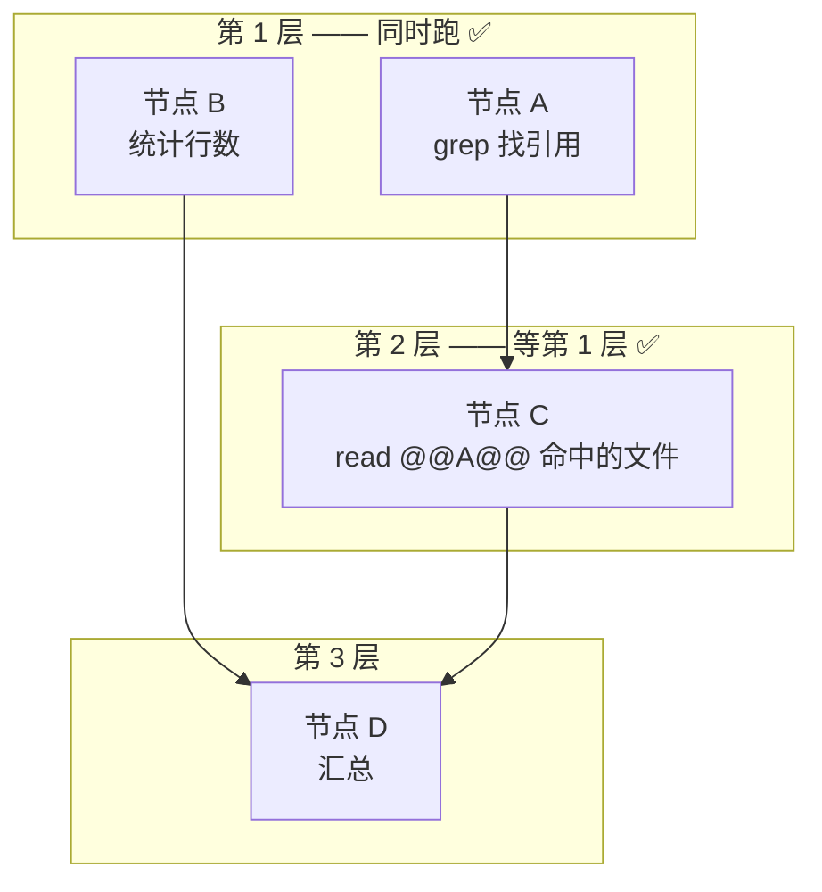
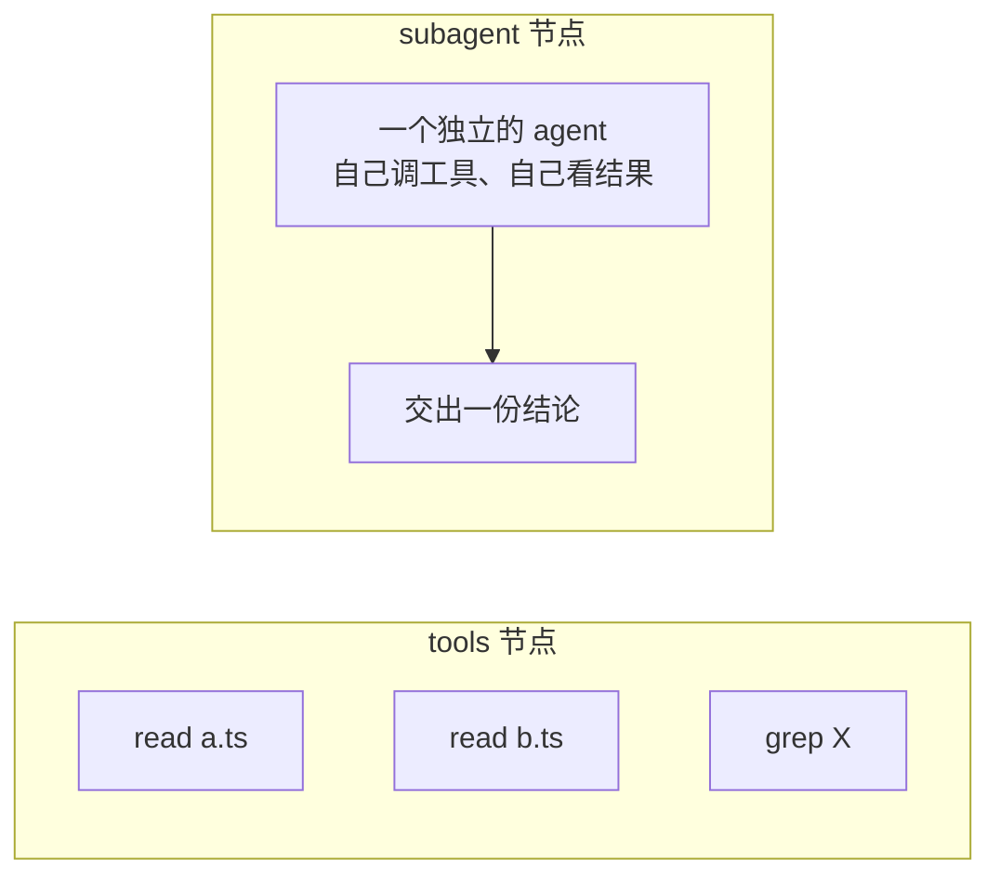
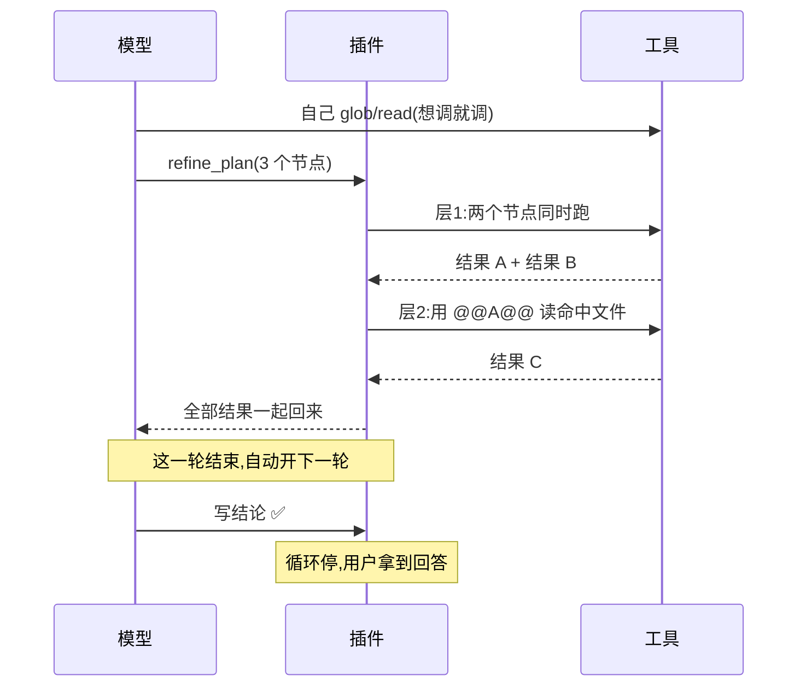

# dsh-refine-loop

**让模型把「并行的那部分活」画成一张图交出来，插件按依赖分层跑完，结果一起还给它。**

---

## 一句话

> 模型可以随时自己调工具。当它想把一批活**一起做完**时，交一张图：
> 图里有若干节点，节点之间用 `after` 说明谁等谁。
> 插件按层执行 —— **同层并行、跨层串行** —— 跑完把**所有结果一起**还给模型，这一轮结束。
> 下一轮模型拿着结果决定：再交一张图，或者**写结论**（写结论 = 这件事答完了，循环停）。



---

## 图怎么跑：同层并行、跨层串行



- `after: ["A"]` 表示这个节点等 A ✅
- 下游参数写 `@@A@@` → 插件把 A 的**整段输出**塞进去 ✅，并且自动算作依赖 ✅

---

## 节点有三种



| 节点 | 里面是什么 | 额外模型调用 | 特点 |
|---|---|---:|---|
| **tools** | 一批**事先写死**的调用 | **0** ✅ | 便宜；参数不能自适应 |
| **subagent** | 一个从零开始的 agent | 一份上下文 + 一份报告 | 能边看边决定 |
| **subagent_fork** | 一个继承本对话的 agent | 同上，且每步重发历史 | 任务离不开本对话时用 |

**子代理之间不能互相依赖 ✅** —— 它们是并行分支，依赖另一个子代理的图会被直接拒绝 ✅。

---

## 一轮里发生什么



---

## 实测（单次抽样，方差很大）

同一份代码、同一个 profile、同一个模型、同一个任务，只切插件的 `enabled`。
原始记录在 `bench/results/`。

| 场景 | 关插件 | 开插件 |
|---|---|---|
| `coverage`（盘点 14 个文件的测试覆盖） | 60s / 257k | 712s / 2,576k |
| 主 agent 的往返步数 | 10 | 1–11（看模型怎么切） |
| 主 agent 的上下文 | 38k | 41k |

**这一版不做任何「怎么切」的引导**：图完全由模型决定。
实测里它有时用一个 `tools` 节点干完，有时派 11 个 agent —— 差别就这么大。
**这个插件提供的是「能把并行活交给图」这个能力本身，不保证更快。**

---

## 改设置

```yaml
- insert:
    - id: refine-loop
      name: '@zyn19940107/dsh-refine-loop'
      config:
        enabled: true                    # 整个插件挂不挂
        maxBatchSize: 8                  # 一张图最多几个节点
        maxBatchTimeoutMs: 600000        # 一张图的时间预算
        maxAgentDepth: 3                 # 最多派到第几层子代理
        agentNodeTimeoutMs: 300000       # 单个子代理节点的预算
        maxRounds: 16                    # 最多几轮
        respectConcurrencySafety: true   # 认不认工具自己声明的「不能并发」
        concurrentTools: [glob, grep]    # 插件放行的只读工具
        concurrentShell: true            # 只读 shell 命令也可并行
        shellTool: ops_bash
```

| 字段 | 默认 | 说明 |
|---|---|---|
| `maxBatchSize` | `8` | 一张图的节点上限 |
| `maxBatchTimeoutMs` | `600000` | 一张图的时间预算（子代理在前台跑，也管着它们） |
| `maxAgentDepth` | `3` | 子代理还能不能再派子代理 |
| `agentNodeTimeoutMs` | `300000` | 单个子代理节点的预算，超了报这个节点失败，其余结果照常回来 |
| `maxRounds` | `16` | 一个请求最多几轮，用完就停 |
| `respectConcurrencySafety` | `true` | 认不认工具自己声明的独占性 |
| `concurrentTools` | `[glob, grep]` | 纯读工具，随便并行；**写操作永远不要加** |
| `concurrentShell` | `true` | 只读 shell 命令是否并行 |

---

## 关于并发安全

插件默认认工具自己声明的并发安全性：没声明 `isConcurrencySafe` 的一律独占。

补充判定：`glob` / `grep` 直接放行；shell 命令由插件自己判断 —— 必须是简单命令（无重定向、无管道、无链、无替换），
可执行文件必须在只读白名单里，危险参数（`find -exec`、`grep --pre`、`sort -o` …）单独挡掉。
**判断不了的，排队。** 独占调用是屏障：它前面的先跑完、它自己单独跑、后面的再开始。

批次结果里会写明每项是 `concurrent` 还是 `serial`，整批是 `concurrent` / `mixed` / `serial`。

---

## 装上

```sh
dsh plugin add /path/to/dsh-refine-loop

# 或打包
pnpm pack
dsh plugin add ./zyn19940107-dsh-refine-loop-0.1.0.tgz
```

装完请开一个新会话 —— 已开着的会话不会刷新模型看到的工具表。

---

## 自己改代码

```sh
pnpm install
pnpm build        # 打包
pnpm typecheck    # 类型检查
pnpm specs        # 跑规格
```

规格里有几条在测事实：同一层三个节点的**峰值并发数**、层与层的顺序、失败调用的修复、
以及轮次预算 —— 不是看摘要，是看行为。

---

## 已知边界

- **不改变 harness 的循环结构**：全部走公开扩展点（`tools/register`、`tools/execute`、`agent/pre-step`、
  `systemPrompt.section`、`commands/register`），`agent-loop` 一行没动。
- **子代理在前台同步跑**：慢会拖住这一轮，但它有自己的预算（`agentNodeTimeoutMs`）。
- **子代理的中间过程不进主上下文**，你只看得到它的结论 —— 这是它的价值，也是它的成本。
- **图里的调用参数可能写错**：图是在跑之前写的，所以插件在调用失败时会问模型一次「这条调用应该是什么」，
  用修好的参数重跑那一条（最多两次），其余节点不受影响。
- **图的结果可能装不下**：被截掉的部分在 spill 文件里，下一张图可以读回来。
- **占位符是 `@@节点名@@`**，不是 `{{节点名}}` —— harness 的提示词渲染器把双花括号当变量引用。

## License

MIT
