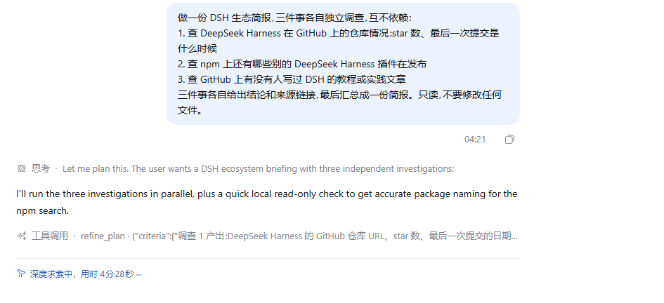
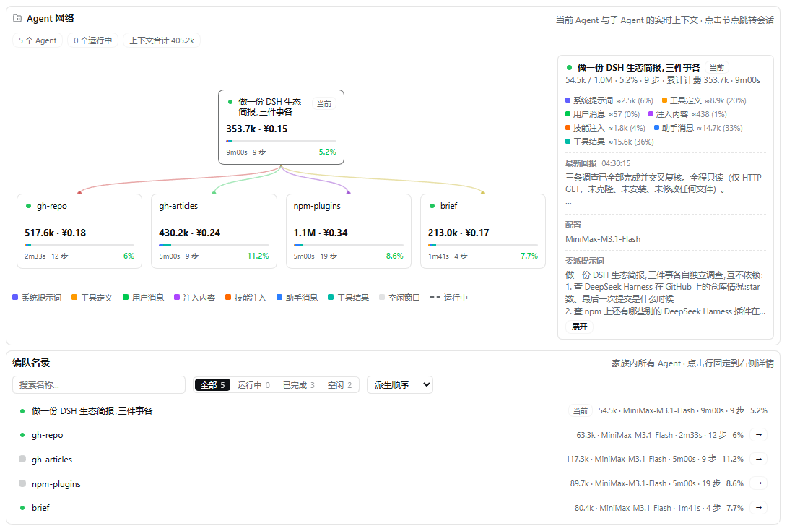

# dsh-refine-loop

给 DeepSeek Harness 用的插件：**把「想 → 做 → 看 → 再想」的串行链，换成「规划一次 → 跑完 → 一次性收 N 个结论」。**

---

## 你在跟一条每步都重新思考的链干活

Agent loop 是个链。每一轮都是一次完整的模型往返：

```
规划 → 做一件 → 看结果 → 再规划 → 再做一件 → 看结果 → …
```

问题不在每一步，而在三件事叠在一起：

1. **每一步都重新规划。** 做第 5 件事的时候，第 1~4 件的结论已经躺在上下文里了，模型却要重新读一遍、重新想一遍「第 5 件该怎么做」。
2. **每一步都是一次往返。** 一次往返 ≈ 一次完整模型调用。5 件独立的事，就是 5 次往返。
3. **每一步都在为前面的历史付钱。** 上下文只涨不缩，第 N 步要重读前 N-1 步留下的全部内容。

这个插件提供另一种形状，并且**在能强制的地方强制**。

---

## 对比：开插件 vs 不开插件

同一个二进制、同一份 profile、同一个模型、同一个任务 —— 只差插件自己的 `enabled` 开关。
每组 3 次，**串行**跑（并行跑测出来的是 provider 的争用，不是插件），取中位数。

| 指标 | 关掉插件 | 开着插件 | 变化 |
|---|---:|---:|---:|
| 步数（模型往返） | 12 | 6 | **−50%** |
| 工具调用（顶层） | 29 | 16 | −45% |
| 工具调用（含计划内） | 29 | 22 | −24% |
| 总 tokens | 293,356 | 163,282 | **−44%** |
| ├ input | 20,362 | 24,768 | +22% |
| ├ cacheRead | 267,008 | 132,480 | −50% |
| └ output | 5,986 | 6,385 | +7% |
| 墙钟 | 71s | 47s | **−34%** |
| 正确性（命中判据） | 6/6 | 6/6 | 持平 |

**这些数是怎么来的**

- **耗时** = 从进程启动到最终回答写出的墙钟时间。
- **token** = provider 自己上报的用量（input / cacheRead / output），不是估算。
- **步数** = 模型往返次数。关掉插件时模型一步一个工具调用；开着插件时整轮的工作是一张计划，一次调用交出去。
- **正确性** = 任务要回答的 6 项事实（两个文件数、14 个文件名、两个符号定义在哪个文件）有没有全部出现在最终回答里。判据是机械的，不是「读起来不错」。
- **工具调用**分两行：计划内部的调用不产生顶层 `tool/call` 事件，所以只数顶层会低估计划干的活，第二行把它加回来。

**六次运行全部 6/6。** 开着插件时 `input` 反而多了 22% —— 计划本身要占 token；
省下来的是 `cacheRead`（−50%）：步数少一半，每一步就不用重读上一轮攒下的历史。

复现：`pnpm bench`；原始记录在 `bench/results/`，任务和判据在 `bench/task.mjs`。
基准要一个**自己的** DSH home（别跟正在用的那个共用 profile）：
`DSH_SANDBOX_HOME=<你的隔离 DSH_HOME> DSH_BENCH_CWD=<任务要读的目录> pnpm bench`。

---

## 开了插件之后，流程图长什么样

模型在**思考里**先把这一轮的形状说出来，再把它交给 `refine_plan` 落成机器可执行的图：



这是那次跑出来的真实计划（完整 JSON 在 [`docs/example-plan.json`](docs/example-plan.json)）：

| 节点 | 类型 | 依赖 | 干什么 |
|---|---|---|---|
| `local` | `tools` | — | 读本地安装，补准确的包名（2 个 `ops_bash`） |
| `gh-repo` | `subagent` | — | 调查 DSH 在 GitHub 上的官方仓库 |
| `npm-plugins` | `subagent` | — | 调查 npm 上的 DSH 插件包 |
| `gh-articles` | `subagent` | — | 调查 GitHub 上的 DSH 教程文章 |
| `brief` | `subagent_fork` | 上面四条 | 把四条调查结果汇总成简报 |

**两层**：上面四条并行跑，`brief` 等齐了再动。

**节点类型是模型自己选的**，判据只有一条：**这个孩子需不需要知道我们刚才说了什么。**
三个调查各自独立、不需要本对话的上下文 → `subagent`；汇总要用到前面三条的结果 → `subagent_fork`。

---

## 开了插件之后，编队长什么样

一次派出 4 个子代理。DSH 的「编队」页把派生关系画成了树，每个子代理有自己的上下文、耗时和步数：



图里能直接读出来：谁派生了谁、每个子代理烧了多少上下文（`npm-plugins` 1.1M，`gh-repo` 517.6k）、
跑了多久、走了几步、上下文压力百分之多少。

---

## 插件做了四件事

### 一、`refine_plan`：一次调用带一整张流程图

模型在一个调用里给出**这一轮的全部形状**：

- **判据**（`criteria`）—— 这一轮怎么算成功，每一条都是能对着结果核对的东西
- **节点**（`nodes`）—— 这一轮由哪些节点组成

节点有三种：

| 节点 | 是什么 |
|---|---|
| `tools` | 若干个调用。互相能并发的并发跑，不能并发的排队跑 |
| `subagent` | 一个自包含的任务，交给一个**从零开始**的子代理 |
| `subagent_fork` | 一个任务，交给一个**继承本对话**的子代理 |

**模型自己决定用哪个:**

- **`subagent`** —— 任务**不需要本对话的任何东西**。查一个话题、审一份文件、做一件自成一体的事。
- **`subagent_fork`** —— 任务**要建立在本对话已经说过的内容上**。接着刚才的结论往下分析、对这一轮做个复盘。

判据就一条：**这个孩子需不需要知道我们刚才说了什么。**

节点还能用 `after` 声明**依赖**：

```json
{
  "criteria": ["四个文件都读到了", "peerDependencies 齐了"],
  "nodes": [
    { "id": "scan", "kind": "tools",
      "calls": [
        { "name": "glob", "arguments": { "path": "src", "pattern": "**/*" } },
        { "name": "grep", "arguments": { "path": "src", "pattern": "isConcurrencySafe" } }
      ] },
    { "id": "judge", "kind": "subagent_fork", "after": ["scan"],
      "task": "根据上面读到的内容，判断这个插件的架构是否合理" }
  ]
}
```

执行时：

- **没有依赖的节点一起跑**（`scan` 里的两个调用也一起跑）
- **下一层等上一层**（`judge` 等 `scan`）
- **依赖节点的输出会进到下一个节点**：子代理的 prompt 里会附上前置节点的产出；工具调用的参数里，恰好等于 `@@节点名@@` 的那个字符串会被换成该节点的输出
- **`@@节点名@@` 同时也是一条依赖边**：引用了谁的输出，就得等谁先跑完。引用一个不存在的节点，计划直接报错；**绝不会把字面量 `@@节点名@@` 原样传进工具**
- **所有结果在同一个工具结果里回来** —— 模型下一轮一次就能写完全部结论

> 子代理是**前台**跑的（`run_in_background: false`）：它的结论会回到这个工具结果里，而不是留一个句柄让你以后去收。

### 二、一轮从计划开始

只提供工具，模型会**先埋头干活，再想起来画图** —— 实测中它常常到第 7 步左右才把计划交出来，
前 6 步全是一件事一件事做。那正是这个插件要消灭的形状。

所以计划是**这一轮的第一个调用**，不是可选项：

- 这一轮的第一个工具调用如果**不是** `refine_plan`，它会被拒绝，并被告知先画图
- 计划交出来之后，这一轮里别的调用都放行
- **子代理不吃这一条** —— 它接到的活本来就已经是别人计划里的一层
- **规则会放手**：连着拽两次还不听，就不再拦了。困住模型的规则比被无视的规则更糟

模型被逼着枚举的那份清单，**就是它思考里的流程图** —— 先「读源码 / 独立调研 / 基于前面结果做评审」，
再一层层等下去。

开关：`requirePlan`（默认开）、`planPullbacks`（默认 2）。

### 三、链式规则的闸门：拦「一步一件」

光有工具不够 —— 模型可能根本不去用。所以插件盯着**步骤的形状**：

> 某一步只做了一个调用，而上一步也只做了一个调用 → 这就是链。

连续两次之后，下一步会被告知怎么破链：「先把这一轮画成流程图，再一个调用交出去」。

**规则是提醒，不是笼子。** 它从不拒绝任何调用 —— 真的互相依赖的事情，模型可以继续一件一件做。

### 四、按会话开关

`/dsh-refine-loop off` —— 这个会话里 `refine_plan` 从工具表消失，提示词里的说明跟着消失，链式规则不再触发。
`/dsh-refine-loop on` —— 装回去。

**一条会话关掉，不影响别的会话。** 新会话默认是开的。

---

## 改设置

**在 `cordis.patch.yml` 里改**：

```yaml
- insert:
    - id: refine-loop
      name: '@zyn19940107/refine-loop'
      config:
        enabled: true                    # 整个插件挂不挂
        chainLimit: 2                    # 连续几次「一步一件」之后才提醒
        maxBatchSize: 8                  # 一轮最多几个节点
        maxBatchTimeoutMs: 600000        # 一轮的时间预算
        maxAgentDepth: 1                 # 计划里最多可以派到第几层子代理
        agentNodeTimeoutMs: 300000       # 单个子代理节点的预算
        respectConcurrencySafety: true   # 认不认工具自己声明的「不能并发」
        concurrentTools:                  # 插件放行的工具:只读的,随便跑
          - glob
          - grep
        concurrentShell: true             # 只读的 shell 命令也可以并行
        shellTool: ops_bash               # 上面那条规则管的是哪个工具
```

几个字段的意思：

| 字段 | 默认 | 什么时候改 |
|---|---|---|
| `chainLimit` | `2` | 调到 `1` = 一发现单件链就提醒；调大 = 更宽松，只在链条更长时才管 |
| `maxBatchSize` | `8` | 一轮的节点数上限。节点太多，工具结果也太大，读起来反而费劲 |
| `maxBatchTimeoutMs` | `600000` | 一轮的时间预算。**子代理在前台跑，所以这个预算也管着子代理** |
| `maxAgentDepth` | `1` | `1` = 本对话可以派子代理，子代理里不能再派。调到 `2` 允许孙子代理 |
| `agentNodeTimeoutMs` | `300000` | 单个子代理节点的预算。超了就报这个节点失败，**其余节点的结果照常拿回来** |
| `requirePlan` | `true` | 一轮的第一个工具调用必须是 `refine_plan`。关掉它，插件退回到「只提供能力，不强制形状」 |
| `planPullbacks` | `2` | 一轮最多被拽回几次。拽不动就放手 |
| `respectConcurrencySafety` | `true` | 改成 `false` = 连工具自己声明「不能并发」的调用也一起跑。**只在确认这些工具彼此安全时才改** |
| `concurrentTools` | `[glob, grep]` | 纯读的工具。写操作的工具**永远不要加进来** |
| `concurrentShell` | `true` | 只读 shell 命令是否并行。改成 `false` = shell 一律排队 |
| `shellTool` | `ops_bash` | 上面那条规则管的是哪个工具 |

> `enabled` 在插件加载时读一次，改了要重载才生效。其余字段是活的，改完刷新页面就能看见。

---

## 关于并发安全，说明白

插件**默认认**工具自己声明的并发安全性。harness 的判定在 `packages/core/tools/src/index.ts`：

```ts
executionMode(exec) {
  const tool = this.resolveExecution(exec.name, exec.agent, ...)
  if (!tool?.isConcurrencySafe) return { kind: 'exclusive' }   // 没声明 → 独占
  ...
}
```

没声明 `isConcurrencySafe` 的工具一律独占。插件对此加了一层自己的判定，分两种：

### 纯读工具 —— 风险几乎为零

`glob` 和 `grep` 各自 spawn 一个子进程、返回找到的东西，**没有任何共享的可变状态**。插件直接放行。

> 同一批改动也补在了 harness 源码里（`packages/fs/tool-fs-search/src/glob.ts` 和 `grep.ts` 各加一行 `isConcurrencySafe: () => true`）。那是更正确的位置 —— 但 **harness 的改动要等发版才生效**，所以运行时的效果来自插件这一层。

### shell 命令 —— 风险集中在这里

shell 的命令可能是任何东西，所以插件**自己判断命令**：

- 必须是一个简单命令：没有重定向、没有链、没有管道、没有替换
- 引号按 shell 的规则解析：**引号里的 `>`、`|` 是字面量**，不危险；但双引号里的 `$` 和反引号仍会展开，遇到就拒绝
- 可执行文件必须在只读命令白名单里（`ls` `cat` `grep` `find` `head` `tail` `wc` `stat` …）
- 白名单命令的危险参数要单独挡掉（`find -exec`、`find -delete`、`grep --pre`、`sort -o`、`tail -f` …）

**判断不了的，就老老实实排队。** 这条规则宁可放过也不放过 —— 一个被误判成只读的命令，如果同时跑了两份，损坏是静默的，没有任何报错。

批次结果里会写清楚每一项是 `concurrent` 还是 `serial`，以及整批的 `schedule` 是 `concurrent` / `mixed` / `serial`。**这是可观测的 —— 不用猜。**

### 顺序也是保证

独占的调用是**屏障**：它前面的调用先跑完，它自己单独跑，它后面的调用再开始。`[A(并发), B(独占), C(并发)]` 的执行顺序就是 A → B → C，和 harness 自己的调度器一致。

---

## 装上

```sh
# 从本地装
dsh plugin add /path/to/dsh-refine-loop

# 或者打包
pnpm pack
dsh plugin add ./zyn19940107-refine-loop-0.1.0.tgz
```

**装完请开一个新会话** —— 已经开着的会话不会刷新模型看到的工具表。

---

## 自己改代码

```sh
pnpm install
pnpm build        # 打包
pnpm typecheck    # 类型检查
pnpm specs        # 跑测试
```

规格里有两条是真的在测并发：一条看三个调用的**时间窗有没有重叠**，一条看计划的**层与层的顺序** —— 不是看摘要，是看事实。

---

## 已知边界

- **插件不改变 harness 的循环结构。** 它是一个插件，用的是公开扩展点（`tools/register`、`tools/execute`、`agent/pre-step`、`systemPrompt.section`、`commands/register`）。harness 自己的 `agent-loop` 一行没动。
- **子代理在前台同步跑。** 一个跑得慢的子代理会拖住这一轮 —— 但它有**自己的预算**（`agentNodeTimeoutMs`），超了就报这个节点失败，其余节点的结果照常拿回来。整轮还有一个总预算 `maxBatchTimeoutMs`。
- **计划里的子代理消耗和主会话一样的预算**，但它的中间过程不进主上下文 —— 你只看得到结论。
- **批次里的子调用不进 session 日志的 `tool/call` 事件。** 它们的内容在 `refine_plan` 自己的工具结果里，所以模型看到的东西是可重建的，但逐项的调用记录不在。
- **`maxBatchTimeoutMs` 在插件加载时读一次。** 改它要重载。
- **链式规则是提醒。** 一个坚持一步一件的模型，每隔 `chainLimit` 步会被提醒一次，但不会被拦住。这是故意的：规则是规矩，不是陷阱。
- **「一轮从计划开始」是会拦的** —— 它拒绝这一轮的第一个非计划调用，但拽两次就放手（`planPullbacks`）。它比链式规则重，因为它拦的是执行。
- **harness 保留双花括号。** 它的提示词渲染器把 `{{name}}` 当变量引用，名字不合规就直接抛异常、把整段渲染炸掉。所以：插件的占位符是 `@@节点名@@` 而不是 `{{节点名}}`，指导文本里也不允许出现 `{{`（插件加载时就会检查并拒绝启动）。**改提示词文案时别把双花括号写回去。**

## License

MIT
