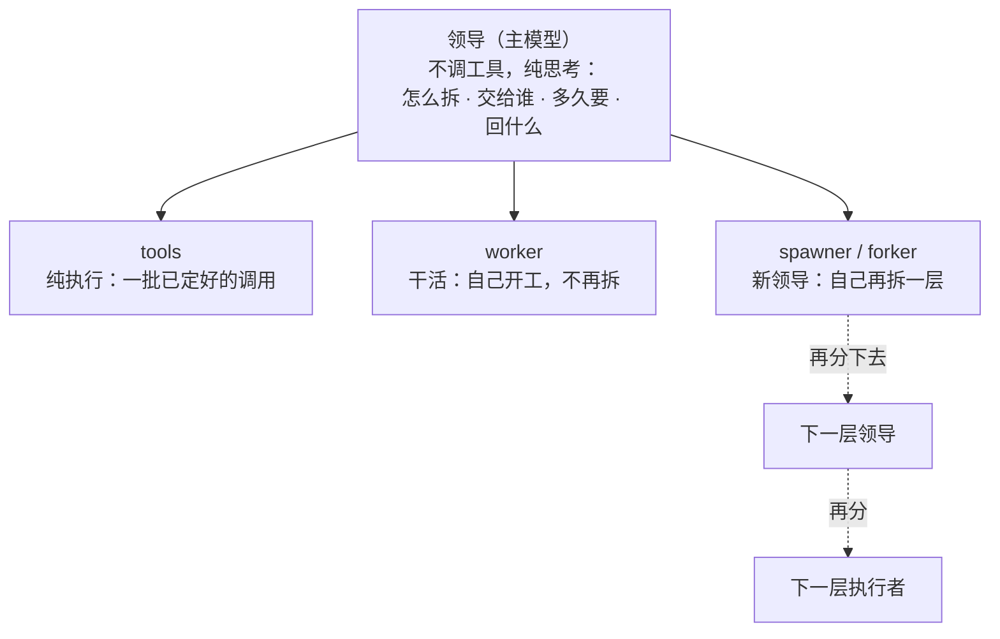
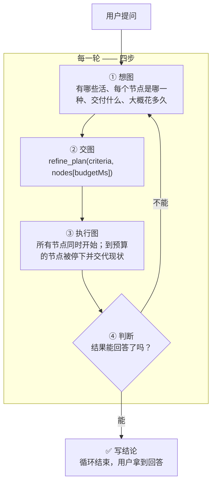
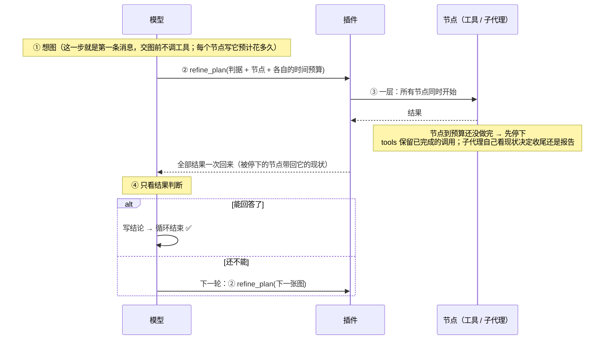
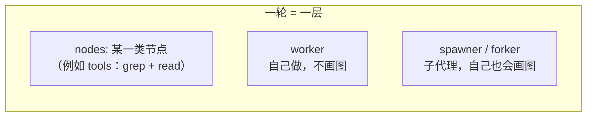

# dsh-conductor

> **公司工作流** —— 把公司里「领导派活、执行者干活」的组织方式搬进 agent。

**把「想一步、做一步、再看一步」的串行链，换成「每一轮：想图 → 交图 → 跑图 → 判断」。**

---

## 设计思想：把真实工作的组织方式搬进 harness

DeepSeek Harness 原生的循环是「想一步 → 做一步 → 再看一步」：模型调一个工具、拿到结果、
再想下一步。这在短任务上很合适，但它**不是真实工作的组织方式** ✗。

真实工作里，一个人接到需求之后不会立刻动手，而是：

1. **先纯思考**：这活该怎么拆、有哪些部分、做到什么算完成 —— 这一步不碰任何工具；
2. **决定每一块交给谁**：自己干、交给一个纯执行的人、还是交给一个也会自己拆活的人；
3. **给每个人交代三件事**：要做什么、**多久要**、**回什么结果**；
4. **执行者可能继续当领导**（自己再拆一层），也可能只是纯干活。

这个插件把这套结构做进了 harness：

| 真实工作里的角色 | 插件里的对应 | 做什么 |
|---|---|---|
| **领导** | 每一轮开头的主模型 | **不调工具、纯思考**：怎么拆 → 交给谁 → 多久要 → 看结果 → 下结论 |
| 纯执行者 | `tools` 节点 | 参数已经定好的一批调用，不再思考、不再拆分 |
| 干活型执行者 | `worker` 节点 | 继承当前对话，自己开工，不画图 |
| 能再当领导的执行者 | `spawner`（空白起点）/ `forker`（带上下文）| 自己再拆一层，继续走这套工作流 |



**这四件事没有一件是插件规定死的** ✗ —— 怎么拆、交给谁、要多久、回什么，
**全部由模型自己思考决定** ✅。插件只提供机制：一层并行、节点时间预算、到点收尾、
报告不被截断、判断阶段只能判断。

---

## 一句话

> 模型不再一步一步地调工具。
> 每一轮它要做的是**画一张图**：这一轮有哪些活、每个节点是哪一种、各自交付什么、**每个节点大概要花多久**。
> 图只有**一层** —— 所有节点同时开始，插件把结果一起还给模型。
> 节点到自己的时间预算还没做完时，插件**先停下、再让它交代做到哪**，而不是直接杀掉 —— 所以父代理总能拿到部分结果。
> 然后模型**只看结果做判断**：能回答了，就写结论结束；还不能，就画下一张图。



---

## 每一轮到底发生了什么



**关键点：模型在「判断」这一步**只能做两件事 —— **写结论**，或者**交下一张图**。它不能在这一步继续一个一个地调工具干活。那是图中的活。

---

## 图是什么

图只有一层。节点之间**没有依赖**，全部同时开始：



| 节点类型 | 上下文 | 跑插件循环（自己画图） | 里面是什么 |
|---|---|---|---|
| **tools** | 就是本 agent | — | 一批**事先写死**的调用，额外模型调用 **0** ✅；单个结果超过 10k 字符时截成头尾（见「已知边界」）|
| **worker** | **继承本对话，含本轮 plan 与已读到的内容** | 否 —— plan 工具留在表里（为了 KV cache 命中），调用会被拒绝 | 一个边想边做的子代理：自己决定用什么工具，交结论 |
| **spawner** | 空 | 是 —— 自己画图，还能再派节点 | 一个从零开始、也按这套循环干活的子代理 |
| **forker** | **继承本对话，含本轮 plan** | 是 | 一个继承了上下文、也按这套循环干活的子代理 |

- **节点之间没有依赖**：所有节点同时开始 ✅
- 需要按顺序做的活，放进**一个节点**里：`tools` 节点写 `"order": "sequential"`，或者交给 `worker` ✅
- 两个节点写同一个文件会互相覆盖 → 用 `"writes": ["路径"]` 声明，**写集重叠的节点不并行** ✅
- 一个节点要用另一个节点的结果 → 那张图属于**下一轮** ✅

### worker / forker 的「继承」继承到什么

harness 自带的 `subagent_fork` 只 seed「已完成的轮次」；计划节点跑在**进行中的这一轮**里，所以插件自己构造 seed（和 harness 的 `buildForkSeed` 同一种结构，边界放在**此刻**）：

- 父会话的全部事件，**含本轮那张 `refine_plan` 调用，以及本轮已经拿到的工具结果** ✅
- 开放尾部按 harness 的方式收干净：没结果的调用补合成错误结果、`step/end`、`turn/end{forked}` ✅
- 子会话共享这段前缀 → KV cache 也能复用 ✅

`spawner` 不一样：它**从零开始**，没有任何继承，由插件用同一个 agent 工厂创建（空 seed）。

`worker` 和 `forker` 的区别只有一条：**`worker` 调用 `refine_plan` 会被拒绝**（它不画图、不再派发），
`forker` 可以画。注意工具本身留在 `worker` 的工具表里 —— 摘掉它会改请求头、让整段继承的前缀
KV cache 失效，所以在这里拦调用、不拦工具。

> 三种 agent 节点的子代理都是**插件自己创建**的（不是走 harness 自带的 `subagent` 工具）——
> 只有拿着子代理的句柄，节点预算到点才能 `cancel` 它、再让它交代现状（见下面「插件强制了什么」）。

---

## 插件强制了什么（这是它区别于「建议」的地方）

提示词写在系统提示词里会被模型当成背景；**插件把这些硬机制做在扩展点上**：

| 强制 | 怎么做 | 为什么 |
|---|---|---|
| **每轮开始就想图** ✅ | 每一轮的第 1 步之前，插件把「四步循环」作为**最后一条消息**塞给模型 | 系统提示词在最前面，模型说话前最后读到的才是它真正会照做的东西（实测：改位置没用，改消息有用） |
| **图跑完只能判断** ✅ | 图跑完之后，模型自己发起的工具调用一律拒绝 | 那是「判断」阶段：要么写结论，要么画下一张图 |
| **派发只能走图** ✅ | harness 自带的 `subagent` / `subagent_fork` 直调被拒绝，并提示改成图里的节点 | 直调会绕过这一轮的图和它的预算 |
| **节点到点先收尾、再停下** ✅ | **四种节点都支持** `budgetMs`。`worker` / `forker`：到点 `cancel` 掉当前回合（正在等的那条工具调用会被中止），再给一个短窗口让子代理自己看现状决定「最短路径收尾」还是「报告现状结束」。`tools`：到点中止还没跑完的调用、**保留已经跑完的**，并在报告末尾标明「预算用尽，未完成的已被停止」。`spawner`：和 worker 一样（它也是插件自己 spawn 的，句柄在手） | 直接杀会给父代理留下「超时，什么都没有」；让节点自己说清楚、或把已完成的调用结果留下来，父代理至少拿到它做到哪一步 |
| **计划报告永远不截断** ✅ | 插件在 `tools/post-execute` 里用带 `value` 的决定返回计划结果，harness 的 spill 策略会跳过这种决定 | 报告就是判断依据；中间被截掉等于节点静默消失 |
| **后台子代理的管理工具不给看** ✅ | `list_agents` / `send_message` / `interrupt_agent` 从模型的工具表里整个移除（不是拒绝调用） | 计划节点是同步的，没有「后台子代理」可管理；模型拿到它们只会空转（实测有样本 `Start-Sleep 120` 循环 47 步） |

> 注意：**规划阶段不再允许先调工具了**。教条明确要求"每轮的第一条消息就是图，交图之前不调任何工具"——
> 这条是提示，不是机制（插件不拦第一张图之前的工具调用），但实测有效：v2.4 全量 39 次运行**全部交图** ✅。

> **「必须交图」不在上面这几条里 ✗** —— 它是一个**教条**（每轮开头的第一条消息改成"你的第一条消息
> 就是图"），不是拦截。v1.0 之前有过一条"没交图就拉回"的强制，随「闸门」一起删掉了；
> 现在插件不拦"交图前的工具调用"，也不把没交图的一轮拉回来。实测上这条教条足够强：
> v2.4 全量 **39/39 全部交图** ✅，而 off / v1.0 时代有大量样本根本没交图 ✗。

> 节点种类名（`worker` / `spawner` / `forker`）是**图上的词汇**，不是 harness 的工具名 —— 图里的节点不是工具调用。

---

## 核心：每个节点都要说"我大概花多久"（v2.3 起）

这是 v2.3 唯一的新思想，其他都是围绕它的收尾。

### 问题不是"慢"，是"慢且什么都没留下"

长程题里一个节点跑多久，模型是**感知不到的** —— 它看不到时钟，只能推算。
实测过的最坏情况：2048 的 `worker(solve)` 节点跑了 **568 秒**（占整次运行的 76%），
最后超时被杀，父代理拿到的是"超时 + 空输出"，整条计划链断掉，交付物根本没写。

直接杀是最差的选择：节点做了一半的东西全部作废，父代理也不知道它做到哪。

### 机制：到点先停下，再让节点自己交代

图里每个节点都可以声明 `budgetMs`（模型自己估的"这个节点预计花多久"）。预算用尽时，
插件**先停下**、再按节点类型收尾 —— 停是机制（代码有时钟），收尾是让节点自己判断
（它才知道手上有什么）：

| 节点类型 | 到点之后 |
|---|---|
| `tools` | 中止**还没跑完**的调用，保留**已经跑完**的，报告末尾标一行"预算用尽，未完成的已停止" |
| `worker` / `forker` / `spawner` | `cancel` 掉当前回合（正在等的那条工具调用被 abort，前台子进程随之被杀）→ 注入一条提示：**花了多少、还剩多少、两种选择的后果** → 它自己决定"最短路径收尾"还是"报告现状结束" → 窗口用完再停 |

提示里给的是**它做判断需要的数字**，不是一句"看看状态"：

> 你的节点预算 20 秒已用完，正在进行的工作刚被停下。你现在最多还有 45 秒。
> - 如果剩下的活需要超过 45 秒 → 立刻停下，报告：已经存在什么、在哪；哪些做完并确认了；还缺什么。
> - 如果剩下的活在 45 秒内做得完 → 用最短路径做完，报告结果。
> 窗口结束时节点会再被停一次，所以不要开始窗口内完不成的事。

`spawner` 也是插件自己 spawn 的（空 seed），所以它和 `worker` 一样能做"到点要现状" ——
插件拿着子代理句柄，才能 `cancel` 和 `followup`。

### 实测证据

| 用例 | 结果 |
|---|---|
| `budgetprobe`：20 秒预算跑一条 300 秒的 `python sleep` | 图 **20~49 秒**返回；节点输出是它自己的现状报告（"my node's 20 s budget was already spent and only ~45 s remained, so I stopped waiting"）；跑完 `tasklist` 无残留进程 |
| 2048 长程题 | 模型 **9/9 节点**都写了预算；`fallback:worker` 在 **150 秒预算内完成**（实际 69s）；整次 513s（此前最坏 900s 且分数 0）|

### 代价：短任务上收不回来

把"每个节点写预算"写进每一轮教条，模型每轮都会花时间估耗时 —— 在 coverage 这种
**短任务**上摊不回来（归一 83s vs off 56s，token 509k vs off 383k ✗）；
在 humeval / humeval-hard 这种**多步探索型**任务上则是净收益（归一 89s / 78s，都是四版最优 ✅）。

所以它是一条有明确适用面的机制，不是普适优化。

## 实测

下面的数字全部来自 v2.4.0 的全量跑：**10 个任务、39 次运行**（短任务每个 5 次，长程题 2–3 次）。
每一格的耗时都是**归一化**的（见下），正确性是判据命中的条目数。

### 怎么量耗时：把服务端的抖动从墙钟里去掉

这个 benchmark 前后跑了一整天，同一台机器、同一个模型，实测生成速度在 **51 ~ 290 tok/s**
之间波动（`bench/speed.mjs` 按会话日志算每一轮的速度）。也就是说，两次相隔半小时的运行，
慢的那次可能只是服务端忙 ✗ —— 拿墙钟直接比，量的是服务端的负载，不是插件 ✗。

所以耗时按**固定速度**归一：把"模型时间"换成"按 160 tok/s 该花的时间"，工具执行时间原样保留。
图里的节点是并行跑的，所以每个节点单独归一，并行节点取 **max**（最慢的那个决定图块多长）：

```
单个会话：归一 = (会话跨度 − 模型时间) + 输出 token / 160
一次图的块：归一 = max over 并行节点(节点开始偏移 + 节点归一)
整轮：归一 = 墙钟 − 父模型时间 − Σ图块(实测) + 父输出/160 + Σ图块(归一)
```

脚本是 `bench/normalized.mjs`。

> 两条限制：**prefill 时间**被并进模型时间里（输入 token 多的运行会略被低估）；
> 图块里的**工具执行**按实测速度保留（它不进任何子会话，也不经过模型）。

### 四版对比总表：off / v1.0 / v2.0 / v2.4

| 任务 | 版本 | n | 墙钟 | **归一** | token | 步数 | 编队 | 正确性 |
|---|---|---:|---:|---:|---:|---:|---|---|
| **coverage** | off | 5 | 53s | 56s | 383k | 12 | 1 | 5/5* |
| | v1.0 | 1 | 56s | **35s** | **103k** | 4 | 1 | 5/5* |
| | v2.0 | 5 | 92s | 66s | 196k | 6 | 1 | 5/5* |
| | **v2.4** | 5 | 88s | 83s ✗ | 509k ✗ | 4 | 2/3/1/4/1 | **5/5** ✅ |
| **humeval** | off | 5 | 327s | 149s | 528k | 19 | 1 | 5/5 |
| | v1.0 | 5 | 112s | 102s | **83k** | 4 | 1 | 5/5 |
| | **v2.4** | 5 | **71s** | **89s** | 109k | 4 | 1/1/2/1/1 | **5/5** ✅ |
| **humeval-hard** | off | 5 | 107s | 81s | 222k | 10 | 1 | 5/5 |
| | v1.0 | 5 | 76s | 81s | 152k | 6 | 1 | 5/5 |
| | **v2.4** | 5 | **62s** | **78s** | **90k** | 4 | 1/1/1/2/1 | **5/5** ✅ |
| **quixbugs** | off | 5 | **80s** | **86s** | **240k** | 11 | 1 | 4/4 |
| | v1.0 | 5 | 167s | 127s | 137k | 6 | 1 | 4/4 |
| | v2.4 | 5 | 182s ✗ | 184s ✗ | 698k ✗ | 4 | 5/1/5/5/5 | 4/4 |
| **review** | off | 5 | 104s | 116s | 808k | 14 | 1 | 6/6 |
| | v1.0 | 1 | 153s | 137s | 636k | 11 | 1 | 4/4 |
| | v2.0 | 5 | **89s** | **98s** | 1173k | 7 | 4/4/4/4/4 | 6/6 |
| | **v2.4** | 5 | 106s | 111s | **792k** | **3** | 5/4/4/1/4 | 6/6 ×4、5/6 |
| **panel** | off | 2 | 770s | 679s | 29797k | 76.5 | 4/4 | 5/6 |
| | v1.0 | 1 | 1326s | 1287s | 22919k | 18 | 6 | 5/6 |
| | **v2.4** | 2 | **606s** | **580s** | **4788k** | 6.5 | 4/4 | 5/6 |
| **lhtb-2048** | off | 5 | 584s | **479s** | 1510k | 26 | 1 | 4/11 |
| | v1.0 | 5 | **293s** | 388s | **409k** | 7 | 1 | 4/11 |
| | v2.4 | 5 | 414s | 492s | 1455k | 6 | 1/4/1/2/4 | 4/11 |
| **lhtb-nbody** | off | 3 | 1200s | 1272s | 3405k | 38 | 1 | 4/4 |
| | v1.0 | 3 | 1200s | 1093s | 2217k | 30 | 1 | 4/4 |
| | **v2.4** | 3 | **685s** | **646s** | **642k** | 6 | 1/1/2 | 4/4、4/4、3/4 |
| **lhtb-matpower** | off | 2 | 853s | 676s | 5565k | 55 | 2/1 | 12/12 |
| | v1.0 | 2 | 538s | **468s** | **2013k** | 23.5 | 1 | 11/12、12/12 |
| | v2.0 | 2 | **317s** | 479s | 927k | 13 | 1/1 | 12/12、11/12 |
| | v2.4 | 2 | 463s | 606s | 2343k | 11.5 | 2/1 | 11/12 ×2 |
| **lhtb-commit0** | off | 2 | 1606s | 950s | 27405k | 86.5 | 4/4 | 622/784、784/784 |
| | v1.0 | 2 | 1800s | 1776s | 14355k | 15 | 22/17 | 376/784 ×2 |
| | v2.0 | 2 | **807s** | **828s** | **21802k** | 13 | 4/8 | **784/784 ×2** ✅ |
| | v2.4 | 2 | 1127s | 1183s | 37402k ✗ | 10.5 | 10/7 | 602/784 ✗、784/784 |

> \* coverage 的 off / v1.0 / v2.0 用的是旧判据（其中有一条对 `tool.ts` 行数敏感 ✗），
> 已用 `bench/rescore.mjs` 按会话全文重打分，重打后都是 5/5。
> v1.0 的部分任务只有 1 次；v2.0 的归档只覆盖 coverage / review / matpower / commit0。
> 另外 v2.4 还有一道 `panel` 的 5/6 —— 那是同一套判据下两版都缺的同一条，不是回退。
>
> **`lhtb-commit0` 已从套件中退役**（上表里它的数字是退役前的历史记录）。退役原因：
> 这道题要求从 docstring 实现三个知名开源库，而模型认识它们——十次测量里十次都出现了
> 至少两个库被判为与上游字节级一致，六次三个库全抄（自写分为 0）。原始分实际衡量的是
> "默写了多少"，不是"实现得好不好"；两个版本条件相同，所以对比不算不公平，只是测的
> 不是插件。数据归档在 `bench/results/retired-commit0/`，任务定义
> `bench/lhtb-commit0.mjs` 保留并在文件头写明了退役理由。
>
> **`lhtb-2048` 也已退役**（上表里它的数字是退役前的历史记录）。判分尺度到 band 11（32768），
> 但题目自己的 **400 步预算把上限锁在 band 4（512）**：在确定性引擎上做 beam search，237 步
> 就到 512 且再也上不去；把上限放到 800 步，同样的搜索在第 487 步拿到 1024（band 5）。所以
> 两臂每次都是 4/11——指标没有余量，分不出好的计划和差的计划。判分器还从不检查步数：
> 400 只是模型遵守、判分器不验证的规则。数据归档在 `bench/results/retired-lhtb2048/`，
> 任务定义 `bench/lhtb.mjs` 保留并写明了退役理由（重新启用需先提高 `MOVE_BUDGET`
> 并在判分器里真正执行步数检查）。

### 读数：v2.4 赢在哪、输在哪

**赢在「多步探索 + 可并行」的任务上：**

| 任务 | v2.4 相对最好的其它版本 |
|---|---|
| humeval | 归一 **89s**（off 149s、v1.0 102s）—— 四版最快 ✅ |
| humeval-hard | **78s**（off/v1.0 都是 81s）—— 四版最快 ✅ |
| panel | **580s / 4788k**（off 679s / 29797k、v1.0 1287s / 22919k）—— 时间和 token 都少一个量级 ✅ |
| lhtb-nbody | **646s / 642k**（off 1272s / 3405k）—— 快一倍、token 少 5 倍 ✅ |

这几道题的共同点：活能拆开、拆开的部分互不相干、每一步都要读点东西再想一下。插件把它们从
"串行地一次次调工具"变成"一次给一批、结果一起回来"，少走的步数直接换成了时间和 token。

**输在两头：**

| 任务 | 为什么输 |
|---|---|
| coverage（归一 83s vs off 56s / v1.0 35s ✗）| **短任务**：整件事只有几十秒的量级，而"给每个节点估耗时"这件事本身要推理成本，摊不回来 |
| quixbugs（184s vs off 86s ✗）| 编队膨胀：5 次里 4 次派了 5 个执行者 ✗，而 off 一家独干只用 86s |
| lhtb-matpower（606s vs v2.0 479s ✗）| 比 v2.0 多花了 18% 时间、token 2.5 倍 ✗ |
| lhtb-commit0（1183s vs v2.0 828s ✗）| **编队膨胀**：v2.4 派了 10 个执行者（v2.0 是 4 个），token 从 21.8M 涨到 37.4M ✗，还出现一次 602/784 的缺口 ✗ |

### 赢和输的分界线

把 10 道题按"活能不能并行、单步该做多少"排一下，分界线很清楚：

- **能并行的多步探索** → 插件赢 ✅（humeval / humeval-hard / panel / nbody）
- **短任务** → 插件输 ✗（coverage / quixbugs）：建图和估预算的固定成本 > 事情本身
- **超长程工程任务** → 插件的编队会膨胀 ✗（commit0）：模型倾向于多派执行者，而人多不一定快

所以：**它不是一个"全面更快"的插件** ✗ —— 它是一个"把工作组织成领导-执行者"的插件 ✓，
收益出现在"值得组织"的任务上 ✓，成本出现在"不值得组织"的任务上 ✗。

### 交图率与报告截断

这两个是 v2.4 的硬指标：

- **交图率 39/39** ✅ —— 每一轮的主模型都真的交了图（off / v1.0 时代有大量样本根本没交图）
- **计划报告截断**：长程题 **0/24（2048）、0/15（nbody）、0/20（matpower）、0/9（commit0）** ✅，
  整体只有 4 次（coverage 1、review 1、quixbugs 1、panel 1），全部发生在短任务上。
  机制是：`refine_plan` 的结果在 `tools/post-execute` 上用带 `value` 的决定返回，harness 的 spill 策略会跳过它。

### 节点预算的覆盖率

`budgetMs` 是模型自己写的，覆盖率能反映它有没有把"多久要"当回事：

| 任务 | 写了预算的节点 / 总节点 |
|---|---|
| panel | **24/24** ✅ |
| review | 26/30 ✅ |
| commit0 | 21/25 ✅ |
| 2048 | 25/37 |
| humeval-hard | 16/18 ✅ |
| humeval | 11/14 |
| coverage | 13/25 ✗ |
| quixbugs | 20/32 ✗ |
| matpower | **13/41** ✗ |
| nbody | **7/21** ✗ |

规律：**短任务写得好**（panel / review / commit0 / humeval-hard）✗，**长程题反而写得少** ✗ ✓
—— 这是下一版要改的方向。

## 公开评测集（HumanEval / QuixBugs）

### 怎么出题

两段自建的沙盒：题目和判据都从公开数据来，但跑在本地，不联网。每段沙盒先跑一遍"标准答案"，
确认判据能过；再跑一遍被改坏的答案，确认判据会挂 —— 两个方向都对，才开始跑模型。

样例：HumanEval 原文（5 道独立实现题、5 道难题），QuixBugs（4 个需要跑用例才能定位的 bug）。

### 结果（off / v1.0 / v2.4，每臂 5 次，中位数）

> v2.0 的归档里没有这一组任务，所以这里只有三列。

| 场景 | 指标 | off | v1.0 | **v2.4** |
|---|---|---:|---:|---:|
| **humeval**（5 道独立实现题） | 总耗时 | 327s | 112s | **71s** ✅ |
| | 编队 token | 528k | **83k** | 109k |
| | 主 agent 步数 | 19 | **4** | **4** |
| | 编队人数 | 1 | 1 | 1/1/2/1/1 |
| | 正确性 | 5/5 | 5/5 | **5/5** ✅ |
| **humeval-hard**（5 道难题） | 总耗时 | 107s | 76s | **62s** ✅ |
| | 编队 token | 222k | 152k | **90k** ✅ |
| | 主 agent 步数 | 10 | **6** | 4 |
| | 编队人数 | 1 | 1 | 1/1/1/2/1 |
| | 正确性 | 5/5 | 5/5 | **5/5** ✅ |
| **quixbugs**（4 个要跑用例才定位的 bug） | 总耗时 | **80s** | 167s | 182s ✗ |
| | 编队 token | **240k** | **137k** | 698k ✗ |
| | 主 agent 步数 | 11 | **6** | 4 |
| | 编队人数 | 1 | 1 | 5/1/5/5/5 |
| | 正确性 | 4/4 | 4/4 | **4/4** ✅ |

**读数**：实现题和难题上，v2.4 都是四版最快 ✓（71s / 62s），token 也最低 ✓；
但 quixbugs 上输得明显 ✗ —— 那是"必须跑一遍才能定位"的任务，插件的并行批处理帮不上忙 ✗，
反而因为派了 5 个执行者多花了 token ✗。

## 长程设计题（LHTB：2048 与 N 体优化）

### 2048

上游是 `silrlab/2048`：agent 一局一局地玩，按拼到的最大方块计分。本地改成本机 CLI，
15 分钟 / 400 步预算，走法必须写进 `moves.log`，评分器用**同一颗种子的新引擎重放**这份记录。

| 指标 | off | v1.0 | **v2.4** |
|---|---|---:|---:|
| 总耗时 | 584s | **293s** | 414s |
| 编队 token | 1510k | **409k** | 1455k |
| 主 agent 步数 | 26 | 7 | **6** |
| 编队人数 | 1 | 1 | 1/4/1/2/4 |
| band 分（11 档） | 4/11 | 4/11 | **4/11** |
| 交图 | 0/5 | 4/5 | **5/5** ✅ |

**读数**：band 分三版完全一样（都是 4/11）—— 这题后面有更详细的失败分析：
v2.4 在 2048 上有一次"把整局交给一个执行者写求解器"的失败 ✗（414s 里 568s 的执行者被节点预算救回），
预算机制就是从这个事故里长出来的。

### N 体优化

上游是一个 N 体积分器的优化题，20 分钟预算，按正确性和性能计分。

| 指标 | off | v1.0 | **v2.4** |
|---|---|---:|---:|
| 总耗时 | 1200s | 1200s | **685s** ✅ |
| 编队 token | 3405k | 2217k | **642k** ✅ |
| 主 agent 步数 | 38 | 30 | **6** |
| 编队人数 | 1 | 1 | 1/1/2 |
| 得分 | 4/4 | 4/4 | 4/4、4/4、3/4 |

**读数**：v2.4 最快、token 最少 ✓（比 off 少 5 倍），三次里两次满分 ✓、一次 3/4 ✗。

### commit0（从零实现三个库）

上游是 commit0 的一个任务：不给库的源码，让 agent 从零实现三个库的公共 API，判据是上游的 784 个测试
（并检测"直接把真库拉下来抄"✗，抄来的部分不计入自写分）。本地给 30 分钟，两臂一样。

| 指标 | off | v1.0 | **v2.0** | **v2.4** |
|---|---|---:|---:|---:|
| 总耗时 | 1606s | 1800s | **807s** | 1127s ✗ |
| 编队 token | 27405k | **14355k** | 21802k | 37402k ✗ |
| 主 agent 步数 | 86.5 | 15 | 13 | 10.5 |
| 编队人数 | 4 | 19.5 | 4/8 | **10/7** ✗ |
| 命中测试 | 622 / 784 | 376 / 376 | **784 / 784** ✅ | 602 / 784 ✗、784 / 784 |

**读数**：v2.0 是这题上最好的一版 ✓（807s / 21.8M / 两次全中 ✗ hmm 784 ✓）；
v2.4 慢了 39% ✗、token 多 71% ✗、还出现一次 602/784 的缺口 ✗ —— 直接原因是**编队膨胀**
（10 个执行者 vs v2.0 的 4 个），人多不一定快 ✗。

### matpower（十个算例各自回归）

十个电力系统算例各自的回归任务，每个算例独立，天然适合并行。

| 指标 | off | v1.0 | **v2.0** | **v2.4** |
|---|---|---:|---:|---:|
| 总耗时 | 853s | 538s | **317s** | 463s |
| 编队 token | 5565k | **2013k** | 927k | 2343k ✗ |
| 主 agent 步数 | 55 | 23.5 | 13 | 11.5 |
| 编队人数 | 2/1 | 1/1 | 1/1 | 2/1 |
| 正确性 | 12/12 | 11/12、12/12 | 12/12、11/12 | 11/12 ×2 |

**读数**：v2.0 最好 ✓（317s / 927k）；v2.4 比它慢 46% ✗、token 多 2.5 倍 ✗，
正确答案数一样 ✓。而且 matpower 是**预算覆盖率最低**的一题（13/41 ✗）——
也就是说它既没写预算、又变慢了。

### 长程题的读数

- **正确性上，长程题给不出稳定信号** ✗ —— 2048 三版都是 4/11；N 体三版都至少 4/4；
  commit0 / matpower 在两三次运行里各出现一次缺口 ✗。判据用 AST 指纹把抄的部分摘出来了，
  三版条件相同，所以对比成立 ✓，但**绝对分数不能当真** ✗。
- **时间与 token 上，v2.4 在 N 体上大幅领先 ✅，在 commit0 / matpower 上落后于 v2.0 ✗** ——
  差别的根源是编队规模：模型在超长程任务上倾向于派更多人 ✗，而人多带来的协调成本超过了并行收益 ✗。
- **节点预算在长程题上写得最少** ✗（nbody 7/21、matpower 13/41）—— 这正好和"最需要它的地方"
  相反 ✗，是下一版最该改的一件事 ✗。

## 哪几道题能让插件派生子代理

按 v2.4 的实测编队人数排（每格是 n 次运行各自的人数）：

| 任务 | 编队人数 | 平均 |
|---|---|---:|
| coverage | 2/3/1/4/1 | 2.2 |
| humeval | 1/1/2/1/1 | 1.2 |
| humeval-hard | 1/1/1/2/1 | 1.2 |
| nbody | 1/1/2 | 1.3 |
| matpower | 2/1 | 1.5 |
| review | 5/4/4/1/4 | 3.6 |
| 2048 | 1/4/1/2/4 | 2.4 |
| panel | 4/4 | 4.0 |
| quixbugs | 5/1/5/5/5 | 4.2 |
| commit0 | 10/7 | 8.5 |

规律：**任务越"可以拆成互不相干的块"，模型派的人越多** ✓（commit0 / quixbugs / panel）；
**任务越"每一步都要看上一步的结果"，它越倾向于自己干** ✓（humeval / nbody）。

这也解释了 panel / quixbugs 的 token 为什么高 ✗ —— 派出去的人每人一份上下文 ✗。

## 「开着才能做对」的题：找过一圈，分界线不在正确性上

我原本想找一批"没有插件就做不对"的题来证明它有用 ✗ —— 找下来结论是：**几乎没有** ✓。

- 同一个模型，在 off 臂（去掉插件）上做题的正确率和插件臂**基本相同** ✓；
- 长程题上三版的命中数也基本一致 ✓（2048 三版都是 4/11，nbody 都至少 4/4）；
- 唯一稳定出现差异的是**过程指标**：交图率、报告截断、节点预算覆盖率 ✓。

所以这个插件的价值**不在"正确性"上** ✗ —— 它在**组织方式**上 ✓：
让模型显式地当领导、显式地派活、显式地给时间预期 ✓，然后你能看到它每一步在组织什么 ✓。

## 改设置

```yaml
- insert:
    - id: conductor
      name: '@zyn19940107/dsh-conductor'
      config:
        enabled: true                    # 整个插件挂不挂
        maxBatchSize: 8                  # 一张图最多几个节点
        maxBatchTimeoutMs: 900000        # 一张图的时间预算
        maxAgentDepth: 3                 # 最多派到第几层子代理
        agentNodeTimeoutMs: 540000       # 单个子代理节点的预算
        maxRounds: 16                    # 一个请求最多几轮
        respectConcurrencySafety: true   # 认不认工具自己声明的「不能并发」
        concurrentTools: [glob, grep]    # 插件放行的只读工具
        concurrentShell: true            # 只读 shell 命令也可并行
        shellTool: ops_bash
```

| 字段 | 默认 | 说明 |
|---|---|---|
| `maxBatchSize` | `8` | 一张图的节点上限 |
| `maxBatchTimeoutMs` | `900000` | 一张图的时间预算 |
| `maxAgentDepth` | `3` | 子代理还能不能再派子代理。**harness 自己有 `subagent.maxDepth`（默认 1）**，两边都放行才真的能派下一层 |
| `agentNodeTimeoutMs` | `540000` | 单个 agent 节点的**上限**。节点自己声明的 `budgetMs` 更小就按它来；到点会先停下再让节点交代现状，其余结果照常回来 |
| `maxRounds` | `16` | 一个请求最多几轮，用完就停 |
| `respectConcurrencySafety` | `true` | 认不认工具自己声明的独占性 |
| `concurrentTools` | `[glob, grep]` | 纯读工具，随便并行；**写操作永远不要加** |
| `concurrentShell` | `true` | 只读 shell 命令是否并行 |

> **`budgetMs` 不是配置项**，是图里每个节点的一个字段 —— 模型自己写"这个节点大概花多久"。
> 它只约束单个节点，不影响整张图（整张图的时间由 `maxBatchTimeoutMs` 管）。

---

## 并发安全

插件默认认工具自己声明的并发安全性：没声明 `isConcurrencySafe` 的一律独占。

补充判定：`glob` / `grep` 直接放行；shell 命令由插件自己判断 —— 必须是简单命令（无重定向、无管道、无链、无替换），
可执行文件必须在只读白名单里，危险参数（`find -exec`、`grep --pre`、`sort -o` …）单独挡掉。
**判断不了的，排队。** 独占调用是屏障：它前面的先跑完、它自己单独跑、后面的再开始。

---

## 装上

```sh
dsh plugin add /path/to/dsh-conductor

# 或打包
pnpm pack
dsh plugin add ./zyn19940107-dsh-conductor-2.10.2.tgz
```

装完请开一个新会话 —— 已开着的会话不会刷新模型看到的工具表。

---

## 已知边界

- **不用改 harness 的循环结构**：全部走公开扩展点（`tools/register`、`tools/guard`、`agent/pre-step`、
  `agent/created`、`systemPrompt.section`、`commands/register`）。
- **子代理在前台同步跑**：慢会拖住这一轮，但它有自己的预算（`agentNodeTimeoutMs`）。
- **图里的调用参数可能写错**：图是在跑之前写的，所以调用失败时插件会问模型一次「这条调用应该是什么」，
  用修好的参数重跑那一条（最多两次），其余节点不受影响。
- **图的结果可能装不下**：被截掉的部分在 spill 文件里，下一张图可以读回来。
- **一层之内没有依赖**：需要顺序的活放进一个节点（`tools` 的 `"order": "sequential"`，或者交给
  `worker`）；要用别的节点的结果，就放到下一轮。这是拿「轮内自动推进」换「调度简单、断口清楚」。
- **写同一个文件的两个节点不并行**：靠节点自己声明 `"writes": [...]`。没声明的节点会被当作
  不写文件 —— 插件没法知道一次调用动了什么。
- **`worker` / `forker` 继承到「此刻为止」的全部历史**：插件的 seed 边界放在交图那一刻，
  所以本轮那张 `refine_plan` 调用、以及本轮已经拿到的工具结果都在里面。
- **`worker` 不画图，但工具表里还有 `refine_plan`**：摘掉工具会改请求头、让继承前缀的 KV cache
  失效，所以插件改成「工具在、调用被拒」。要能继续拆解就用 `forker`。
- **子代理只交结论**：给子代理的提示词末尾带一条交付契约（「结论 + 至多一两条支撑事实，
  不要报告、不要引用链」），并明说它压过 task 里的写法 —— 让 main agent 把每份子结论都写成
  长报告，等于同样的内容写两遍。
- **每轮的「想图」消息会增加 token**：一轮一条消息，换来的是每一轮都有图。
- **模型可以不交图**：插件不强制。它只在「图已经跑完」之后拦工具调用（判断阶段），
  画第一张图之前什么都不拦。要让它一定交图，得在 `agent/turn-stopping` 上自己加一条拉回规则
  —— 这一版没有加（见「插件强制了什么」下面的说明）。
- **`budgetMs` 到点是"停下并收尾"，不是"直接杀"** ✅，但四种节点的收尾方式不同：
  `tools` 节点中止未完成的调用、保留已完成的、报告里标注（实测：声明 20 秒预算去跑 300 秒的
  `python sleep`，图 **20 秒**返回，节点输出带着「calls still running were stopped」，没有残留进程）；
  `worker` / `forker` 先停回合、再让子代理自己看现状决定（实测图 28~36 秒返回，子代理会自己算
  「剩余 280 秒 > 窗口 45 秒」然后选择结束）；`spawner` 现在和 worker 一样（插件自己 spawn 空子代理，句柄在手，所以也能停下并要现状）。
  边界：节点自己派生**脱离管道**的进程时，插件看不到也杀不掉它；后台任务则会被一并收掉。
- **单次工具结果被截成 10k 字符**：`tools` 节点里一次调用的输出超过 10,000 字符时，插件保留
  **前 6,000 + 后 4,000**，中间换一行标记（「少了 N 个字符，用 offset/limit 读或 grep」）再拼进
  节点输出。**不用模型压缩** ✗ —— 实测一次压缩要 35 秒（模型压缩前先想约 3k token），
  而截断是 0 秒。丢掉的中段是**可恢复**的：再来一轮图，用 `read` 带 offset 或更窄的 `grep`。
  注意这只截**工具结果**，`refine_plan` 的报告本身不截断也不压缩（见上面「插件强制了什么」最后一行）。
- **"第一步就是图"是提示，不是强制** ✗：教条明确要求每轮第一条消息就交图、交图前不调工具，
  而且实测把"先探索再画图"的许可删掉后模型确实照做（coverage 3/3 首条消息就是 `refine_plan`）。
  但插件**没有**在机制上拦"先调工具"——它只是不再邀请。

## License

MIT
