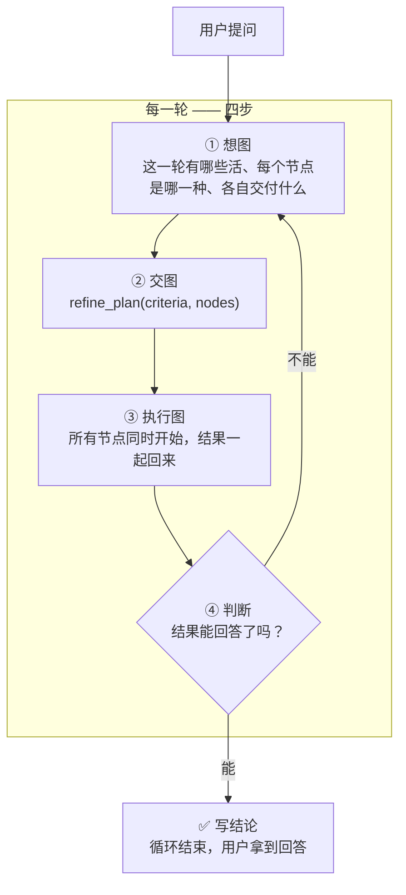
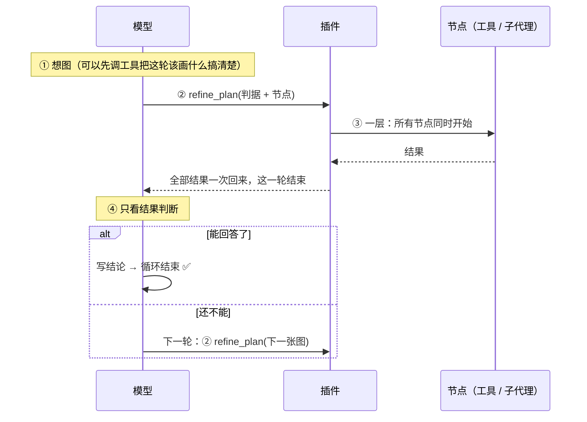
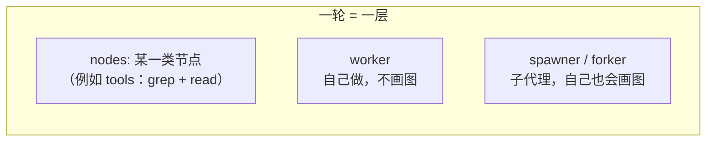

# dsh-refine-loop

**把「想一步、做一步、再看一步」的串行链，换成「每一轮：想图 → 交图 → 跑图 → 判断」。**

---

## 一句话

> 模型不再一步一步地调工具。
> 每一轮它要做的是**画一张图**：这一轮有哪些活、每个节点是哪一种、各自交付什么。
> 图只有**一层** —— 所有节点同时开始，插件把结果一起还给模型。
> 然后模型**只看结果做判断**：能回答了，就写结论结束；还不能，就画下一张图。



---

## 每一轮到底发生了什么



**关键点：模型在「判断」这一步**只能做两件事 —— **写结论**，或者**交下一张图**。它不能在这一步继续一个一个地调工具干活。那是图中的活。

---

## 图是什么

图只有一层。节点之间**没有依赖**，全部同时开始：



| 节点类型 | 上下文 | 跑插件循环（自己画图） | 里面是什么 |
|---|---|---|---|
| **tools** | 就是本 agent | — | 一批**事先写死**的调用，额外模型调用 **0** ✅ |
| **worker** | **继承本对话，含本轮 plan 与已读到的内容** | 否 —— plan 工具留在表里（为了 KV cache 命中），调用会被拒绝 | 一个边想边做的子代理：自己决定用什么工具，交结论 |
| **spawner** | 空 | 是 —— 自己画图，还能再派节点 | 一个从零开始、也按这套循环干活的子代理 |
| **forker** | **继承本对话，含本轮 plan** | 是 | 一个继承了上下文、也按这套循环干活的子代理 |

- **节点之间没有依赖**：所有节点同时开始 ✅
- 需要按顺序做的活，放进**一个节点**里：`tools` 节点写 `"order": "sequential"`，或者交给 `worker` ✅
- 两个节点写同一个文件会互相覆盖 → 用 `"writes": ["路径"]` 声明，**写集重叠的节点不并行** ✅
- 一个节点要用另一个节点的结果 → 那张图属于**下一轮** ✅

### worker / forker 的「继承」继承到什么

harness 自带的 `subagent_fork` 只 seed「已完成的轮次」；计划节点跑在**进行中的这一轮**里，所以插件自己构造 seed（和 harness 的 `buildForkSeed` 同一种结构，边界放在**此刻**）：

- 父会话的全部事件，**含本轮那张 `refine_plan` 调用，以及本轮已经拿到的工具结果** ✅
- 开放尾部按 harness 的方式收干净：没结果的调用补合成错误结果、`step/end`、`turn/end{forked}` ✅
- 子会话共享这段前缀 → KV cache 也能复用 ✅

`worker` 和 `forker` 的区别只有一条：**`worker` 调用 `refine_plan` 会被拒绝**（它不画图、不再派发），
`forker` 可以画。注意工具本身留在 `worker` 的工具表里 —— 摘掉它会改请求头、让整段继承的前缀
KV cache 失效，所以在这里拦调用、不拦工具。

---

## 插件强制了什么（这是它区别于「建议」的地方）

提示词写在系统提示词里会被模型当成背景；**插件把四条硬机制做在扩展点上**：

| 强制 | 怎么做 | 为什么 |
|---|---|---|
| **每轮开始就想图** ✅ | 每一轮的第 1 步之前，插件把「四步循环」作为**最后一条消息**塞给模型 | 系统提示词在最前面，模型说话前最后读到的才是它真正会照做的东西（实测：改位置没用，改消息有用） |
| **图跑完只能判断** ✅ | 图跑完之后，模型自己发起的工具调用一律拒绝 | 那是「判断」阶段：要么写结论，要么画下一张图 |
| **派发只能走图** ✅ | harness 自带的 `subagent` / `subagent_fork` 直调被拒绝，并提示改成图里的节点 | 直调会绕过这一轮的图和它的预算 |
| **后台子代理的管理工具不给看** ✅ | `list_agents` / `send_message` / `interrupt_agent` 从模型的工具表里整个移除（不是拒绝调用） | 计划节点是同步的，没有「后台子代理」可管理；模型拿到它们只会空转（实测有样本 `Start-Sleep 120` 循环 47 步） |

> 注意：**规划设计阶段是允许调工具的**。工具调用用来搞清楚「图里的节点该写什么」；不允许的是用工具把活干完、跳过图。

> **「必须交图」不在上面这几条里。** 那条强制在 `5b6b997`（v1.0 之前）随「闸门」一起删掉了 ——
> 现在一轮没交图**不会**被拉回来，模型可以完全不交图地把活干完：`bench/results/` 里有 7 个
> 插件开着但 `planned=false` 的样本，其中一个走了 83 步。插件提供的是「一图一层」的形状和
> 上面这几条硬规则，**用不用是模型的判断**。

> 节点种类名（`worker` / `spawner` / `forker`）是**图上的词汇**，不是 harness 的工具名 —— 图里的节点不是工具调用。

---
---

## 实测

同一份代码、同一个 profile、同一个模型、同一个任务，只切插件的 `enabled`。
原始记录在 `bench/results/`；旧版（多轮 DAG 图）的记录在 `bench/results/before-one-layer/`。
**这一轮把十道题全部重跑了**：coverage / review / panel 三个场景，humeval / humeval-hard /
quixbugs 三个公开评测集，以及 2048 / nbody / matpower / commit0 四个长程题。每臂抽样
2~5 次，表里取中位数。模型端点在跑的过程中抖过几次（单步卡 10~18 分钟），被卡住的样本
会重跑；样本量小的场景（panel / matpower / commit0 只有 2 次）看趋势，不要看小数。

### 三组对比总表：off / v1.0 / v2.0

三组数据摆在一起：**off**（这一版插件关掉）、**v1.0**（旧版的分层 DAG 图，记录在
`bench/results/before-one-layer/`）、**v2.0**（这一版插件开着）。每格是「耗时 / 编队 token」，
取中位数；「抽样」一列是「off 次 / v1 次 / v2 次」。

| 场景 | 抽样 | off | v1.0（旧版 DAG） | **v2.0（这一版）** |
|---|---|---|---:|---:|
| coverage | 5 / 1 / 5 | 53s / 383k | **56s / 103k** | 92s / 196k |
| review | 5 / 1 / 5 | 104s / 808k | 153s / 636k | **89s** / 1173k |
| panel | 2 / 1 / 2 | 770s / 29,797k | 1,326s / 22,919k | **552s / 5,192k** |
| humeval | 5 / 5 / 5 | 327s / 528k | 112s / 83k | **101s / 84k** |
| humeval-hard | 5 / 5 / 5 | 107s / 222k | 76s / 152k | **37s / 128k** |
| quixbugs | 5 / 5 / 5 | 80s / 240k | 167s / **137k** | 92s / 158k |
| lhtb-2048 | 5 / 5 / 5 | 584s / 1510k | **293s / 409k** | 438s / 975k |
| lhtb-nbody | 3 / 3 / 3 | 1200s / 3405k | 1200s / 2217k | 1200s / **1663k** |
| lhtb-matpower | 2 / 2 / 2 | 853s / 5565k | 538s / 2013k | **317s / 927k** |
| lhtb-commit0 | 2 / 2 / 2 | 1606s / 27,405k | 1800s / **14,355k** | 807s / 21,802k |

正确性（各版判据的命中数；判据在 v1.0 → v2.0 之间换过两次，横向只作参考）：

| 场景 | off | v1.0 | v2.0 |
|---|---|---|---|
| coverage | 4/5 | 4/5 | 4/5 |
| review | 6/6 | 4/4（旧判据 4 条） | 6/6 |
| panel | 5/6 | 5/6 | 5/6 |
| humeval | 5/5 | 5/5 | 5/5 |
| humeval-hard | 5/5 | 5/5 | 5/5 |
| quixbugs | 4/4 | 4/4 | 4/4 |
| lhtb-2048 | 4/11 | 4/11 | 4/11 |
| lhtb-nbody | 4/4 | 4/4 | 4/4 |
| lhtb-matpower | 12/12 与 12/12 | 11/12 与 12/12 | 12/12 与 11/12 |
| lhtb-commit0 | 622 与 784（满分 784） | 376 与 376 | **784 与 784** |

### 读数：谁赢在哪

- **v2.0 对 off：主 agent 全面变便宜，总账看题。** 主 agent 往返步数、上下文、缓存输入
  在所有题上都降（步数 −30%~−85%，缓存读 −58%~−96%）；总 token 在 tools-only 的题上
  降得最多（humeval −84%、panel −83%、matpower −83%、commit0 −20%），在模型画了多个
  `worker` 的 review 上反而 +45%（子代理各自重发继承的上下文）。
- **v2.0 对 v1.0：不是全面更好。** 赢在长程题（humeval-hard、nbody 的 token、matpower、
  commit0 的耗时），输在短程的 coverage / lhtb-2048（两项都更贵），以及 review / quixbugs
  的 token。旧版的分层 DAG 在「已经知道自己要什么形状」的短任务上更省 —— 它不用让模型
  每轮重新决定图长什么样；一图一层的收益出现在「一轮里本来就有并行活」的长任务上。
- **panel 是插件最该赢的题，也确实赢了**：任务是「三方独立审查、互相看不见」，`worker`
  节点正好对上。两臂编队都是 4 人，但主 agent 步数 77 → 21、总 token −83%。
- **正确性：插件不提高也不破坏。** 十道题里九道的命中数三组相同；唯一的变化是
  lhtb-commit0（关掉插件有一次只过 622/784 且被判抄了一个库，开着插件的两次都 784/784、
  自写分 1.00）和 lhtb-matpower（开着插件有一次掉 1 个算例）。
- **panel 的 5/6 两臂相同，缺的是同一项判据**：它要求答案里出现「评审一 / 评审二 /
  评审三」这三个字，四次运行都没用这三个标题 ✗ —— 是判据写法太死，不是答案缺内容。

### 赢和输的分界线

十道题跑下来，分界线**不在「有没有子代理」**，而在两件事上：**这一轮的活能不能拆成并行的几份**、
**主 agent 那条串行链有多长**。

| 形状 | 什么时候赢 | 实测（对关掉插件，中位数） |
|---|---|---|
| 全是 `tools` 节点 | 一条链上串着很多「读一点、想一点」的往返，但这些活本身不需要判断 | humeval **−69% 耗时 / −84% token**、humeval-hard −65% / −42%、matpower −63% / −83% |
| 有 `worker` 节点 | 子判断互相独立、而且**每份子结论就是交付物的一部分**（主 agent 只做汇总） | panel **−28% / −83%**、commit0 −50% 耗时（三个库一个 `worker`） |
| 派了但没用 | 主 agent 还要自己把结论重写一遍 —— 子代理的输出被丢掉大半 | review **+45% token**（3 个 `worker` 各自重发继承来的上下文） |
| 不派也不省 | 任务本身很短，多出来的「画图往返」盖过了省下的步数 | coverage +74% 耗时、quixbugs +15% 耗时（token 仍然降） |

和 v1.0（分层 DAG）比，分界线还要再挪一次：**短任务上旧版更省**（coverage 56s/103k 对
92s/196k、2048 293s/409k 对 438s/975k），**长任务上这一版更省**（matpower 317s/927k 对
538s/2013k、commit0 807s 对 1800s）。旧版的分层 DAG 不用让模型每轮重新决定图长什么样，
这在小任务上是优势；一图一层的收益出现在「一轮里本来就有并行活」的长任务上。

**profile 只有 harness + 被测插件**（`dsh-sandbox/home/profiles/bench`）。这一点是
硬要求：沙盒里如果还装着别的会注册「派发」工具的插件，被测模型会拿到两套互相竞争的
指令，测出来的就是那个插件的行为，不是这个插件的。

## 公开评测集上的 A/B（HumanEval / QuixBugs）

上面那些场景是手工设计的：题目按插件的形状挑，判据是「答案里有没有这几个字」。
这一节把两件事都换成真的 —— **题目来自公开评测集，判据是跑出来的**。

> 这一节的三个场景、以及后面「长程设计题」的四道题，都是**本轮重跑**的（每臂 5 次，
> 长程题 2~3 次）；更早一轮的旧数字保留在 `bench/results/before-one-layer/`，
> 上面总表里的 v1.0 那一列就是它们。

### 两个沙盒

| profile | bundles | 用途 |
|---|---|---|
| `bench-off` | `dsh-base` + `dsh-headless` | 不带插件 |
| `bench-on` | 同上 + `@zyn19940107/dsh-refine-loop` | 带插件 |

两个 profile 只差一个 bundle —— 这是「带插件 / 不带插件」唯一可测的差别。
`bench-on` 里的插件是**没被改过的原版**，只配了部署参数：`enabled: true`、
`shellTool: pwsh`（基准 profile 里实际的 shell 工具叫 `pwsh`；插件默认写的是 dsh-ops 的
`ops_bash`，不改这一项的话它的只读-shell 规则是空的，每次 shell 调用都独占）。

```sh
node bench/setup-profiles.mjs                  # 建这两个沙盒
node bench/probe-judge.mjs humeval humeval-hard quixbugs   # 先证明判据是对的
node bench/compare.mjs 5 humeval humeval-hard quixbugs     # 跑 A/B（顺序跑，不并行）
node bench/pubeval-table.mjs                   # 出表
```

### 样例从哪来

| 评测集 | 出处 | 取的题 | 判据 |
|---|---|---|---|
| HumanEval | [openai/human-eval](https://github.com/openai/human-eval) | 10 道原题（prompt 与 test 都是数据集原文），分成两组各 5 道 | 跑数据集自己的 `check()` |
| QuixBugs | [jkoppel/QuixBugs](https://github.com/jkoppel/QuixBugs)（MIT） | 4 个程序里的 bug | 跑数据集自己的用例 + 3 条留出用例 |

题面和用例**逐字** vendored 在 `bench/data/`（带 sha256），判据脚本从 vendored 副本读，
不从工作区读 —— 改测试不算通过；工作区里的 `check.py` 被指纹记录，改了就判失败。
QuixBugs 的用例本来就是公开的、agent 看得见，所以判据里另外加了 **3 条留出用例**
（留出用例先跟数据集自己的正确程序对过才拿来用），专治「按可见用例硬编码」。

判据本身要先证明是对的：`bench/probe-judge.mjs` 拿一份正确答案、一份错误答案、
一份被改过的判据各跑一遍 —— 正确 5/5、错误 0/5、改判据被抓，三项都过才开始跑模型。

### 结果（三组：off / v1.0 / v2.0，每臂 5 次，中位数）

| 场景 | 指标 | off | v1.0 | **v2.0** |
|---|---|---:|---:|---:|
| **humeval**（5 道独立实现题） | 总耗时 | 327s | 112s | **101s** |
| | 编队 token | 528k | **83k** | 84k |
| | ├ input / cacheRead / output | 38k / 470k / 19k | 29k / 51k / 16k | 6k / 65k / 11k |
| | 主 agent context | 36k | 35k | **26k** |
| | 主 agent 步数 | 19 | **4** | **4** |
| | 编队人数 | 1 | 1 | 1 |
| | 正确性 | 5/5 | 5/5 | 5/5 |
| **humeval-hard**（5 道难题） | 总耗时 | 107s | 76s | **37s** |
| | 编队 token | 222k | 152k | **128k** |
| | ├ input / cacheRead / output | 22k / 177k / 12k | 17k / 97k / 12k | 18k / 99k / 9k |
| | 主 agent context | 26k | 29k | **25k** |
| | 主 agent 步数 | 10 | **6** | 7 |
| | 编队人数 | 1 | 1 | 1 |
| | 正确性 | 5/5 | 5/5 | 5/5 |
| **quixbugs**（4 个要跑用例才定位的 bug） | 总耗时 | **80s** | 167s | 92s |
| | 编队 token | 240k | **137k** | 158k |
| | ├ input / cacheRead / output | 24k / 200k / 10k | 15k / 111k / 17k | 21k / 122k / 14k |
| | 主 agent context | 25k | 34k | 32k |
| | 主 agent 步数 | 11 | **6** | 7 |
| | 编队人数 | 1 | 1 | 1 |
| | 正确性 | 4/4 | 4/4 | 4/4 |

> 三组的 off / v2.0 是本轮重跑的；v1.0 是 `before-one-layer/` 里的归档记录（也是 5 次中位数）。

每次运行的原始记录在 `bench/results/`，表是 `bench/three-way.mjs` 生成的，不是手打的。
本轮 10 次开插件的运行里 **10 次都真的画了图**（全是 `tools` 节点，没有派子代理）。

### 读数

**token 两项都降，降的是缓存输入。** 少走几步，每一步就不用把变长的历史重发一遍：
缓存输入 −44% / −39%，往返步数 −30% / −36%。新读的 input 只降 18% / 13%，输出
一个降一个升 —— 和前面那批场景是同一个结论。

**耗时看形状。** 实现题省时间（−65%），修 bug 那组反而慢了 **+15%**：
修 bug 的下一步取决于上一步跑出来的输出，每一轮都要重新画一张图，输出 token 因此涨了
40%，主上下文也涨了 28%。**要跑一遍才知道下一步的活，插件的「一轮一图」纪律是双刃剑。**

**正确性 20 次全对。** 两个评测集、两个臂、每一道题，插件一次都没让题做不成，也没让它
多做对 —— 插件改的是代价，不是能不能做成。

**编队人数全是 1。** 模型自己选的节点全是 `tools` 节点，一次也没派子代理。插件给的
「派发」能力在这两个任务上没被用上，所以这里的「编队」测的是**要不要分叉**，不是分叉
之后省了多少。

## 长程设计题（LHTB：2048 与 N 体优化）

前面那些题都是「能一次列全」的活 —— 几个函数、几个 bug。这一节换成 LHTB
（[Long-Horizon Terminal-Bench](https://github.com/zli12321/LHTB)）的两道**长程设计题**：
题来自公开评测集，本机改编（这台机器没有 Docker，上游容器里的东西在本地重做）。

| 题目 | 出处 | 形状 | 评分 |
|---|---|---|---|
| 2048 | `silrlab/2048` | 一直玩到预算用完 | 连续分：最大 tile 的 band + 棋盘进度（上限 11） |
| N 体优化 | `silrlab/nbody-accel-iterative` | 把 O(N²) 改快，物理不变 | 加权分：4 档 × min(加速比 / 上限, 1) |

### 改编了什么

- **2048**：上游是容器里的游戏守护进程，这里是本地 CLI（`g2048.py`）—— 规则、引擎、种子、
  记谱格式都是上游的。评分器用一台**全新**引擎重放 `moves.log` 取峰值，和上游一样；
  进度没法伪造，只有真合并出来的 tile 才算数。
- **N 体**：上游的隐藏验证器在本机重写（`judge_nbody.py`）：同样的 4 档、同样的权重和
  加速比上限、同样是**全新随机生成**的留出世界（id 打乱、质量/初速/截断半径/步长都变），
  参照系是上游的 numpy O(N²) 基线。参照系和提交在**同一个进程**里跑 —— 跨进程跑同一份
  numpy 代码会有 1e-6 的漂移，一步混沌放大就超过上游 1e-2 的位置容差了（这是踩过的坑）。
- 两道题都按上游的做法**按时间截断**：到点就停，磁盘上留下什么就评什么。
- LHTB 的素材（引擎、基准 CLI、判据、参考答案）放在**仓库外**的沙盒
  （`D:\code\vibe\dsh-sandbox\lhtb\`），仓库里只留跑它们的脚本 —— 判据是 oracle，
  仓库不能顺手送一份现成的答案。

### 结果

#### 2048（三组，每臂 5 次，中位数）

| 指标 | off | v1.0 | **v2.0** |
|---|---:|---:|---:|
| 总耗时 | 584s | **293s** | 438s |
| 整个编队的 token | 1510k | **409k** | 975k |
| ├ input / cacheRead / output | 66k / 1401k / 48k | 66k / 291k / 52k | 28k / 907k / 55k |
| 主 agent 的 context | 74k | 76k | 73k |
| 主 agent 的往返步数 | 26 | **7** | 22 |
| 编队人数 | 1 | 1 | 1 |
| band 分（11 分制） | 4 | 4 | 4 |

逐样本（墙钟 / 编队 token / 主 agent 步数）：

```
off : 776s/902k   713s/1137k   584s/3168k   580s/2282k   361s/1510k
v1.0: 293s/627k   387s/ 409k   243s/ 520k   262s/ 288k   311s/ 333k
v2.0: 217s/975k   333s/1381k   438s/1146k   477s/ 691k   569s/ 524k
```

读数：

- **v1.0 在这题上最省**，v2.0 居中，off 最贵。三组的 band 分完全一样（都是 4/11）。
- **v2.0 相对 off 仍然更便宜**（−25% 耗时 / −35% token），但没有 v1.0 那么便宜 —— 旧版的
  分层 DAG 不用让模型每轮重新决定图长什么样。
- **逐样本方差很大** ✗：off 的 token 从 902k 到 3,168k，v2.0 从 524k 到 1,381k，中位数只当趋势。

#### N 体优化（三组，每臂 3 次，中位数）

| 指标 | off | v1.0 | **v2.0** |
|---|---:|---:|---:|
| 总耗时 | 1200s（预算用完） | 1200s（预算用完） | 1200s（预算用完） |
| 整个编队的 token | 3405k | 2217k | **1663k** |
| 主 agent 的往返步数 | 38 | 30 | **21** |
| 编队人数 | 1 | 1 | 1 |
| 分数（4 档加权） | 4/4 | 4/4 | 4/4 |

逐样本（墙钟 / 编队 token / 主 agent 步数）：

```
off : 1200s/ 815k   1200s/3405k   1200s/4841k
v2.0: 1200s/1663k   1200s/1625k   1200s/8809k
```

读数：三组都把 20 分钟预算用完、分数打满 4/4；差别在中位数 token 上，v2.0 最低（−51%
对 off、−25% 对 v1.0）。但 v2.0 有一次跑飞到 8.8M / 83 步 ✗ —— **中位数只当趋势** ✗。

另外：**这道题对 MiniMax-M3.1-Flash 不够硬 —— 它被做满了。** 9 次运行全部 4/4 档、
加权分 1.00：agent 在 20 分钟里写出了两个内核（均匀网格 + 3×3 stencil 的稀疏局部解，
和对称化分块的稠密全局解），三档加速比 13.3× / 8.66× / 25.3×，全部越过上游上限。
上游榜单上 MiniMax M3 的平均分只有 0.357（77 题里严格通过 1 题），**本机改编明显比
上游容易** —— 留出世界的对抗性没有完全搬过来。

## 哪几道题能让插件派生子代理

公开评测集和 2048 / N 体那几道题里**编队人数一直是 1** —— 模型一次子代理都没派出去。原因不是
插件不行，是**那些题目的形状里没有可以并行的节点**（`panel` 和 `commit0` 是反例，见上面的表）。这一节先在 LHTB 的 77 道题里把"能并行"的形状筛出来，再挑两道跑 A/B。

筛的标准是三条同时成立：(1) 题面里有**互不依赖**的子活；(2) 每个子活能**单独判分**；
(3) 子活之间不需要互相看对方的产物。

| 题目 | 子活 | 互不依赖? | 单独判分? | 能不能并行 |
|---|---|---|---|---|
| `commit0-multilib-tdd` | 三个库(tinydb / sortedcontainers / cachetools) | 完全独立 | 各自一套隐藏测试(204/297/283) | **能** |
| `matpower-opf-regression` | manifest 里十个算例 | 完全独立 | 同一套判据逐字段比 | **能** |
| `apex-law433-matter` | 四个案件 | 独立,但**阶段全局解锁** | 分阶段给分 | 只能顺序 |
| `apex-management-consulting-matter` | 两个案件 | 同上 | 同上 | 只能顺序 |
| `apex-investment-banking-matter` / `apex-ib244-matter` | 19 / 38 个阶段 | 阶段互相依赖 | 分阶段 | 不能 |
| `2048` / `chess-mate` / `sudoku-recovery` | 一局一关 | 严格串行 | 连续分 | 不能 |
| tasks-2.0 的 31 道 "Reconstruct X" | 一个产物 | — | 隐藏场景 | 不能 |
| `nbody-accel-iterative` | 一份实现 | — | 加权分 | 不能 |

**结论：「一份规格、多个产物」的形状才让子代理有活可分** —— 三个库、十个算例，每个都是
一份能单独交、能单独判分的活。而「一局一关」「阶段解锁」这类再长的题，结构上就是一条链，
只能一条链跑到底。这解释了 2048 和 N 体那两道题里编队人数为什么一直是 1。

但**形状允许不等于模型会派** ✗：`commit0` 剪影清楚（三个库、三份隐藏测试），模型真的画了
三个 `worker` 一个库一个（编队 4 人 / 8 人）；`matpower` 明明是十个算例、判据也逐字段独立，
模型两次都选了单节点（编队 1 人）—— 它把那十份当成了"一条流水线"。**派不派是模型的判断，
插件只提供形状。** 短任务也能派：`panel`（三方独立审查）编队 4 人，而且是这十道题里插件
赢最多的一题（token −83%）。

下面两道都是从 LHTB 拿的，本机改编（没有 Docker，上游容器里的东西在本地重做），判据都是可执行的。

### commit0-multilib-tdd：三个库从零实现

上游的题：三个真实的 Python 库（tinydb 4.8.2 / sortedcontainers 2.4.0 / cachetools 7.1.4）
**每个函数体都被换成 `raise NotImplementedError`**，评测用的测试套件不给你 —— 你得从 docstring 和
docs 里读懂行为，**自己写测试**，再实现到自己的测试全过。打分是**隐藏的三套真实测试（784 个）里
通过的比例**。

本机改编做了三件事：

- 上游是容器里的镜像，这里在本地重建工作区（上游的 `stub_library.py` 原样用，
  所以活下来的 docstring 是上游的），判据是上游 `tests/fixed_tests` 的同一套测试（784 个）。
- 上游给 agent 5 小时、专家 8 小时；本地给 **30 分钟**，两臂一样。到了就停，磁盘上留下什么就评什么。
- **上游用禁网防止"直接把真库拉下来抄"**（`network_mode: none`）。这台机器封不住 ——
  本地代理能挡 pypi/github，但挡不住会绕的模型（`--noproxy`）。所以判据改成**检测**：
  判据存了上游每个函数体的 AST 指纹，agent 的文件只要函数体和上游逐个 AST 一样就算"抄的"，
  这部分**不计入「自写分」**，并在记录里点名。

### lhtb-commit0（三组，每臂 2 次，均值）

| 指标 | off | v1.0 | **v2.0** |
|---|---:|---:|---:|
| 总耗时 | 1606s | 1800s | **807s** |
| 整个编队的 token | 27405k | **14355k** | 21802k |
| ├ input / cacheRead / output | 189k / 9932k / 93k | 68k / 450k / 35k | 51k / 368k / 22k |
| 主 agent 的 context | 189k | 73k | **60k** |
| 主 agent 的往返步数 | 86.5 | 15 | **13** |
| 编队人数 | 4 | 19.5 | 6 |
| 命中的隐藏测试 | 622 与 784 | 376 与 376 | **784 与 784** |
| 自写分（去掉抄来的库） | 0.79 与 1.00 | 0.48 与 0.48 | **1.00 与 1.00** |

逐样本（墙钟 / 编队 token / 主 agent 步数 / 编队 / 命中）：

```
off : 1412s/36472k/ 56步/4人/622 of 784    1800s/18339k/117步/4人/784 of 784
v1.0: 1800s/16436k/ 13步/22人/376 of 784   1800s/12274k/ 17步/17人/376 of 784
v2.0:  725s/19146k/ 13步/4人/784 of 784     888s/24459k/ 13步/8人/784 of 784
```

读数：

- **v1.0 也派了子代理**（22 人 / 17 人 ✗ —— 模型把图拆得过碎），但只过了 376/784、自写分只有 0.48；
  v2.0 把编队收到 4 人 / 8 人，两次都是 784/784、自写分 1.00。
- **v2.0 耗时最短**（1606s / 1800s / 807s），缓存输入也最低（9932k / 450k / 368k）。
- **v1.0 的 token 最低**（14355k）—— 它派得太碎、每个子代理做的事都很少，但总步数没有换算成正确率。

### matpower-opf-regression：十个算例各算各的

上游的题：实现一个审计流水线，对 manifest 里的**每一个算例**跑 AC 潮流、DC OPF、AC OPF，
写出七份确定性的报告（列名、JSON 键、单位都是规格的一部分），评分器会**自己重跑一遍 PYPOWER**，
拿公开和**隐藏**的 manifest 逐字段比。

本机改编：上游的 verifier 原样用（它通过 `APP_DIR` 读工作区，一行都不用改），10 个算例
（case9/14/30/57/118 + 缩放和压力变体），30 分钟预算。

### lhtb-matpower（三组，每臂 2 次，均值）

| 指标 | off | v1.0 | **v2.0** |
|---|---:|---:|---:|
| 总耗时 | 853s | 538s | **317s** |
| 整个编队的 token | 5565k | 2013k | **927k** |
| ├ input / cacheRead / output | 131k / 4575k / 66k | 133k / 1817k / 63k | 80k / 785k / 62k |
| 主 agent 的 context | 137k | 134k | **132k** |
| 主 agent 的往返步数 | 55 | 23.5 | **13** |
| 编队人数 | 1.5 | 1 | 1 |
| 正确性（12 个算例） | 12/12 与 12/12 | 11/12 与 12/12 | 12/12 与 11/12 |

逐样本：

```
off : 564s/4177k/12 of 12    1141s/6953k/12 of 12
v1.0: 596s/1025k/11 of 12     480s/3002k/12 of 12
v2.0: 236s/ 714k/12 of 12     398s/1140k/11 of 12
```

三组的正确性都是 23/24 或 24/24 这一档，差别在代价：v2.0 耗时和 token 都最低。
一条抽样漏了 1 个算例，不作结论。

### 两道题合起来的读数（三组对照）

- **形状决定模型派不派。** 同一套插件：「一局一关」的 2048 编队 1 人、N 体 1 人；
  `commit0`（三个库）v2.0 画三个 `worker`（4 人 / 8 人）、v1.0 拆成 **22 人 / 17 人**（过碎）；
  `matpower`（十个算例）v1.0 和 v2.0 都选了单节点。插件不是不派，是**模型自己判断派多少**。
- **省的是主上下文。** `commit0` 主 agent 步数：off 86.5 → v1.0 15 → v2.0 **13**；上下文：
  off 189k → v1.0 73k → v2.0 **60k**；缓存输入：off 9932k → v1.0 450k → v2.0 **368k**。
- **代价和分数要一起看。** `commit0` 的 v1.0 总 token 最低（14,355k），但它两次都撞满 30 分钟
  预算、只过 **376/784**；v2.0 用 21,802k token、807s 拿到 **784/784**。`matpower` 三组
  耗时 853s / 538s / **317s**、token 5565k / 2013k / **927k**，正确性都在 23/24 这一档。
- **正确性上，长程题给不出稳定信号。** 2048 三组都是 band 4/11；N 体三组都满分；
  唯一明显的一次是 `commit0`：off 622/784（自写分 0.79）、v1.0 376/784（0.48）、
  v2.0 784/784（1.00）。
- **一个诚实的警告**：本地改编的 `commit0` 没有真正禁网，agent 抄上游真库是可能的；
  判据用 AST 指纹把抄的部分摘出来，三组条件相同，所以对比成立，但**绝对分数不能当真**。

## 「开着才能做对」的题：找过一圈，分界线不在正确性上

既然「省代价」已经测过了，这一节专门问：**有没有哪道题，开着插件能做对，关掉就做不对？**

十道题里没有一道出现稳定差别。唯一一次在正确性上出现的差别在 `lhtb-commit0`：关掉插件
有一次只过 622/784（另一次 784/784），开着插件的两次都 784/784、自写分 1.00。一次抽样，
只当观察，不作结论。

**所以插件可测、稳定的收益是「代价」，不是正确性。** 想让「关掉就做不对」稳定出现，
约束得换一种：不是「多几个 bug」，而是「同样时间里塞不下」—— N 份独立的大活 + 一个硬截止时间。
`lhtb-commit0-tight` 就是照这个设计的（同一道 commit0，预算从 30 分钟收到 12 分钟，
串行做不完而三个子代理并行有机会做完），代码和判据都就位了，**这一版还没跑**（本轮跑的是
30 分钟的标准版，见上面 commit0 那节）。那节的三个子代理（`cachetools` / `sortedcontainers` /
`tinydb`，一个库一个）说明这条路是通的：形状对了，模型就会去分工。

## 改设置

```yaml
- insert:
    - id: refine-loop
      name: '@zyn19940107/dsh-refine-loop'
      config:
        enabled: true                    # 整个插件挂不挂
        maxBatchSize: 8                  # 一张图最多几个节点
        maxBatchTimeoutMs: 900000        # 一张图的时间预算
        maxAgentDepth: 3                 # 最多派到第几层子代理
        agentNodeTimeoutMs: 540000       # 单个子代理节点的预算
        maxRounds: 16                    # 一个请求最多几轮
        respectConcurrencySafety: true   # 认不认工具自己声明的「不能并发」
        concurrentTools: [glob, grep]    # 插件放行的只读工具
        concurrentShell: true            # 只读 shell 命令也可并行
        shellTool: ops_bash
```

| 字段 | 默认 | 说明 |
|---|---|---|
| `maxBatchSize` | `8` | 一张图的节点上限 |
| `maxBatchTimeoutMs` | `900000` | 一张图的时间预算 |
| `maxAgentDepth` | `3` | 子代理还能不能再派子代理。**harness 自己有 `subagent.maxDepth`（默认 1）**，两边都放行才真的能派下一层 |
| `agentNodeTimeoutMs` | `540000` | 单个子代理节点的预算，超了报这个节点失败，其余结果照常回来 |
| `maxRounds` | `16` | 一个请求最多几轮，用完就停 |
| `respectConcurrencySafety` | `true` | 认不认工具自己声明的独占性 |
| `concurrentTools` | `[glob, grep]` | 纯读工具，随便并行；**写操作永远不要加** |
| `concurrentShell` | `true` | 只读 shell 命令是否并行 |

---

## 并发安全

插件默认认工具自己声明的并发安全性：没声明 `isConcurrencySafe` 的一律独占。

补充判定：`glob` / `grep` 直接放行；shell 命令由插件自己判断 —— 必须是简单命令（无重定向、无管道、无链、无替换），
可执行文件必须在只读白名单里，危险参数（`find -exec`、`grep --pre`、`sort -o` …）单独挡掉。
**判断不了的，排队。** 独占调用是屏障：它前面的先跑完、它自己单独跑、后面的再开始。

---

## 装上

```sh
dsh plugin add /path/to/dsh-refine-loop

# 或打包
pnpm pack
dsh plugin add ./zyn19940107-dsh-refine-loop-2.0.0.tgz
```

装完请开一个新会话 —— 已开着的会话不会刷新模型看到的工具表。

---

## 已知边界

- **不用改 harness 的循环结构**：全部走公开扩展点（`tools/register`、`tools/guard`、`agent/pre-step`、
  `agent/created`、`systemPrompt.section`、`commands/register`）。
- **子代理在前台同步跑**：慢会拖住这一轮，但它有自己的预算（`agentNodeTimeoutMs`）。
- **图里的调用参数可能写错**：图是在跑之前写的，所以调用失败时插件会问模型一次「这条调用应该是什么」，
  用修好的参数重跑那一条（最多两次），其余节点不受影响。
- **图的结果可能装不下**：被截掉的部分在 spill 文件里，下一张图可以读回来。
- **一层之内没有依赖**：需要顺序的活放进一个节点（`tools` 的 `"order": "sequential"`，或者交给
  `worker`）；要用别的节点的结果，就放到下一轮。这是拿「轮内自动推进」换「调度简单、断口清楚」。
- **写同一个文件的两个节点不并行**：靠节点自己声明 `"writes": [...]`。没声明的节点会被当作
  不写文件 —— 插件没法知道一次调用动了什么。
- **`worker` / `forker` 继承到「此刻为止」的全部历史**：插件的 seed 边界放在交图那一刻，
  所以本轮那张 `refine_plan` 调用、以及本轮已经拿到的工具结果都在里面。
- **`worker` 不画图，但工具表里还有 `refine_plan`**：摘掉工具会改请求头、让继承前缀的 KV cache
  失效，所以插件改成「工具在、调用被拒」。要能继续拆解就用 `forker`。
- **子代理只交结论**：给子代理的提示词末尾带一条交付契约（「结论 + 至多一两条支撑事实，
  不要报告、不要引用链」），并明说它压过 task 里的写法 —— 让 main agent 把每份子结论都写成
  长报告，等于同样的内容写两遍。
- **每轮的「想图」消息会增加 token**：一轮一条消息，换来的是每一轮都有图。
- **模型可以不交图**：插件不强制。它只在「图已经跑完」之后拦工具调用（判断阶段），
  画第一张图之前什么都不拦。要让它一定交图，得在 `agent/turn-stopping` 上自己加一条拉回规则
  —— 这一版没有加（见「插件强制了什么」下面的说明）。

## License

MIT
