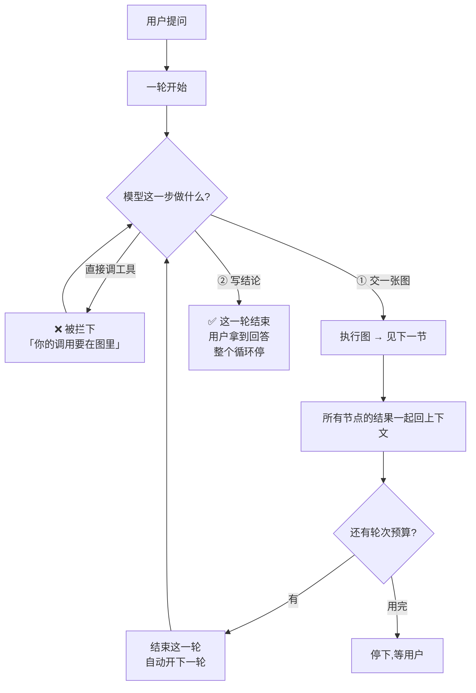
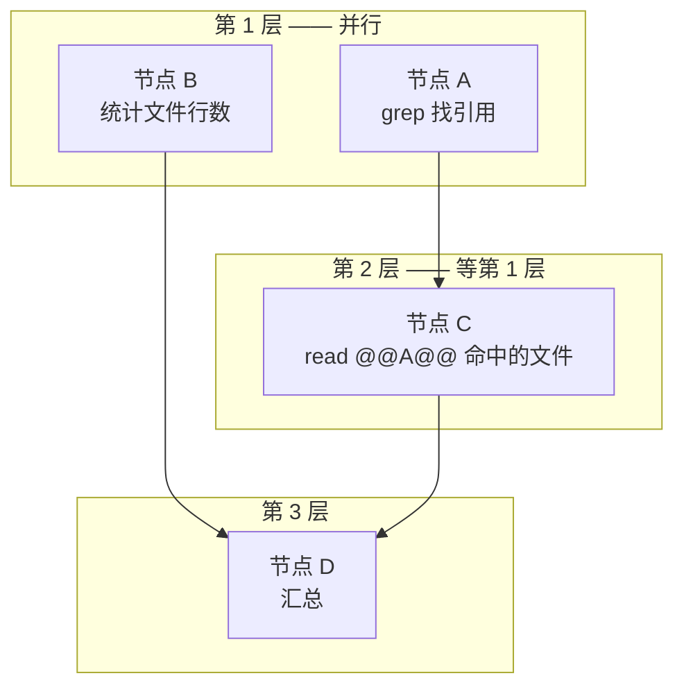
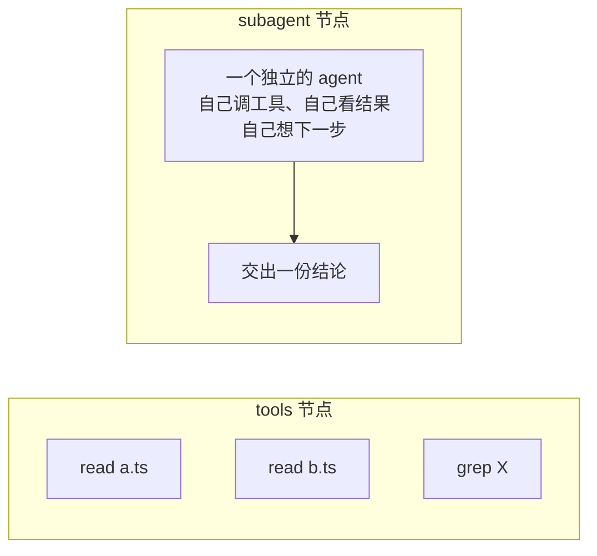
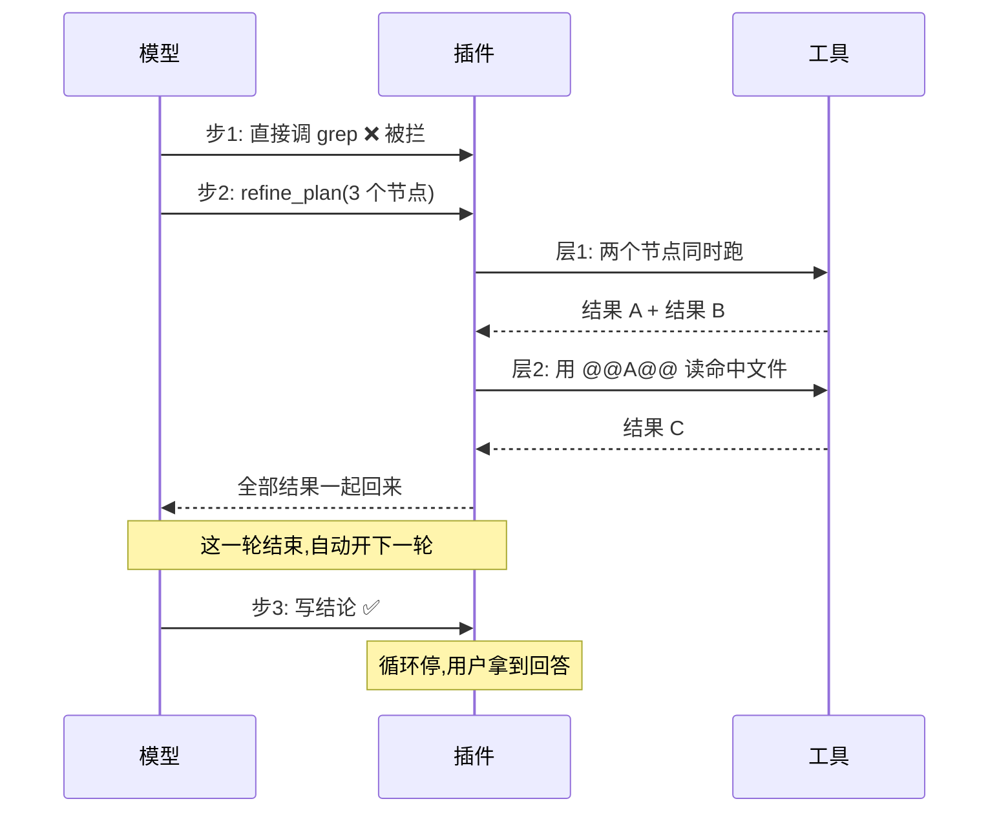
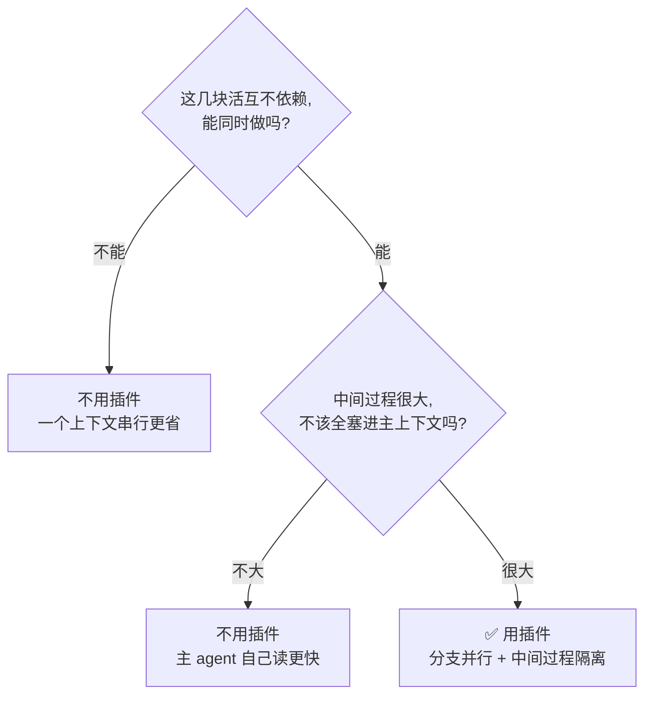

# dsh-refine-loop

**把「想一步、做一步」的串行链，换成「先规划、再并行做完、一次拿到所有结论」。**

---

## 一句话讲清思路

> 让模型先把这件事想清楚：**分成哪几块、哪些能同时做、哪些必须等前面的结果**，
> 画成一张图。插件照着图跑，跑完把**所有结果一起**还给模型。
> 模型拿着结果决定下一步：**再画一张图**，或者**写结论**。
> 写结论 = 这件事答完了，循环停。

模型在**一轮**里只有两个动作可选：**交一张图**，或者**写结论**。它自己不许直接调工具。



---

## 图怎么跑：同层并行、跨层串行

一张图 = **若干层**。层由 `after`（依赖）算出来：

- **同一层**的节点互不依赖 → **同时跑** ✅
- **下一层**等上一层全部完成 → **串行** ✅
- 下游要用的上游结果，写 `@@节点名@@`，插件把那段输出塞进去 ✅



**为什么要分层？** 因为「找出哪些文件提到了 X」和「统计行数」互不相干，可以一起做；
而「读那些文件」必须等第一层的结果 —— 这就是**并行里带串行**。

---

## 一个节点有两种：跑批的、会想的



| | `tools` 节点 | `subagent` 节点 |
|---|---|---|
| 里面是什么 | 模型**事先写死**的一批调用 | 一个**完整的 agent**，边做边想 |
| 能不能自己纠错 | ❌ 参数定死了 | ✅ 能 |
| 适合的活 | 调用确定的、纯读的 | 「要看了才知道怎么做」的 |
| 成本 | **0 次额外模型调用** ✅ | 一份独立上下文 + 一份报告 |

**子代理之间不互相依赖。** 它们是并行的分支：每个孩子只用自己的任务书工作，
不需要另一个孩子的输出。需要上下游的活，写成下一层的 `tools` 节点，或留给下一轮。

---

## 一整件事怎么走完（举例）



**实测形态：2 个 turn（交图 → 结论）、主 agent 2 步。**

---

## 三条规则

| # | 规则 | 为什么 |
|---|---|---|
| 1 | **模型不许自己调工具** —— 一步只有「交图」或「写结论」 | 逼它一次把形状想清楚，而不是走一步看一步 |
| 2 | **图按层跑**：同层并行、跨层串行 | 独立的事同时做，依赖的事排队 |
| 3 | **图跑完这一轮就结束** → 自动开下一轮；**写结论就整个循环结束** | 每一轮是一次「规划→执行→看结果」，结论才算答完 |

---

## 实测：它赢在哪里，输在哪里

同一个二进制、同一个 profile、同一个模型、同一个任务，只切插件的 `enabled`。
**单次抽样，方差很大**（尤其涉及子代理时）—— 表里的数只说明量级和方向。

### 主 agent 的形状：稳定大幅改善 ✅

| | 关插件 | 开插件 |
|---|---|---|
| 主 agent 的往返步数 | 10–13 | **2** ✅ |
| 主 agent 的上下文 | 30k–69k | **21k–37k** ✅ |
| 一轮里的动作 | 一步步试 | 交图 → 拿结果 → 结论 |

### 整队总账：看任务形状

| 场景 | 关插件 | 开插件 | 结论 |
|---|---|---|---|
| `coverage`（宽任务：盘点 14 个文件） | 97.7s / 465k | **96.9s / 299k** | **略赢** ✅ |
| `coverage`（聚焦任务：回答三个问题） | **47.8s / 225k** | 144.2s / 1.07M | **输** ❌ |
| `review`（几块大的独立审查 + 汇总） | 160s / 953k | 158s / **659k** | **token 赢** ✅ |
| `sweep`（14 个文件各一句话） | **27s / 141k** | 162s / 741k | **输** ❌ |
| `fanout`（5 个点名文件） | **8s / 35k** | 75s / 142k | **输** ❌ |

**规律：**

- 任务**越聚焦**，关插件越强 —— 一个上下文能边看边收窄，特别高效。
- 任务**越宽、分支越独立**，开插件才有机会：主 agent 只出结论，中间过程不压它。
- 子代理的**报告长度**是最大开销来源（实测一个孩子能写 6,000 token 的报告）；
  它也只能缓解、不能消除 —— 信息要过孩子的嘴，就得付输出的钱。

---

## 什么时候该开



**一句话：这是「上下文隔离 + 结构保证」的工具，不是「省 token / 省时间」的银弹。**

---

## 改设置

**在 `cordis.patch.yml` 里改**：

```yaml
- insert:
    - id: refine-loop
      name: '@zyn19940107/dsh-refine-loop'
      config:
        enabled: true                    # 整个插件挂不挂
        maxBatchSize: 8                  # 一张图最多几个节点
        maxBatchTimeoutMs: 600000        # 一张图的时间预算
        maxAgentDepth: 1                 # 计划里最多派到第几层子代理
        agentNodeTimeoutMs: 300000       # 单个子代理节点的预算
        maxRounds: 16                    # 最多几轮
        respectConcurrencySafety: true   # 认不认工具自己声明的「不能并发」
        concurrentTools: [glob, grep]    # 插件放行的只读工具
        concurrentShell: true            # 只读 shell 命令也可并行
        shellTool: ops_bash
```

| 字段 | 默认 | 什么时候改 |
|---|---|---|
| `maxBatchSize` | `8` | 一张图的节点数上限。节点太多，结果也太大，读起来反而费劲 |
| `maxBatchTimeoutMs` | `600000` | 一张图的时间预算。**子代理在前台跑，所以这个预算也管着子代理** |
| `maxAgentDepth` | `1` | `1` = 本对话可以派子代理，子代理里不能再派。调到 `2` 允许孙子代理 |
| `agentNodeTimeoutMs` | `300000` | 单个子代理节点的预算。超了报这个节点失败，**其余节点的结果照常拿回来** |
| `maxRounds` | `16` | 循环最多几轮。用完后不再自动开下一轮 |
| `requirePlan` | `true` | 关掉它，插件退回到「只提供能力，不强制形状」 |
| `planPullbacks` | `2` | 图还没交出来之前，最多被拽回几次。拽不动就放手 |
| `respectConcurrencySafety` | `true` | 改成 `false` = 连工具声明「不能并发」的调用也一起跑。**只在确认安全时才改** |
| `concurrentTools` | `[glob, grep]` | 纯读工具。写操作的工具**永远不要加进来** |
| `concurrentShell` | `true` | 只读 shell 命令是否并行。改成 `false` = shell 一律排队 |

> `enabled` 在插件加载时读一次，改了要重载。其余字段是活的。

---

## 关于并发安全

插件**默认认**工具自己声明的并发安全性（harness 的 `executionMode`）。没声明 `isConcurrencySafe` 的一律独占。

插件的补充判定分两种：

**纯读工具**（`glob`、`grep`）—— 各自 spawn 子进程、无共享可变状态，直接放行。

**shell 命令** —— 风险集中在这里。插件自己判断命令：必须是简单命令（无重定向、无管道、无链、无替换）；
引号内的 `>`/`|` 是字面量、不算危险；可执行文件必须在只读白名单里；白名单命令的危险参数单独挡掉
（`find -exec`、`grep --pre`、`sort -o` …）。**判断不了的，老老实实排队。**

独占调用是**屏障**：它前面的先跑完、它自己单独跑、后面的再开始。
批次结果里会写明每项是 `concurrent` 还是 `serial`，整批是 `concurrent` / `mixed` / `serial` —— **可观测，不用猜**。

---

## 装上

```sh
dsh plugin add /path/to/dsh-refine-loop

# 或打包
pnpm pack
dsh plugin add ./zyn19940107-dsh-refine-loop-0.1.0.tgz
```

**装完请开一个新会话** —— 已开着的会话不会刷新模型看到的工具表。

---

## 自己改代码

```sh
pnpm install
pnpm build        # 打包
pnpm typecheck    # 类型检查
pnpm specs        # 跑规格
```

规格里有几条在测「真并行」：层内三个节点的时间窗必须重叠、层与层的顺序必须对、
以及同一层三个节点的峰值并发数 —— 不是看摘要，是看事实。

---

## 已知边界

- **不改变 harness 的循环结构。** 全部走公开扩展点（`tools/register`、`tools/execute`、`agent/pre-step`、
  `systemPrompt.section`、`commands/register`），`agent-loop` 一行没动。
- **子代理在前台同步跑。** 跑得慢会拖住这一轮 —— 但它有自己的预算（`agentNodeTimeoutMs`），
  超了报这个节点失败，其余结果照常拿回。
- **子代理的中间过程不进主上下文**，你只看得到它的结论 —— 这是它的价值，也是它的成本（结论要付输出钱）。
- **画图时参数只能靠猜。** 图在任何东西跑过之前写下的，所以提示词要求节点里的调用写绝对路径。
- **图的结果可能装不下**，被截掉的部分在 spill 文件里，下一张图可以读回来。
- **占位符是 `@@节点名@@`，不是 `{{节点名}}`** —— harness 的提示词渲染器把双花括号当变量引用，
  名字不合规会直接抛异常。插件加载时检查并拒绝含 `{{` 的文案。

## License

MIT
