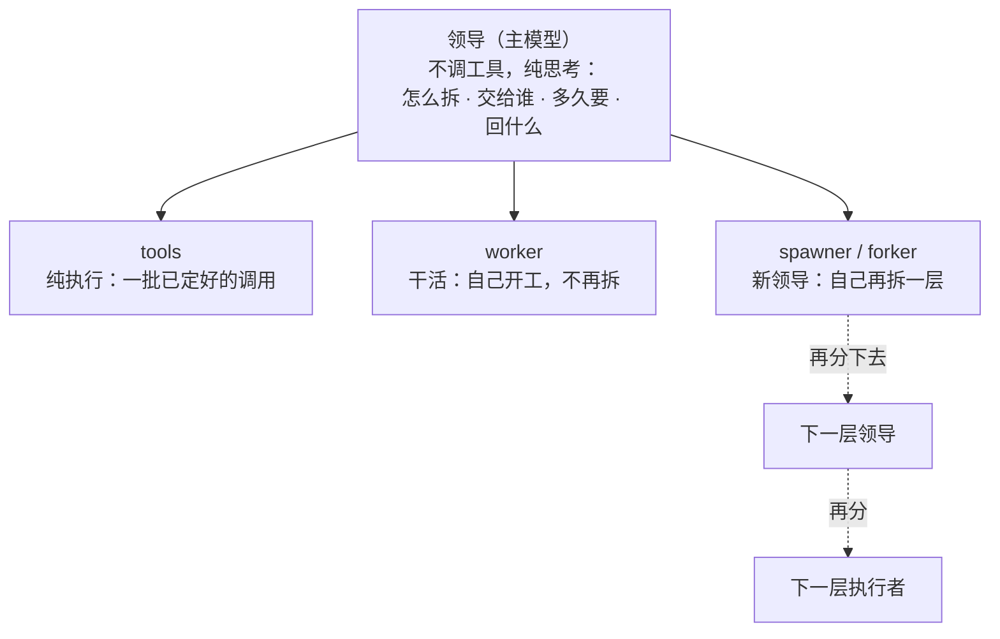
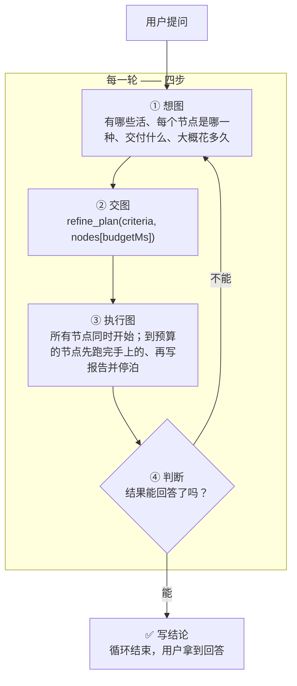
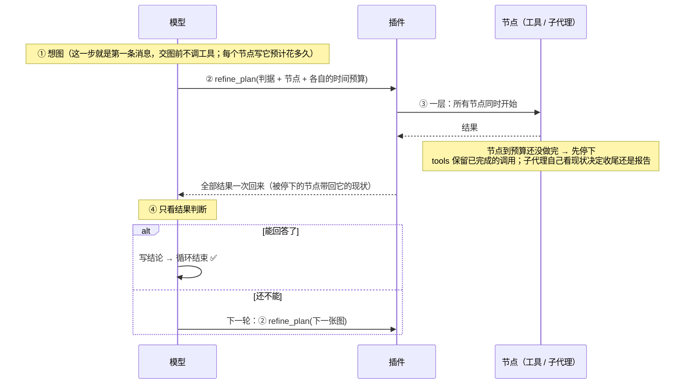
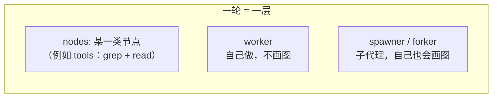

# dsh-conductor

> **公司工作流** —— 把公司里「领导派活、执行者干活」的组织方式搬进 agent。

**把「想一步、做一步、再看一步」的串行链，换成「每一轮：想图 → 交图 → 跑图 → 判断」。**

---

## 设计思想：把真实工作的组织方式搬进 harness

DeepSeek Harness 原生的循环是「想一步 → 做一步 → 再看一步」：模型调一个工具、拿到结果、
再想下一步。这在短任务上很合适，但它**不是真实工作的组织方式** ✗。

真实工作里，一个人接到需求之后不会立刻动手，而是：

1. **先纯思考**：这活该怎么拆、有哪些部分、做到什么算完成 —— 这一步不碰任何工具；
2. **决定每一块交给谁**：自己干、交给一个纯执行的人、还是交给一个也会自己拆活的人；
3. **给每个人交代三件事**：要做什么、**多久要**、**回什么结果**；
4. **执行者可能继续当领导**（自己再拆一层），也可能只是纯干活。

这个插件把这套结构做进了 harness：

| 真实工作里的角色 | 插件里的对应 | 做什么 |
|---|---|---|
| **领导** | 每一轮开头的主模型 | **不调工具、纯思考**：怎么拆 → 交给谁 → 多久要 → 看结果 → 下结论 |
| 纯执行者 | `tools` 节点 | 参数已经定好的一批调用，不再思考、不再拆分 |
| 干活型执行者 | `worker` 节点 | 继承当前对话，自己开工，不画图 |
| 能再当领导的执行者 | `spawner`（空白起点）/ `forker`（带上下文）| 自己再拆一层，继续走这套工作流 |



**这四件事没有一件是插件规定死的** ✗ —— 怎么拆、交给谁、要多久、回什么，
**全部由模型自己思考决定** ✅。插件只提供机制：一层并行、节点时间预算、到点收尾、
报告不被截断、判断阶段只能判断。

---

## 一句话

> 模型不再一步一步地调工具。
> 每一轮它要做的是**画一张图**：这一轮有哪些活、每个节点是哪一种、各自交付什么、**每个节点大概要花多久**。
> 图只有**一层** —— 所有节点同时开始，插件把结果一起还给模型。
> 节点到自己的时间预算还没做完时，插件**先让它跑完手上那条调用、再要一份现状报告**，而不是直接杀掉；写完报告节点**不结束**，下一轮用同一个 id 就能接着干 —— 所以父代理总能拿到部分结果，也不会丢掉已经付过的时间。
> 然后模型**只看结果做判断**：能回答了，就写结论结束；还不能，就画下一张图。



---

## 每一轮到底发生了什么



**关键点：模型在「判断」这一步**只能做两件事 —— **写结论**，或者**交下一张图**。它不能在这一步继续一个一个地调工具干活。那是图中的活。

---

## 图是什么

图只有一层。节点之间**没有依赖**，全部同时开始：



| 节点类型 | 上下文 | 跑插件循环（自己画图） | 里面是什么 |
|---|---|---|---|
| **tools** | 就是本 agent | — | 一批**事先写死**的调用，额外模型调用 **0** ✅；单个结果超过 10k 字符时截成头尾（见「已知边界」）|
| **worker** | **继承本对话，含本轮 plan 与已读到的内容** | 否 —— plan 工具留在表里（为了 KV cache 命中），调用会被拒绝 | 一个边想边做的子代理：自己决定用什么工具，交结论 |
| **spawner** | 空 | 是 —— 自己画图，还能再派节点 | 一个从零开始、也按这套循环干活的子代理 |
| **forker** | **继承本对话，含本轮 plan** | 是 | 一个继承了上下文、也按这套循环干活的子代理 |

- **节点之间没有依赖**：所有节点同时开始 ✅
- 需要按顺序做的活，放进**一个节点**里：`tools` 节点写 `"order": "sequential"`，或者交给 `worker` ✅
- 两个节点写同一个文件会互相覆盖 → 用 `"writes": ["路径"]` 声明，**写集重叠的节点不并行** ✅
- 一个节点要用另一个节点的结果 → 那张图属于**下一轮** ✅

### worker / forker 的「继承」继承到什么

harness 自带的 `subagent_fork` 只 seed「已完成的轮次」；计划节点跑在**进行中的这一轮**里，所以插件自己构造 seed（和 harness 的 `buildForkSeed` 同一种结构，边界放在**此刻**）：

- 父会话的全部事件，**含本轮那张 `refine_plan` 调用，以及本轮已经拿到的工具结果** ✅
- 开放尾部按 harness 的方式收干净：没结果的调用补合成错误结果、`step/end`、`turn/end{forked}` ✅
- 子会话共享这段前缀 → KV cache 也能复用 ✅

`spawner` 不一样：它**从零开始**，没有任何继承，由插件用同一个 agent 工厂创建（空 seed）。

`worker` 和 `forker` 的区别只有一条：**`worker` 调用 `refine_plan` 会被拒绝**（它不画图、不再派发），
`forker` 可以画。注意工具本身留在 `worker` 的工具表里 —— 摘掉它会改请求头、让整段继承的前缀
KV cache 失效，所以在这里拦调用、不拦工具。

> 三种 agent 节点的子代理都是**插件自己创建**的（不是走 harness 自带的 `subagent` 工具）——
> 只有拿着子代理的句柄，节点预算到点才能 `cancel` 它、再让它交代现状（见下面「插件强制了什么」）。

---

## 插件强制了什么（这是它区别于「建议」的地方）

提示词写在系统提示词里会被模型当成背景；**插件把这些硬机制做在扩展点上**：

| 强制 | 怎么做 | 为什么 |
|---|---|---|
| **每轮开始就想图** ✅ | 每一轮的第 1 步之前，插件把「四步循环」作为**最后一条消息**塞给模型 | 系统提示词在最前面，模型说话前最后读到的才是它真正会照做的东西（实测：改位置没用，改消息有用） |
| **图跑完只能判断** ✅ | 图跑完之后，模型自己发起的工具调用一律拒绝 | 那是「判断」阶段：要么写结论，要么画下一张图 |
| **派发只能走图** ✅ | harness 自带的 `subagent` / `subagent_fork` 直调被拒绝，并提示改成图里的节点 | 直调会绕过这一轮的图和它的预算 |
| **节点到点：跑完手上的、写报告、不结束** ✅ | **四种节点都支持** `budgetMs`。`tools`：到点中止还没跑完的调用、**保留已经跑完的**。会思考的节点：**不杀在飞的调用**（等它返回，它的时间已经付过），然后进入报告模式（拒绝一切工具、报告不设时限）；写完报告节点**停泊**——下一轮计划里出现同一个 id 就接着干，不出现就结束 | 直接杀会给父代理留下「超时，什么都没有」，也让节点已经付过的时间作废；停泊让「预算到点」变成「暂停、报告、下一轮接着干」 |
| **计划报告永远不截断** ✅ | 插件在 `tools/post-execute` 里用带 `value` 的决定返回计划结果，harness 的 spill 策略会跳过这种决定 | 报告就是判断依据；中间被截掉等于节点静默消失 |
| **后台子代理的管理工具不给看** ✅ | `list_agents` / `send_message` / `interrupt_agent` 从模型的工具表里整个移除（不是拒绝调用） | 计划节点是同步的，没有「后台子代理」可管理；模型拿到它们只会空转（实测有样本 `Start-Sleep 120` 循环 47 步） |

> 注意：**规划阶段不再允许先调工具了**。教条明确要求"每轮的第一条消息就是图，交图之前不调任何工具"——
> 这条是提示，不是机制（插件不拦第一张图之前的工具调用），但实测有效：v2.10.4 全量 **40/40 全部交图** ✅。

> **「必须交图」不在上面这几条里 ✗** —— 它是一个**教条**（每轮开头的第一条消息改成"你的第一条消息
> 就是图"），不是拦截。v1.0 之前有过一条"没交图就拉回"的强制，随「闸门」一起删掉了；
> 现在插件不拦"交图前的工具调用"，也不把没交图的一轮拉回来。实测上这条教条足够强：
> v2.10.4 全量 **40/40 全部交图** ✅，而 off 臂没有"图"这个概念。

> 节点种类名（`worker` / `spawner` / `forker`）是**图上的词汇**，不是 harness 的工具名 —— 图里的节点不是工具调用。

---

## 核心：节点的预算到点之后

### 问题不是"慢"，是"慢且什么都没留下"

长程题里一个节点跑多久，模型是**感知不到的** —— 它看不到钟表，只能推算。实测过的最坏情况：
2048 的 `worker(solve)` 节点跑了 **568 秒**（占整次运行的 76%），最后超时被杀，
父代理拿到的是"超时 + 空输出"，整条计划链断掉，交付物根本没写。

直接杀是最差的选择：节点做了一半的东西全部作废，父代理也不知道它做到哪。

### 现在的做法：跑完手上的、写报告、但不结束

图里每个节点都可以声明 `budgetMs`。预算用尽时按节点类型收尾：

| 节点类型 | 到点之后 |
|---|---|
| `tools` | 中止**还没跑完**的调用，保留**已经跑完的**，报告末尾标一行"预算用尽，未完成的已停止" |
| `worker` / `forker` / `spawner` | **不杀在飞的调用**：等它返回——它的时间已经付过，可能就差一行。然后进入"报告模式"：拒绝一切工具调用，要求写现状报告（磁盘上有什么、确认了什么、还缺什么），报告本身**不设时限**（API 慢不能把已完成的活变成沉默） |

写完报告之后，节点**不结束**（2.9 起）：

- 子会话保持存活，上下文、文件、后台任务都留着；
- 下一轮计划里**出现同一个 node id** → 复用那个子会话，给它这张图里的新预算继续干；
- 下一轮不给这个 id → 当场销毁（父代理认为没必要继续）；
- 循环结束 → 剩下的统一释放。

这样"预算到点"不再等于"这段工作作废"，而是"暂停一下、报告进度、下一轮接着干"。

### 实测证据

| 用例 | 结果 |
|---|---|
| `toolprobe`：20 秒预算跑一条 180 秒的阻塞命令 | 图约 210 秒返回；命令跑完，输出进了报告（2.7 起不再杀在飞的调用）|
| `parkprobe`：10 秒预算 + 30 秒命令 | 第 1 轮报告并停泊，第 2 轮用同一个 id 接回**同一个子会话**（实测子会话总数 1）并完成 |
| `noticeprobe` | 后台任务完成时父代理会收到通知，不需要轮询（这是 `bg` 撤回后保留的教训：任务要归回合，通知才有接收者）|

### 代价：短任务上收不回来

"给每个节点估耗时 + 建图"本身要花推理成本，在 coverage / quixbugs 这种**短任务**上摊不回来
（详见下一节实测）；在 panel 这种**单个子任务很重**的题上是净收益。

## 实测：v2.10.4，8 个任务、每臂 5 次

同一版（v2.10.4）、同一台机器、同一个模型、同一批时间窗内跑完：**8 个任务 × 2 臂 × 5 次 = 80 次**，
4 路并发，失败自动重试。

### 怎么量（这一版的测量口径）

四条修正，都是之前批次踩过的坑：

1. **token 只算本会话自己的。** fork 出来的子会话，日志开头是父对话的拷贝，里面带着父代理
   自己的 usage；按整个文件累加会把父代理的 token 按子代理数量重复计一遍。`bench/sessions.mjs`
   在 `session/end-seed` 处切开，只统计切点之后的。
2. **工作区按 (condition, index) 隔离。** 之前同一 condition 的多次重复共用一个工作区，
   `setup()` 每次重建，并发跑时互相把对方的 `solution.py` 重置成空模板——一次 `humeval-hard`
   因此出现过「worker 报告 RESULT 5/5、判据却 0/5」的假失败。
3. **判据按语义而不是字面。** 「三份独立评审」改成形状判据；「参数原样透传」补上「裸值 /
   透传 / 不做形状校验」等表述。答案型判据从会话全文重判。
4. **被限流打断的运行不算。** 每条记录都扫描 `turn/end` 的 `kind: error`：这批里 `panel-off`
   有 4 次被 429（Token Plan 速率限制）中途打断、判据读到的是一段被截断的回答，已全部重跑，
   最终 80 条记录 0 个错误回合。

时间仍是**归一化**的：把模型时间换成"按 160 tok/s 该花的时间"，工具执行时间原样保留，
并行节点取 max。脚本 `bench/normalise.mjs`；一张总表 `bench/final-table.mjs`。

### 总表

| 任务 | 臂 | n | 墙钟 | **归一化** | token | 未缓存 | 成本 | 编队 | 步数 | 正确性 |
|---|---|---:|---:|---:|---:|---:|---:|---|---:|---|
| **panel**（三份独立评审）| off | 5 | 1269s | 992s | 41343k | 1061k | ¥3.005 | 6 | 69 | 28/30 |
| | **on** | 5 | **526s** ✅ | **538s** ✅ | **4076k** ✅ | **207k** | **¥0.570** ✅ | 4 | 6 | 28/30 |
| **lhtb-matpower**（十算例回归）| off | 5 | **912s** | **724s** | 10371k | 192k | ¥0.834 | 2 | 77 | 56/60 |
| | on | 5 | 1287s | 903s | **2748k** ✅ | 134k | **¥0.722** ✅ | 3 | 8 | **57/60** ✅ |
| **lhtb-nbody**（数值优化）| off | 5 | 1200s | **1058s** | 3274k | **115k** | ¥0.583 | 1 | 33 | **20/20** |
| | on | 5 | 1200s | 1165s | **1496k** ✅ | 133k | **¥0.542** ✅ | 2 | 7 | 19/20 |
| **review**（三部分源码审查）| off | 5 | 105s | 100s | 1215k | 101k | **¥0.185** | 1 | 17 | 28/30 |
| | **on** | 5 | **99s** | **93s** ✅ | 1251k | 102k | ¥0.228 | 4 | 4 | 27/30 |
| **humeval-hard**（5 道难题）| off | 5 | 199s | 207s | **222k** | 28k | **¥0.086** | 1 | 10 | 25/25 |
| | **on** | 5 | **132s** ✅ | **133s** ✅ | 312k | 42k | ¥0.135 | 2 | 4 | 25/25 |
| **humeval**（5 道独立实现题）| off | 5 | **174s** | **178s** | 677k | 43k | **¥0.147** | 1 | 20 | 25/25 |
| | on | 5 | 219s | 206s | **397k** ✅ | 43k | ¥0.172 | 2 | 5 | 25/25 |
| **quixbugs**（4 个小 bug）| off | 5 | **75s** | **79s** | **253k** | 15k | **¥0.064** | 1 | 12 | 20/20 |
| | on | 5 | 153s ✗ | 139s ✗ | 756k ✗ | 44k | ¥0.147 ✗ | 5 | 6 | 20/20 |
| **coverage**（跨文件聚合）| off | 5 | **86s** | **68s** | 618k | 59k | **¥0.108** | 1 | 14 | **25/25** |
| | on | 5 | 119s | 134s ✗ | **191k** ✅ | 57k | ¥0.182 ✗ | 1 | 5 | 24/25 |

### 读数

| 任务 | 归一化 on/off | token on/off | 成本 on/off | 正确性 off → on |
|---|---:|---:|---:|---|
| **panel** | **0.54×** ✅ | **0.10×** ✅ | **0.19×** ✅ | 28/30 → 28/30 |
| **humeval-hard** | **0.64×** ✅ | 1.40× | 1.56× | 25/25 → 25/25 |
| **review** | **0.93×** | 1.03× | 1.23× | 28/30 → 27/30 |
| **lhtb-nbody** | 1.10× | **0.46×** ✅ | **0.93×** ✅ | 20/20 → 19/20 |
| **humeval** | 1.16× | **0.59×** | 1.17× | 25/25 → 25/25 |
| **lhtb-matpower** | 1.25× | **0.27×** ✅ | **0.87×** ✅ | 56/60 → **57/60** ✅ |
| **coverage** | **1.97×** ✗ | **0.31×** ✅ | **1.68×** ✗ | 25/25 → 24/25 |
| **quixbugs** | **1.76×** ✗ | **2.98×** ✗ | **2.32×** ✗ | 20/20 → 20/20 |
| **几何平均** | **1.07×** | **0.56×** | **1.04×** | 227/235 → 225/235 |

### 一条清楚的结论：只有一类任务真的赚

| 任务 | 类型 | 结果 |
|---|---|---|
| **panel** | 三份**互相独立**的评审，每份都要读源码再判断 | **时间 0.54×、token 0.10×、成本 0.19×、正确性持平** ✅ |
| humeval-hard | 5 道难题，独立 + 较重 | 时间 0.64×（快），token/成本略涨 |
| review | 三个问题，读同一批文件 | 时间 0.93×，成本 1.23× |
| nbody | 数值优化，能拆但要在同一份代码上迭代 | 时间 1.10×，token 0.46×、成本 0.93×，正确性 20/20 → 19/20 |
| humeval | 5 个独立小函数 | 时间 1.16×、成本 1.17×，token 0.59× |
| matpower | 单文件 + 严格规格 + 迭代调试 | 时间 1.25×，token 0.27×、成本 0.87×，正确性 56/60 → 57/60 |
| coverage | 跨文件聚合计数 | 时间 1.97×、成本 1.68×，token 0.31× ✗ |
| quixbugs | 4 个几十行的小 bug | 时间 1.76×、成本 2.32× ✗ |

**panel 赢在哪**：题目本身要求"三份互相独立、互不知情的评审"。插件把它变成三个并行
forker，各自独立上下文；off 臂是一个代理顺序做三份，三份的源码阅读全部累积在同一个上下文里
（41.3M token vs 4.1M）。**独立性 → 并行 → 上下文隔离**。

**quixbugs 输在哪**：4 个几十行的小 bug，单代理 75 秒、¥0.06 就做完了。插件臂编队 5 个人，
每人一份上下文，token 2.98 倍、成本 2.32 倍——**框架开销大于任务本身**。2.10.4 的"先读后派"
和"验收归属"两条提示词**没有**改变这一点：成本主体是"为每个几十行的活开一个代理"。

**coverage 这轮的离群**：on 臂 token 只有 off 的 31%，但成本 1.68×——省下的全是便宜的缓存读，
贵的那部分（未缓存输入、输出）反而涨了。

### 分界线

按这 8 道题排下来，分界线不在"任务复杂不复杂"，而在两件事：

1. **子任务之间是否真的独立**（不是"能不能拆"，而是"拆开之后能不能各干各的"）；
2. **单个子任务是否足够重**（重到能盖过建图、继承上下文、汇总的固定成本）。

| 满足 | 例子 | 结果 |
|---|---|---|
| 独立 + 重 | panel | 大赚 ✅ |
| 独立 + 较轻 | humeval-hard / review | 时间赚，钱未必 |
| 独立 + 轻 | humeval / quixbugs | 时间/成本反而亏，token 有省 |
| 不独立 + 重 | nbody / matpower | 时间略慢，token/成本略赚，正确性有波动 |
| 不独立 + 轻 | coverage | 亏 ✗ |

### 机制指标

| 指标 | off | on |
|---|---|---|
| 交图率 | — | **40/40** ✅ |
| 编队中位（人数）| 1 | 4 |
| 主 agent 步数中位 | 69 | **6** |
| 每任务编队（on 臂中位）| — | panel 4、quixbugs 5、review 4、matpower 3、nbody 2、humeval 2、humeval-hard 2、coverage 1 |

> 编队人数和收益**不相关**：quixbugs 派了 5 个人（亏），panel 派了 4 个人（大赚）。
> 区别在"这些人是不是真的各自独立地干活"。

### 旧版数字（已作废）

仓库历史里还有 v1.0 / v2.0 / v2.4 / v2.10.2 的对照表（git history 与 `bench/results/before-*`、
`archive-*`）。**它们不能和上面的数字直接比**：那时的 token 统计带着"种子重复计数"的问题，
判据也改过。这一版 README 只保留 v2.10.4 自己的数字。

## 哪几道题能让插件派生子代理

v2.10.4 实测（on 臂，5 次运行各自编队人数的中位，含主代理自己）：

| 任务 | 编队人数 |
|---|---:|
| coverage | 1 |
| humeval | 2 |
| humeval-hard | 2 |
| lhtb-nbody | 2 |
| lhtb-matpower | 3 |
| review | 4 |
| panel | 4 |
| quixbugs | 5 |

规律：**任务越"可以拆成互不相干的块"，模型派的人越多**（quixbugs / review / panel / matpower）；
**任务越"整份交付物只有一件事"，它越倾向于自己干**（coverage / humeval / nbody）。

但**人数和收益不相关**：quixbugs 派了 5 个人（成本 2.32×），panel 派了 4 个人（成本 0.19×）。
差别在"这些人是不是真的各自独立地干活"。

## 「开着才能做对」的题：找过一圈，分界线不在正确性上

我原本想找一批"没有插件就做不对"的题来证明它有用 —— 找下来结论是：**几乎没有**。

- 同一个模型，在 off 臂（去掉插件）上做题的正确率**不低**：8 个任务里 5 个两臂都满分；
- 剩下的三处差异都很小：nbody 20/20 → 19/20、review 28/30 → 27/30、coverage 25/25 → 24/25，
  而 matpower 反过来 56/60 → **57/60**（插件臂更高）。合计 **227/235 → 225/235**，差 2 个案例；
- 稳定出现差异的是**过程指标**：交图率 40/40、主 agent 步数 69 → 6、报告不截断。

所以这个插件的价值**不在"正确性"上** —— 它在**组织方式**上：让模型显式地当领导、
显式地派活、显式地给时间预期，然后你能看到它每一步在组织什么。

反过来说：**它也不该被当成"提高正确率"的东西** ❌ —— 这一版两臂的案例正确率是 227/235 → 225/235，
插件臂还低 2 个案例；它在正确性上没有可依赖的正收益。

## 改设置

```yaml
- insert:
    - id: conductor
      name: '@zyn19940107/dsh-conductor'
      config:
        enabled: true                    # 整个插件挂不挂
        maxBatchSize: 8                  # 一张图最多几个节点
        maxBatchTimeoutMs: 900000        # 一张图的时间预算
        maxAgentDepth: 3                 # 最多派到第几层子代理
        agentNodeTimeoutMs: 540000       # 单个子代理节点的预算
        maxRounds: 16                    # 一个请求最多几轮
        respectConcurrencySafety: true   # 认不认工具自己声明的「不能并发」
        concurrentTools: [glob, grep]    # 插件放行的只读工具
        concurrentShell: true            # 只读 shell 命令也可并行
        shellTool: ops_bash
```

| 字段 | 默认 | 说明 |
|---|---|---|
| `maxBatchSize` | `8` | 一张图的节点上限 |
| `maxBatchTimeoutMs` | `900000` | 一张图的时间预算 |
| `maxAgentDepth` | `3` | 子代理还能不能再派子代理。**harness 自己有 `subagent.maxDepth`（默认 1）**，两边都放行才真的能派下一层 |
| `agentNodeTimeoutMs` | `540000` | 单个 agent 节点的**上限**。节点自己声明的 `budgetMs` 更小就按它来；到点会先停下再让节点交代现状，其余结果照常回来 |
| `maxRounds` | `16` | 一个请求最多几轮，用完就停 |
| `respectConcurrencySafety` | `true` | 认不认工具自己声明的独占性 |
| `concurrentTools` | `[glob, grep]` | 纯读工具，随便并行；**写操作永远不要加** |
| `concurrentShell` | `true` | 只读 shell 命令是否并行 |

> **`budgetMs` 不是配置项**，是图里每个节点的一个字段 —— 模型自己写"这个节点大概花多久"。
> 它只约束单个节点，不影响整张图（整张图的时间由 `maxBatchTimeoutMs` 管）。

---

## 并发安全

插件默认认工具自己声明的并发安全性：没声明 `isConcurrencySafe` 的一律独占。

补充判定：`glob` / `grep` 直接放行；shell 命令由插件自己判断 —— 必须是简单命令（无重定向、无管道、无链、无替换），
可执行文件必须在只读白名单里，危险参数（`find -exec`、`grep --pre`、`sort -o` …）单独挡掉。
**判断不了的，排队。** 独占调用是屏障：它前面的先跑完、它自己单独跑、后面的再开始。

---

## 装上

```sh
dsh plugin add /path/to/dsh-conductor

# 或打包
pnpm pack
dsh plugin add ./zyn19940107-dsh-conductor-2.10.3.tgz
```

装完请开一个新会话 —— 已开着的会话不会刷新模型看到的工具表。

---

## 已知边界

- **不用改 harness 的循环结构**：全部走公开扩展点（`tools/register`、`tools/guard`、`agent/pre-step`、
  `agent/created`、`systemPrompt.section`、`commands/register`）。
- **子代理在前台同步跑**：慢会拖住这一轮，但它有自己的预算（`agentNodeTimeoutMs`）。
- **图里的调用参数可能写错**：图是在跑之前写的，所以调用失败时插件会问模型一次「这条调用应该是什么」，
  用修好的参数重跑那一条（最多两次），其余节点不受影响。
- **图的结果可能装不下**：被截掉的部分在 spill 文件里，下一张图可以读回来。
- **一层之内没有依赖**：需要顺序的活放进一个节点（`tools` 的 `"order": "sequential"`，或者交给
  `worker`）；要用别的节点的结果，就放到下一轮。这是拿「轮内自动推进」换「调度简单、断口清楚」。
- **但插件不检查这条规则** ✗：计划里没有声明依赖的语法，所以模型可以把「写文件的节点 + 它的验证节点」
  放进同一层——2.10.2 的 nbody 里出现过三次（`impl[tools]` + `edge[worker]`），验证节点靠
  `Start-Sleep` 轮询等文件出现（5 次、25–50 秒），把并行变成了"伪装成并行的等待"，
  还验证到了中间版本，最终版本从未在 `global` 档跑过。
  **2.10.3 用提示词修掉**：规划侧明确"同层不许等、写和验是一个节点"，worker 侧明确"东西不在就
  报告，不要 sleep"。改后 3 次 nbody 全部 4/4、零轮询，节点变成
  `order: sequential` 的 `write → check → check`。机制上仍拦不住，只是教条变具体了。
- **写同一个文件的两个节点不并行**：靠节点自己声明 `"writes": [...]`。没声明的节点会被当作
  不写文件 —— 插件没法知道一次调用动了什么。
- **`worker` / `forker` 继承到「此刻为止」的全部历史**：插件的 seed 边界放在交图那一刻，
  所以本轮那张 `refine_plan` 调用、以及本轮已经拿到的工具结果都在里面。
- **`worker` 不画图，但工具表里还有 `refine_plan`**：摘掉工具会改请求头、让继承前缀的 KV cache
  失效，所以插件改成「工具在、调用被拒」。要能继续拆解就用 `forker`。
- **`worker` 拿不到 tools 节点，但拿得到 `tools` 工具**（2.10.0 起）：同一套调度、同一个
  5,000 字符截断，只是不需要画图。这样叶子节点也能"把一批只做收集的调用打成一个批次"，
  而不必为它破例开一张图。非 worker 会话调用它会被拒绝并提示改用图里的 tools 节点。
- **子代理只交结论**：给子代理的提示词末尾带一条交付契约（「结论 + 至多一两条支撑事实，
  不要报告、不要引用链」），并明说它压过 task 里的写法 —— 让 main agent 把每份子结论都写成
  长报告，等于同样的内容写两遍。
- **每轮的「想图」消息会增加 token**：一轮一条消息，换来的是每一轮都有图。
- **模型可以不交图**：插件不强制。它只在「图已经跑完」之后拦工具调用（判断阶段），
  画第一张图之前什么都不拦。要让它一定交图，得在 `agent/turn-stopping` 上自己加一条拉回规则
  —— 这一版没有加（见「插件强制了什么」下面的说明）。
- **`budgetMs` 到点是"跑完手上的 → 写报告 → 停泊"，不是"直接杀"** ✅：
  `tools` 节点到点中止**未完成**的调用、保留**已完成**的、报告里标注；会思考的节点**不杀在飞的调用**
  （等它返回——它的时间已经付过），然后进入报告模式（拒绝工具、报告不限时）。写完报告节点**停泊**：
  子会话、上下文、文件、后台任务都留着，下一轮计划里出现同一个 node id 就接回并给新预算，不出现就销毁，
  循环结束统一释放。实测：`toolprobe`（20 秒预算 + 180 秒命令）图约 210 秒返回且输出在报告里；
  `parkprobe`（10 秒预算 + 30 秒命令）第 2 轮接回的是**同一个子会话**（子会话总数 1）。
  边界：节点自己派生**脱离管道**的进程时，插件看不到也杀不掉它。
- **单次工具结果被截成 10k 字符**：`tools` 节点里一次调用的输出超过 10,000 字符时，插件保留
  **前 6,000 + 后 4,000**，中间换一行标记（「少了 N 个字符，用 offset/limit 读或 grep」）再拼进
  节点输出。**不用模型压缩** ✗ —— 实测一次压缩要 35 秒（模型压缩前先想约 3k token），
  而截断是 0 秒。丢掉的中段是**可恢复**的：再来一轮图，用 `read` 带 offset 或更窄的 `grep`。
  注意这只截**工具结果**，`refine_plan` 的报告本身不截断也不压缩（见上面「插件强制了什么」最后一行）。
- **"第一步就是图"是提示，不是强制** ✗：教条明确要求每轮第一条消息就交图、交图前不调工具，
  而且实测把"先探索再画图"的许可删掉后模型确实照做（coverage 3/3 首条消息就是 `refine_plan`）。
  但插件**没有**在机制上拦"先调工具"——它只是不再邀请。

## License

MIT
