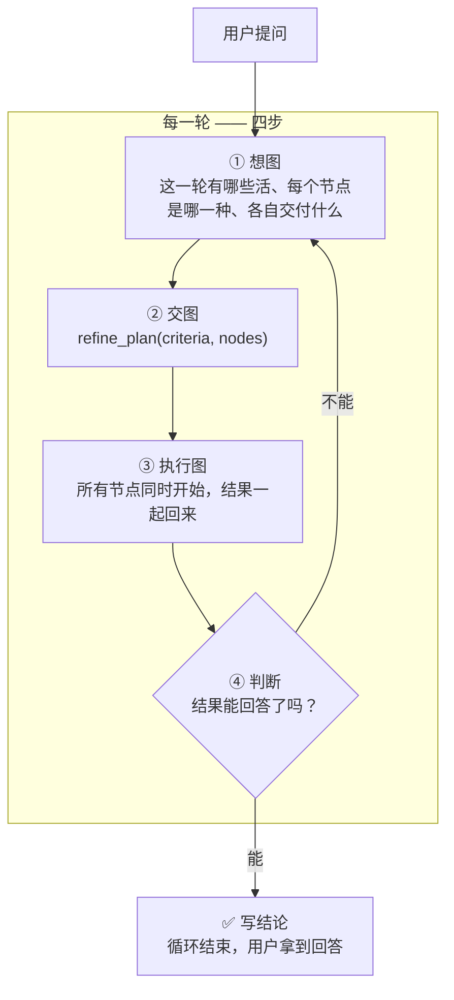
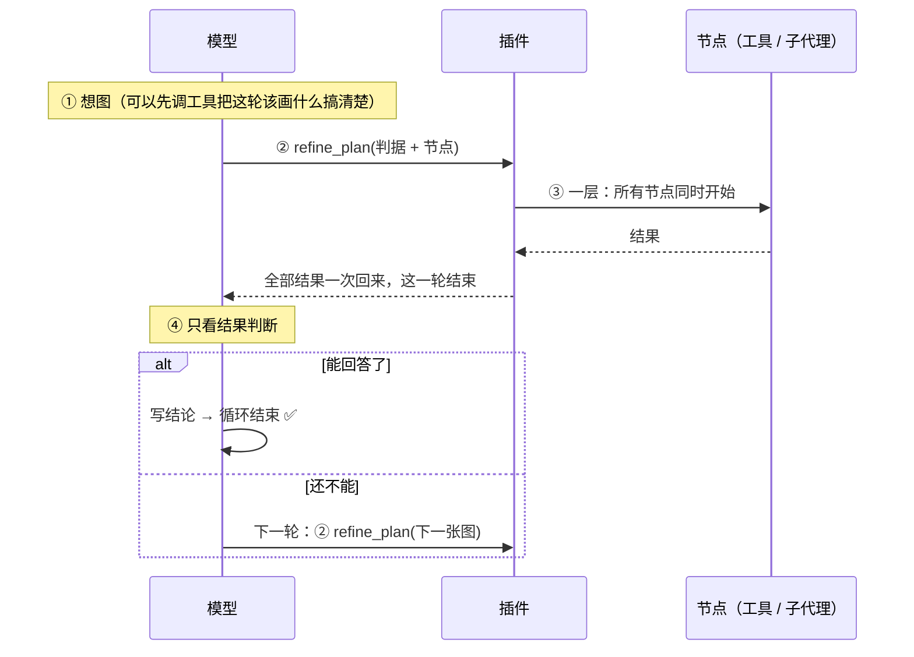
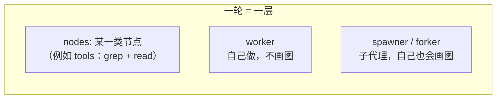
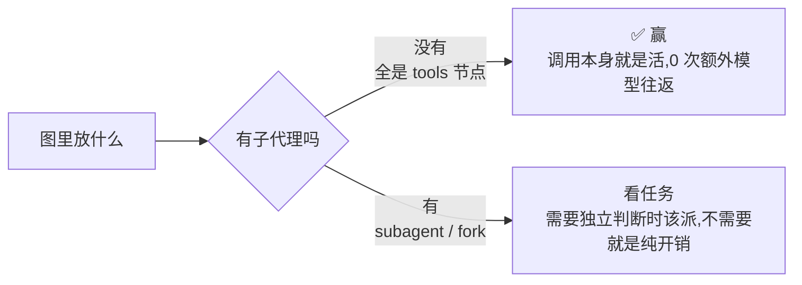

# dsh-refine-loop

**把「想一步、做一步、再看一步」的串行链，换成「每一轮：想图 → 交图 → 跑图 → 判断」。**

---

## 一句话

> 模型不再一步一步地调工具。
> 每一轮它要做的是**画一张图**：这一轮有哪些活、每个节点是哪一种、各自交付什么。
> 图只有**一层** —— 所有节点同时开始，插件把结果一起还给模型。
> 然后模型**只看结果做判断**：能回答了，就写结论结束；还不能，就画下一张图。



---

## 每一轮到底发生了什么



**关键点：模型在「判断」这一步**只能做两件事 —— **写结论**，或者**交下一张图**。它不能在这一步继续一个一个地调工具干活。那是图中的活。

---

## 图是什么

图只有一层。节点之间**没有依赖**，全部同时开始：



| 节点类型 | 上下文 | 跑插件循环（自己画图） | 里面是什么 |
|---|---|---|---|
| **tools** | 就是本 agent | — | 一批**事先写死**的调用，额外模型调用 **0** ✅ |
| **worker** | **继承本对话，含本轮 plan** | 否 —— plan 工具直接摘掉 | 一个边想边做的子代理：自己决定用什么工具，做完交结论 |
| **spawner** | 空 | 是 —— 自己画图，还能再派节点 | 一个从零开始、也按这套循环干活的子代理 |
| **forker** | **继承本对话，含本轮 plan** | 是 | 一个继承了上下文、也按这套循环干活的子代理 |

- **节点之间没有依赖**：所有节点同时开始 ✅
- 需要按顺序做的活，放进**一个节点**里：`tools` 节点写 `"order": "sequential"`，或者交给 `worker` ✅
- 两个节点写同一个文件会互相覆盖 → 用 `"writes": ["路径"]` 声明，**写集重叠的节点不并行** ✅
- 一个节点要用另一个节点的结果 → 那张图属于**下一轮** ✅

### worker / forker 的「继承」继承到什么

harness 自带的 `subagent_fork` 只 seed「已完成的轮次」；计划节点跑在**进行中的这一轮**里，所以插件自己构造 seed（和 harness 的 `buildForkSeed` 同一种结构，边界放在**此刻**）：

- 父会话的全部事件，**含本轮那张 `refine_plan` 调用** ✅
- 开放尾部按 harness 的方式收干净：没结果的调用补合成错误结果、`step/end`、`turn/end{forked}` ✅
- 子会话共享这段前缀 → KV cache 也能复用 ✅

`worker` 和 `forker` 的区别只有一条：**worker 不给 plan 工具**（它不画图、不再派发），`forker` 给。

---

## 插件强制了什么（这是它区别于「建议」的地方）

提示词写在系统提示词里会被模型当成背景；**插件把四条强制做在机制上**：

| 强制 | 怎么做 | 为什么 |
|---|---|---|
| **每轮开始就想图** ✅ | 每一轮的第 1 步之前，插件把「四步循环」作为**最后一条消息**塞给模型 | 系统提示词在最前面，模型说话前最后读到的才是它真正会照做的东西（实测：改位置没用，改消息有用） |
| **每轮必须交图** ✅ | 一轮结束了却没交图 → 插件把它拽回来（最多 3 次） | 「没有图的一轮」等于用串行链回答了请求 |
| **图跑完只能判断** ✅ | 图跑完之后，模型自己发起的工具调用一律拒绝 | 那是「判断」阶段：要么写结论，要么画下一张图 |
| **派发只能走图** ✅ | harness 自带的 `subagent` / `subagent_fork` 直调被拒绝，并提示改成图里的节点 | 直调会绕过这一轮的图和它的预算 |

> 注意：**规划设计阶段是允许调工具的**。工具调用用来搞清楚「图里的节点该写什么」；不允许的是用工具把活干完、跳过图。

> 节点种类名（`worker` / `spawner` / `forker`）是**图上的词汇**，不是 harness 的工具名 —— 图里的节点不是工具调用。

---
---

## 实测

同一份代码、同一个 profile、同一个模型、同一个任务，只切插件的 `enabled`。
原始记录在 `bench/results/`。**每个场景单次抽样 —— 方差很大，看趋势，不要看小数。**

### 当前版本（一图一层）：三个场景

| 场景 | 条件 | 耗时 | 主 agent 步数 | 主 agent 上下文 | 编队 token | 正确性 |
|---|---|---:|---:|---:|---:|---:|
| coverage | off | 213s | 15 | 76k | 721k | 5/5 |
| coverage | **on** | 218s | **6** ✅ | **57k** ✅ | 1,262k ✗ | 4/5 |
| review | off | 123s | 17 | 78k | 871k | 4/4 |
| review | **on** | 183s | 15 | 80k | 3,374k ✗ | 4/4 |
| panel | off | 1,095s | 87 | 202k | 33,683k | 5/6 |
| panel | **on** | 1,084s | **13** ✅ | **86k** ✅ | **21,494k** ✅ | 5/6 |

读数：

- **主 agent 的步数和上下文**：三个场景全降 ✅（panel 87 → 13 步、上下文 −58%；coverage 15 → 6 步）。这是这套形状真正省下来的地方 —— 模型不用一步一步往下走。
- **编队 token**：panel −36% ✅；coverage / review 反而升 ✗。原因是这两题上模型派了 3–4 个子代理，而 `worker`/`forker` 现在**继承整段前缀（含本轮 plan）**，子代理每一步都要重发这段历史，记在编队的 cacheRead 上。继承买到的是子代理不用重读文件，代价是每个子代理都扛着主 agent 的历史。
- **正确性**：panel 和 review 持平；coverage 5/5 → 4/5（单次抽样，噪声范围内）。
- **耗时**：panel 持平，coverage 持平，review +48%。

> 下面是 **v1.0（多轮 DAG 图）** 的实测，保留作对照；旧记录在
> `bench/results/before-one-layer/`。那一版的节点种类是 `tools` / `subagent` /
> `subagent_fork`，节点之间用 `after` 连成分层的图。

**profile 只有 harness + 被测插件**（`dsh-sandbox/home/profiles/bench`）。这一点是
硬要求：沙盒里如果还装着别的会注册「派发」工具的插件，被测模型会拿到两套互相竞争的
指令，测出来的就是那个插件的行为，不是这个插件的。

### 时间、步数与编队

| 场景 | 条件 | 耗时 | 主步 | 编队 | 编队步 |
|---|---|---:|---:|---:|---:|
| fanout（5 个文件各读第一行） | off | **12s** | 3 | 1 | 3 |
| fanout | **on** | 16s | **2** ✅ | 1 | **2** ✅ |
| sweep（跨文件扫一个模式） | off | 197s | 10 | 1 | 10 |
| sweep | **on** | **133s** ✅ | **7** ✅ | 1 | **7** ✅ |
| coverage（spec↔模块覆盖盘点） | off | 60s | 13 | 1 | 13 |
| coverage | **on** | **56s** ✅ | **4** ✅ | 1 | **4** ✅ |
| review（评审 5 个文件） | off | 211s | 31 | 1 | 31 |
| review | **on** | **153s** ✅ | **11** ✅ | 1 | **11** ✅ |
| coveragewide（14 个文件全读一遍） | off | **73s** | 11 | 1 | 11 |
| coveragewide | **on** | 99s | **6** ✅ | 1 | **6** ✅ |
| panel（三方独立评审，必须互相看不见） | off | **1235s** | 76 | 4 | 273 |
| panel | **on** | 1326s | **18** ✅ | 6 | **214** ✅ |
| **greenspecs（长程修复：跑→看红→改→再跑，直到全绿）** | off | **82s** ❌ | 18 ❌ | 1 | 18 ❌ |
| **greenspecs** | **on** | 299s | 33 | 1 | 33 |

### token 拆开看

| 场景 | 条件 | 输入 | 缓存输入 | 输出 | 合计 |
|---|---|---:|---:|---:|---:|
| fanout | off | 13k | 20k | 1k | 34k |
| fanout | **on** | 14k | **11k** ✅ | 1k | **27k** ✅ |
| sweep | off | 75k | 354k | 4k | 433k |
| sweep | **on** | 86k | **221k** ✅ | 10k | **317k** ✅ |
| coverage | off | 29k | 248k | 4k | 281k |
| coverage | **on** | 38k | **59k** ✅ | 5k | **103k** ✅ |
| review | off | 74k | 1,427k | 17k | 1,518k |
| review | **on** | 77k | **542k** ✅ | 17k | **636k** ✅ |
| coveragewide | off | 56k | 391k | 7k | 454k |
| coveragewide | **on** | 53k | **108k** ✅ | 10k | **171k** ✅ |
| panel | off | 762k | 31,827k | 222k | 32,812k |
| panel | **on** | 779k | **21,923k** ✅ | 218k | **22,919k** ✅ |
| greenspecs | off | 55k | 660k | 8k | 723k |
| greenspecs | **on** | 123k | 2,060k | 42k | 2,225k |

（`合计` = 输入 + 缓存输入 + 输出。**其中 90% 以上是缓存输入** —— 每一步把变长的
对话重新发一遍，不是新读进来的内容。真正的新输入和输出，on 和 off 几乎一样。）

### 结论

| 指标 | 结果 |
|---|---|
| **缓存输入（最多的一栏）** | **6/6 场景全降** ✅（−31% ~ −76%） |
| **主 agent 步数** | **6/6 全降** ✅ |
| **新输入 / 输出** | 基本持平 ✅（on 略高，是做规划本身的那点开销） |
| **正确性** | 13/13 持平 ✅（`greenspecs` 补到 5 次 × 2 臂后：off 4/5 vs on 5/5，差别在噪声里） |
| **耗时** | 3 个降 ✅（sweep −32%、coverage −7%、review −27%），3 个升或平（fanout +4s、coveragewide +26s、panel +91s） |
| **`greenspecs` 的正确性** | **off 0/1 ❌ → on 1/1 ✅**（唯一一个「任务能不能做成」出现差别的场景） |

原因很直接：一份材料读一次、理解一次、判一次，比「读一点→想一点→再读一点」省 token，
但每轮多一次图的往返。**缓存输入省下来的量等于「少走的步数 × 每步的上下文」**，
任务越大越明显；任务小的时候，这层固定开销会盖过省下来的那点。

> **注意「合计 token」不是「花的钱」。** 缓存输入的价格通常只有新输入的十分之一左右，
> 而输出最贵。按上面的数粗算，review 的真实成本大约降 25%，panel 大约降 20% ——
> 比「合计降 30%~60%」要小，但仍然是真的降。

### 赢和输的分界线



**`tools` 节点是插件最省的形状**：图的节点就是那批调用，结果一次性回来，判断只发生一次。

### 长程任务：插件省的是代价，不是「做不做得出」

`greenspecs` 借的是长程基准的形状 —— [Long-Horizon-Terminal-Bench](https://zli12321.github.io/LHTB/)
把这类任务定义成「跑 → 量 → 调 → 再跑」的反馈循环，瓶颈不是单步能力，而是**能不能坚持到收敛**。
这里把它落到本仓库：一份源码副本里植入 2 个 bug，specs 有 4 个检查红，要求只改 `src/`、不许改
`verify/`、跑到 `all checks passed`。

**这一节原来的结论是单次抽样得出的**（「off 0/1 → on 1/1，插件唯一把『做不成』变成『做成』的场景」）。
补成 5 次 × 2 臂之后：

| | 关掉插件 | 开着插件 |
|---|---|---|
| **做对** | **4/5** | **5/5** |
| 耗时（中位） | 363s | 330s（−9%） |
| 总 token | 5.36M | 1.74M（**−67%**） |
| 往返步数 | 50 | 26（−48%） |
| 主上下文 | 167k | 125k（−25%） |

**那次抽样里的失败是噪声**：关插件的五次里有四次也做对了。插件在这道题上**稳定**省的是代价
（token −67%、步数 −48%），正确性只多对一次 —— 落在噪声里。

`greenspecs-hard` 是同一形状的加难版（4 个 bug，跨 `concurrency.ts` 和 `rounds.ts` 两个文件；
spec runner 会在第一个 spec 失败时就停下，所以修完第一批才会露出第二批），5 次 × 2 臂：

### greenspecs-hard  (off 5 次 / on 5 次,中位数)

| 指标 | 关掉插件 | 开着插件 | 变化 |
|---|---:|---:|---:|
| 总耗时(秒) | 337s | 683s | +103% |
| 整个编队的 token | 3668k | 2324k | -37% |
| ├ input | 195k | 122k | -37% |
| ├ cacheRead | 3363k | 2190k | -35% |
| └ output | 28k | 44k | +60% |
| 主 agent 的 input | 195k | 122k | -37% |
| 主 agent 的 cacheRead | 3363k | 2190k | -35% |
| 主 agent 的 output | 28k | 44k | +60% |
| 主 agent 的 context(最后一次请求的 prompt) | 135k | 132k | -2% |
| 主 agent 的往返步数 | 46 | 34 | -26% |
| 编队步数 | 46 | 34 | -26% |
| 编队人数 | 1 | 1 | 0% |
| 做对的运行数 | 5/5 | 5/5 | — |
| 正确性(通过的判据) | 1/1 | 1/1 | — |
| 其中真的交了图的运行 | — | 2/5 | — |

只看**真的交了图**的那 2 次:

| 指标 | 关掉插件(全部) | 开着插件(交图的) |
|---|---:|---:|
| 总耗时(秒) | 337s | 616s |
| 整个编队的 token | 3668k | 2109k |
| ├ input | 195k | 116k |
| ├ cacheRead | 3363k | 1953k |
| └ output | 28k | 40k |
| 主 agent 的 input | 195k | 116k |
| 主 agent 的 cacheRead | 3363k | 1953k |
| 主 agent 的 output | 28k | 40k |
| 主 agent 的 context(最后一次请求的 prompt) | 135k | 126k |
| 主 agent 的往返步数 | 46 | 33.5 |
| 编队步数 | 46 | 33.5 |
| 编队人数 | 1 | 1 |

 off 1: 289.8s agents=1 tokens=3289001 mainCtx=97920 correct=1/1 plan=n/0 profile=bench-off
 off 2: 268.2s agents=1 tokens=2609950 mainCtx=101473 correct=1/1 plan=n/0 profile=bench-off
 off 3: 591.4s agents=1 tokens=4597497 mainCtx=143892 correct=1/1 plan=n/0 profile=bench-off
 off 4: 336.8s agents=1 tokens=3667528 mainCtx=134721 correct=1/1 plan=n/0 profile=bench-off
 off 5: 455.2s agents=1 tokens=6321161 mainCtx=142256 correct=1/1 plan=n/0 profile=bench-off
 on  1: 683.3s agents=1 tokens=4874822 mainCtx=207960 correct=1/1 plan=n/0 profile=bench-on
 on  2: 544.3s agents=1 tokens=2323723 mainCtx=109962 correct=1/1 plan=n/0 profile=bench-on
 on  3: 695.6s agents=1 tokens=1971216 mainCtx=120037 correct=1/1 plan=y/0 profile=bench-on
 on  4: 978.4s agents=1 tokens=9125320 mainCtx=184378 correct=1/1 plan=n/0 profile=bench-on
 on  5: 536.0s agents=1 tokens=2246558 mainCtx=132422 correct=1/1 plan=y/0 profile=bench-on

**两档难度都没有出现"关掉就做不对"。**

**子代理节点只在一种任务上划算：需要多个互相看不见的判断**（`panel`）。
同一个 agent 读两遍同一份代码，第二遍会被第一遍的结论污染 —— 要独立性只能开新上下文。
这也解释了 `panel` 的两种条件：**关插件时 harness 自己也在派 4 个子代理**，开插件只是把
主 agent 的 87 步压到 13 步，正好是插件声称的那件事（一图一层版实测：87 → 13 步、主上下文 −58%）。

> **单片抽样，方差很大。** 图里放不放子代理、放几个，是模型自己的判断，差别就是几倍。
> 这个插件保证的是「每一轮的形状」，不是「一定更快」。

---

## 公开评测集上的 A/B（HumanEval / QuixBugs）

上面那些场景是手工设计的：题目按插件的形状挑，判据是「答案里有没有这几个字」。
这一节把两件事都换成真的 —— **题目来自公开评测集，判据是跑出来的**。

### 两个沙盒

| profile | bundles | 用途 |
|---|---|---|
| `bench-off` | `dsh-base` + `dsh-headless` | 不带插件 |
| `bench-on` | 同上 + `@zyn19940107/dsh-refine-loop` | 带插件 |

两个 profile 只差一个 bundle —— 这是「带插件 / 不带插件」唯一可测的差别。
`bench-on` 里的插件是**没被改过的原版**，只配了部署参数：`enabled: true`、
`shellTool: pwsh`（基准 profile 里实际的 shell 工具叫 `pwsh`；插件默认写的是 dsh-ops 的
`ops_bash`，不改这一项的话它的只读-shell 规则是空的，每次 shell 调用都独占）。

```sh
node bench/setup-profiles.mjs                  # 建这两个沙盒
node bench/probe-judge.mjs humeval humeval-hard quixbugs   # 先证明判据是对的
node bench/compare.mjs 5 humeval humeval-hard quixbugs     # 跑 A/B（顺序跑，不并行）
node bench/pubeval-table.mjs                   # 出表
```

### 样例从哪来

| 评测集 | 出处 | 取的题 | 判据 |
|---|---|---|---|
| HumanEval | [openai/human-eval](https://github.com/openai/human-eval) | 10 道原题（prompt 与 test 都是数据集原文），分成两组各 5 道 | 跑数据集自己的 `check()` |
| QuixBugs | [jkoppel/QuixBugs](https://github.com/jkoppel/QuixBugs)（MIT） | 4 个程序里的 bug | 跑数据集自己的用例 + 3 条留出用例 |

题面和用例**逐字** vendored 在 `bench/data/`（带 sha256），判据脚本从 vendored 副本读，
不从工作区读 —— 改测试不算通过；工作区里的 `check.py` 被指纹记录，改了就判失败。
QuixBugs 的用例本来就是公开的、agent 看得见，所以判据里另外加了 **3 条留出用例**
（留出用例先跟数据集自己的正确程序对过才拿来用），专治「按可见用例硬编码」。

判据本身要先证明是对的：`bench/probe-judge.mjs` 拿一份正确答案、一份错误答案、
一份被改过的判据各跑一遍 —— 正确 5/5、错误 0/5、改判据被抓，三项都过才开始跑模型。

### 结果（每场景 5 次 × 2 臂，中位数）

| 场景 | 指标 | 关掉插件 | 开着插件 | 变化 |
|---|---|---:|---:|---:|
| **humeval**（5 道独立实现题） | 总耗时 | 327s | 112s | **-66%** |
| | 总 token | 528k | 83k | **-84%** |
| | ├ input / cacheRead / output | 38k / 470k / 19k | 29k / 51k / 16k | -22% / **-89%** / -18% |
| | 主 agent context | 36k | 35k | -2% |
| | 主 agent 往返步数 | 19 | 4 | **-79%** |
| | 编队人数 | 1 | 1 | 0% |
| | 正确性 | 5/5 | 5/5 | — |
| **humeval-hard**（5 道难题） | 总耗时 | 107s | 76s | **-29%** |
| | 总 token | 222k | 152k | **-32%** |
| | ├ input / cacheRead / output | 22k / 196k / 12k | 17k / 97k / 12k | -23% / **-50%** / +3% |
| | 主 agent context | 26k | 29k | +11% |
| | 主 agent 往返步数 | 10 | 6 | **-40%** |
| | 编队人数 | 1 | 1 | 0% |
| | 正确性 | 5/5 | 5/5 | — |
| **quixbugs**（4 个要跑用例才定位的 bug） | 总耗时 | 80s | 167s | **+108%** |
| | 总 token | 240k | 137k | **-43%** |
| | ├ input / cacheRead / output | 24k / 200k / 10k | 15k / 111k / 17k | -40% / **-44%** / +63% |
| | 主 agent context | 25k | 34k | **+40%** |
| | 主 agent 往返步数 | 11 | 6 | **-45%** |
| | 编队人数 | 1 | 1 | 0% |
| | 正确性 | 4/4 | 4/4 | — |

每次运行的原始记录在 `bench/results/`，表是 `bench/pubeval-table.mjs` 生成的，不是手打的。

### 读数

**token 三个场景都降，降的是缓存输入。** 少走几步，每一步就不用把变长的历史重发一遍：
缓存输入 -89% / -50% / -44%，往返步数 -79% / -40% / -45%。真正新读的 input 只降
22% / 23% / 40%，输出基本持平 —— 这和 README 前面那批场景是同一个结论。

**耗时看形状。** 两组实现题省时间（-66% / -29%），修 bug 那组反而慢了 **+108%**：
修 bug 的下一步取决于上一步跑出来的输出，每一轮都要重新画一张图，输出 token 因此涨了
63%，主上下文也涨了 40%。**要跑一遍才知道下一步的活，插件的「一轮一图」纪律是把双刃剑。**

**「开着插件」不等于「真的用了插件」。** 插件只在**图跑完之后**才拦模型的直接调用；
画图之前模型可以先调工具把节点摸清楚，所以模型完全可以不交图自己干。
这次 30 次运行里，开着插件的那 15 次中有 12 次真的交了图（humeval 4/5、humeval-hard 3/5、
quixbugs 5/5），剩下 3 次只是多了插件的提示词段。表里「其中真的交了图的运行」那一行是
这个比例；只看交了图的那些次，数字比上表更好（humeval：耗时 -72%、总 token -85%）。

**正确性 30 次全对。** 两个评测集、两个臂、每一道题，插件一次都没让题做不成，也没让它
多做对 —— 插件改的是代价，不是能不能做成。

**编队人数全是 1。** 模型自己选的节点全是 `tools` 节点，一次也没派子代理。插件给的
「派发」能力在这三个任务上没被用上，所以这里的「编队」测的是**要不要分叉**，不是分叉
之后省了多少。要测分叉，得用那种「多个判断必须互相看不见」的任务（比如前面那个 `panel`）。

> **单次抽样，方差很大。** `humeval` 关掉插件那五次是 81.5s / 164.1s / 327.3s / 918.1s /
> 618.8s —— 中位数只是中位数。看趋势，不要看小数。

---

## 长程设计题（LHTB：2048 与 N 体优化）

前面那些题都是「能一次列全」的活 —— 几个函数、几个 bug。这一节换成 LHTB
（[Long-Horizon Terminal-Bench](https://github.com/zli12321/LHTB)）的两道**长程设计题**：
题来自公开评测集，本机改编（这台机器没有 Docker，上游容器里的东西在本地重做）。

| 题目 | 出处 | 形状 | 评分 |
|---|---|---|---|
| 2048 | `silrlab/2048` | 一直玩到预算用完 | 连续分：最大 tile 的 band + 棋盘进度（上限 11） |
| N 体优化 | `silrlab/nbody-accel-iterative` | 把 O(N²) 改快，物理不变 | 加权分：4 档 × min(加速比 / 上限, 1) |

### 改编了什么

- **2048**：上游是容器里的游戏守护进程，这里是本地 CLI（`g2048.py`）—— 规则、引擎、种子、
  记谱格式都是上游的。评分器用一台**全新**引擎重放 `moves.log` 取峰值，和上游一样；
  进度没法伪造，只有真合并出来的 tile 才算数。
- **N 体**：上游的隐藏验证器在本机重写（`judge_nbody.py`）：同样的 4 档、同样的权重和
  加速比上限、同样是**全新随机生成**的留出世界（id 打乱、质量/初速/截断半径/步长都变），
  参照系是上游的 numpy O(N²) 基线。参照系和提交在**同一个进程**里跑 —— 跨进程跑同一份
  numpy 代码会有 1e-6 的漂移，一步混沌放大就超过上游 1e-2 的位置容差了（这是踩过的坑）。
- 两道题都按上游的做法**按时间截断**：到点就停，磁盘上留下什么就评什么。
- LHTB 的素材（引擎、基准 CLI、判据、参考答案）放在**仓库外**的沙盒
  （`D:\code
ibe\dsh-sandbox\lhtb\`），仓库里只留跑它们的脚本 —— 判据是 oracle，
  仓库不能顺手送一份现成的答案。

### 结果

#### 2048（5 次 × 2 臂，中位数）

| 指标 | 关掉插件 | 开着插件 | 变化 |
|---|---:|---:|---:|
| 总耗时(秒) | 584s | 293s | **-50%** |
| 整个编队的 token | 1510k | 409k | **-73%** |
| ├ input | 66k | 66k | +1% |
| ├ cacheRead | 1401k | 291k | **-79%** |
| └ output | 48k | 52k | +8% |
| 主 agent 的 context（最后一次请求的 prompt） | 74k | 76k | +3% |
| 主 agent 的往返步数 | 26 | 7 | **-73%** |
| 编队人数 | 1 | 1 | 0% |
| 分数（band / 11） | 4 | 4 | — |
| 连续分（原始 band 值） | 4.79 | 4.79 | 0% |

```
 off 1: 776.1s agents=1 tokens=902156  mainCtx=65682 band=4/11 score=4.7852 plan=n
 off 2: 712.7s agents=1 tokens=1136594 mainCtx=68852 band=4/11 score=4.7852 plan=n
 off 3: 584.3s agents=1 tokens=3168012 mainCtx=79259 band=4/11 score=4.7812 plan=n
 off 4: 580.2s agents=1 tokens=2281977 mainCtx=79449 band=4/11 score=4.7852 plan=n
 off 5: 361.1s agents=1 tokens=1510339 mainCtx=73872 band=4/11 score=4.7852 plan=n
 on  1: 293.2s agents=1 tokens=626990  mainCtx=47432 band=4/11 score=4.7852 plan=n
 on  2: 387.0s agents=1 tokens=408877  mainCtx=76320 band=4/11 score=4.7852 plan=y
 on  3: 243.0s agents=1 tokens=519914  mainCtx=69973 band=4/11 score=4.7852 plan=y
 on  4: 261.7s agents=1 tokens=288344  mainCtx=78508 band=4/11 score=4.7852 plan=y
 on  5: 311.2s agents=1 tokens=332707  mainCtx=77231 band=4/11 score=4.7852 plan=y
```

#### N 体优化（3 次 × 2 臂，中位数）

### lhtb-nbody  (off 3 次 / on 3 次,中位数)

| 指标 | 关掉插件 | 开着插件 | 变化 |
|---|---:|---:|---:|
| 总耗时(秒) | 1200s | 1200s | -0% |
| 整个编队的 token | 3405k | 2217k | -35% |
| ├ input | 115k | 86k | -25% |
| ├ cacheRead | 3199k | 2064k | -35% |
| └ output | 92k | 71k | -22% |
| 主 agent 的 input | 113k | 86k | -24% |
| 主 agent 的 cacheRead | 3086k | 1971k | -36% |
| 主 agent 的 output | 92k | 71k | -22% |
| 主 agent 的 context(最后一次请求的 prompt) | 115k | 97k | -15% |
| 主 agent 的往返步数 | 38 | 30 | -21% |
| 编队步数 | 39 | 31 | -21% |
| 编队人数 | 1 | 1 | 0% |
| 通过的档(加权分见下) | 4/4 | 4/4 | — |
| 连续分(原始 band 值) | 1.00 | 1.00 | 0% |
| 其中真的交了图的运行 | — | 1/3 | — |

只看**真的交了图**的那 1 次(样本太少,只当个例看):

| 指标 | 关掉插件(全部) | 开着插件(交图的) |
|---|---:|---:|
| 总耗时(秒) | 1200s | 704s |
| 整个编队的 token | 3405k | 593k |
| ├ input | 115k | 86k |
| ├ cacheRead | 3199k | 436k |
| └ output | 92k | 71k |
| 主 agent 的 input | 113k | 86k |
| 主 agent 的 cacheRead | 3086k | 436k |
| 主 agent 的 output | 92k | 71k |
| 主 agent 的 context(最后一次请求的 prompt) | 115k | 97k |
| 主 agent 的往返步数 | 38 | 8 |
| 编队步数 | 39 | 8 |
| 编队人数 | 1 | 1 |

 off 1: 1199.9s agents=1 tokens=815232 mainCtx=61169 correct=4/4 plan=n/0 profile=bench-off
 off 2: 1200.0s agents=1 tokens=3404962 mainCtx=114903 correct=4/4 plan=n/0 profile=bench-off
 off 3: 1200.0s agents=1 tokens=4840592 mainCtx=122625 correct=4/4 plan=n/0 profile=bench-off
 on  1: 1199.9s agents=1 tokens=2217022 mainCtx=93938 correct=4/4 plan=n/0 profile=bench-on
 on  2: 1200.0s agents=1 tokens=3116955 mainCtx=113687 correct=4/4 plan=n/0 profile=bench-on
 on  3: 704.1s agents=1 tokens=593042 mainCtx=97331 correct=4/4 plan=y/0 profile=bench-on

### 读数

- **同样的结果，更便宜。** 2048 那题 10 次运行全部打到 band 4（512 的 tile），分数一模一样；
  差的是代价：开着插件耗时 -50%、总 token -73%、往返步数 -73%。省下来的几乎全是缓存输入
  （-79%）—— 少走几步，每一步就不用把变长的历史重发一遍。
- **机制看得见。** 关掉插件时，agent 自己做 12~23 次 pwsh 调用、4~6 次写文件；
  开着插件时（5 次里有 4 次真交了图），这些活被收进图里，顶层只剩 1~2 次 pwsh 和几次
  `refine_plan`。工具调用从顶层搬进图里，就是插件做的事。
- **关掉插件会打转。** off 那 5 次里有 2 次跑飞了：56 步 / 3.17M token、47 步 / 2.28M token
  （on 那 5 次最多 17 步 / 627k）。串行链的病在长程任务上最明显。
- **上下文没变。** 主 agent 最后一次请求的 prompt 两边都是 74k~76k —— 图把活收进去了，
  但结果最后还是要回到主上下文。

- **这道题对 MiniMax-M3.1-Flash 不够硬 —— 它被做满了。** 6 次运行全部 4/4 档、加权分 1.00：
  agent 在 20 分钟里写出了**两个内核**（均匀网格 + 3×3 stencil 的稀疏局部解，和对称化分块
  的稠密全局解），三档加速比分别做到 13.3× / 8.66× / 25.3×，全部越过上游的上限。
  这是真实结果，不是测量失败：上游自己的榜单上 MiniMax M3 的平均分只有 0.357（77 题里
  严格通过 1 题），**本机改编明显比上游容易** —— 留出世界的对抗性没有完全搬过来
  （上游的全局档是 13 万粒子、且世界分布专门为"固定网格退化"设计）。要复现上游的难度，
  得把那一档也搬过来。
- **于是这道题只能测代价。** 代价上：开着插件 token -35%、缓存输入 -35%、输出 -22%、
  步数 -21%、主 context -15%。耗时两臂都是 1200s —— 因为 6 次运行里 5 次都撞到 20 分钟
  预算，时间这一列被预算封顶了，看不出差别。
- **这题上插件几乎没被用上。** 3 次开着插件的运行里只有 1 次真交了图：这类活的形状是
  "写代码 → 测 → 改 → 再测"，下一步取决于上一步的输出，没有可以并行的节点。
  2048 那题 5 次里有 4 次交了图 —— 差别就在这。

> **单次抽样，方差很大。** 2048 关掉插件那五次是 776s / 713s / 584s / 580s / 361s ——
> 中位数只是中位数。看趋势，不要看小数。

---

---

## 哪几道题能让插件派生子代理

前面那几道题里**编队人数一直是 1** —— 插件一次子代理都没派出去。原因不是插件不行，是**题目的形状
里没有可以并行的节点**。这一节先在 LHTB 的 77 道题里把"能并行"的形状筛出来，再挑两道跑 A/B。

筛的标准是三条同时成立：(1) 题面里有**互不依赖**的子活；(2) 每个子活能**单独判分**；
(3) 子活之间不需要互相看对方的产物。

| 题目 | 子活 | 互不依赖? | 单独判分? | 能不能并行 |
|---|---|---|---|---|
| `commit0-multilib-tdd` | 三个库(tinydb / sortedcontainers / cachetools) | 完全独立 | 各自一套隐藏测试(204/297/283) | **能** |
| `matpower-opf-regression` | manifest 里十个算例 | 完全独立 | 同一套判据逐字段比 | **能** |
| `apex-law433-matter` | 四个案件 | 独立,但**阶段全局解锁** | 分阶段给分 | 只能顺序 |
| `apex-management-consulting-matter` | 两个案件 | 同上 | 同上 | 只能顺序 |
| `apex-investment-banking-matter` / `apex-ib244-matter` | 19 / 38 个阶段 | 阶段互相依赖 | 分阶段 | 不能 |
| `2048` / `chess-mate` / `sudoku-recovery` | 一局一关 | 严格串行 | 连续分 | 不能 |
| tasks-2.0 的 31 道 "Reconstruct X" | 一个产物 | — | 隐藏场景 | 不能 |
| `nbody-accel-iterative` | 一份实现 | — | 加权分 | 不能 |

**结论：「一份规格、多个产物」的长程题才是插件能派子代理的地方** —— 三个库、十个算例，每个都是
一份能单独交、能单独判分的活。而「一局一关」「阶段解锁」这类再长的题，结构上就是一条链，
只能一条链跑到底。这解释了 2048 和 N 体那两道题里编队人数为什么一直是 1。

下面两道都是从 LHTB 拿的，本机改编（没有 Docker，上游容器里的东西在本地重做），判据都是可执行的。

### commit0-multilib-tdd：三个库从零实现

上游的题：三个真实的 Python 库（tinydb 4.8.2 / sortedcontainers 2.4.0 / cachetools 7.1.4）
**每个函数体都被换成 `raise NotImplementedError`**，评测用的测试套件不给你 —— 你得从 docstring 和
docs 里读懂行为，**自己写测试**，再实现到自己的测试全过。打分是**隐藏的三套真实测试（784 个）里
通过的比例**。

本机改编做了三件事：

- 上游是容器里的镜像，这里在本地重建工作区（上游的 `stub_library.py` 原样用，
  所以活下来的 docstring 是上游的），判据是上游 `tests/fixed_tests` 的同一套测试（784 个）。
- 上游给 agent 5 小时、专家 8 小时；本地给 **30 分钟**，两臂一样。到了就停，磁盘上留下什么就评什么。
- **上游用禁网防止"直接把真库拉下来抄"**（`network_mode: none`）。这台机器封不住 ——
  本地代理能挡 pypi/github，但挡不住会绕的模型（`--noproxy`）。所以判据改成**检测**：
  判据存了上游每个函数体的 AST 指纹，agent 的文件只要函数体和上游逐个 AST 一样就算"抄的"，
  这部分**不计入「自写分」**，并在记录里点名。

### lhtb-commit0  (off 2 次 / on 2 次,中位数)

| 指标 | 关掉插件 | 开着插件 | 变化 |
|---|---:|---:|---:|
| 总耗时(秒) | 1606s | 1800s | +12% |
| 整个编队的 token | 27405k | 14355k | -48% |
| ├ input | 597k | 1469k | +146% |
| ├ cacheRead | 26499k | 12141k | -54% |
| └ output | 310k | 746k | +141% |
| 主 agent 的 input | 189k | 68k | -64% |
| 主 agent 的 cacheRead | 9932k | 450k | -95% |
| 主 agent 的 output | 93k | 35k | -63% |
| 主 agent 的 context(最后一次请求的 prompt) | 189k | 73k | -62% |
| 主 agent 的往返步数 | 86.5 | 15 | -83% |
| 编队步数 | 213 | 256 | +20% |
| 编队人数 | 4 | 19.5 | +388% |
| 命中的判据(隐藏测试) | 703/784 | 376/784 | — |
| 自写分(去掉抄来的库) | 0.152 | 0.259 | +71% |
| 连续分(判据原始分) | 0.90 | 0.48 | -47% |
| 其中真的交了图的运行 | — | 2/2 | — |

只看**真的交了图**的那 2 次:

| 指标 | 关掉插件(全部) | 开着插件(交图的) |
|---|---:|---:|
| 总耗时(秒) | 1606s | 1800s |
| 整个编队的 token | 27405k | 14355k |
| ├ input | 597k | 1469k |
| ├ cacheRead | 26499k | 12141k |
| └ output | 310k | 746k |
| 主 agent 的 input | 189k | 68k |
| 主 agent 的 cacheRead | 9932k | 450k |
| 主 agent 的 output | 93k | 35k |
| 主 agent 的 context(最后一次请求的 prompt) | 189k | 73k |
| 主 agent 的往返步数 | 86.5 | 15 |
| 编队步数 | 213 | 256 |
| 编队人数 | 4 | 19.5 |

 off 1: 1411.9s agents=4 tokens=36471757 mainCtx=122377 correct=622/784 plan=n/0 profile=bench-off
 off 2: 1800.0s agents=4 tokens=18339035 mainCtx=255830 correct=784/784 plan=n/0 profile=bench-off
 on  1: 1800.0s agents=22 tokens=16436222 mainCtx=65875 correct=376/784 plan=y/3 profile=bench-on
 on  2: 1800.0s agents=17 tokens=12273936 mainCtx=79335 correct=376/784 plan=y/3 profile=bench-on

**读数**

- **插件在这道题上真的派了子代理，而且派得对。** 开着插件的两次运行，插件建的图里有
  **3 个 `subagent` 节点，一个库一个**（`cachetools` / `sortedcontainers` / `tinydb`），
  外加一个准备性的工具节点；整个编队从 **4 人涨到 19.5 人**。
- **省的是主上下文，不是总 token。** 主 agent 的往返步数 86.5 → 15（-83%），
  主上下文 189k → 73k（-62%），总 token -48%；但 **input 和 output 反而涨了**（+146% / +141%）
  —— 活被搬到子代理身上去了，子代理各自读各自的文档、再回话，这部分 token 是新花的钱。
- **自写分：关掉插件 0.152，开着插件 0.259。** 也就是说开着插件那次，真正自己写的部分更多
  （on 的两次都是自己写的 sortedcontainers：203/297）。
- **原始分反而是关插件高（0.90 vs 0.48）** —— 因为关插件那两次**抄得更彻底**（off-2 三个库全抄了，
  784/784 全过）。这说明在这道题上，"分数高"不等于"干得多"，判据必须把抄的部分摘出来。
- **这道题上插件的开销更大**：耗时 1606s → 1800s（+12%），两次开着插件的都撞到 30 分钟预算。
  派 20 个代理要协调成本，省下的主上下文未必抵得上。

### matpower-opf-regression：十个算例各算各的

上游的题：实现一个审计流水线，对 manifest 里的**每一个算例**跑 AC 潮流、DC OPF、AC OPF，
写出七份确定性的报告（列名、JSON 键、单位都是规格的一部分），评分器会**自己重跑一遍 PYPOWER**，
拿公开和**隐藏**的 manifest 逐字段比。

本机改编：上游的 verifier 原样用（它通过 `APP_DIR` 读工作区，一行都不用改），10 个算例
（case9/14/30/57/118 + 缩放和压力变体），30 分钟预算。

### lhtb-matpower  (off 2 次 / on 2 次,中位数)

| 指标 | 关掉插件 | 开着插件 | 变化 |
|---|---:|---:|---:|
| 总耗时(秒) | 853s | 538s | -37% |
| 整个编队的 token | 5565k | 2013k | -64% |
| ├ input | 211k | 133k | -37% |
| ├ cacheRead | 5278k | 1817k | -66% |
| └ output | 75k | 63k | -16% |
| 主 agent 的 input | 131k | 133k | +2% |
| 主 agent 的 cacheRead | 4575k | 1817k | -60% |
| 主 agent 的 output | 66k | 63k | -3% |
| 主 agent 的 context(最后一次请求的 prompt) | 137k | 134k | -2% |
| 主 agent 的往返步数 | 55 | 23.5 | -57% |
| 编队步数 | 64 | 23.5 | -63% |
| 编队人数 | 1.5 | 1 | -33% |
| 通过的档(加权分见下) | 12/12 | 11.5/12 | — |
| 连续分(判据原始分) | 1.00 | 0.96 | -4% |
| 其中真的交了图的运行 | — | 1/2 | — |

只看**真的交了图**的那 1 次:

| 指标 | 关掉插件(全部) | 开着插件(交图的) |
|---|---:|---:|
| 总耗时(秒) | 853s | 596s |
| 整个编队的 token | 5565k | 1025k |
| ├ input | 211k | 137k |
| ├ cacheRead | 5278k | 806k |
| └ output | 75k | 82k |
| 主 agent 的 input | 131k | 137k |
| 主 agent 的 cacheRead | 4575k | 806k |
| 主 agent 的 output | 66k | 82k |
| 主 agent 的 context(最后一次请求的 prompt) | 137k | 137k |
| 主 agent 的往返步数 | 55 | 14 |
| 编队步数 | 64 | 14 |
| 编队人数 | 1.5 | 1 |

 off 1: 564.2s agents=2 tokens=4176601 mainCtx=133122 correct=12/12 plan=n/0 profile=bench-off
 off 2: 1141.0s agents=1 tokens=6953325 mainCtx=140957 correct=12/12 plan=n/0 profile=bench-off
 on  1: 596.1s agents=1 tokens=1024860 mainCtx=137339 correct=11/12 plan=y/0 profile=bench-on
 on  2: 480.3s agents=1 tokens=3002110 mainCtx=130040 correct=12/12 plan=n/0 profile=bench-on

**读数**

- **这道题对 MiniMax-M3.1-Flash 太容易**：四次运行三次 **12/12 全过**（上游的参考解
  本身就是 pypower 的薄封装，最快的一次 9.4 分钟收工）。所以它只能测代价，测不了"能不能做成"。
- 代价上照样有差别：耗时 -37%、总 token -64%、主 agent 往返步数 -57%，而分数持平（两边中位数
  都是 12/12）。开插件那次少花了一半的钱，交出来的东西一样对。
- 但**编队人数是 1**（off 是 1~2 人）：十个算例虽然独立，这道题太短 —— agent 十分钟就能写完，
  没有值得分派的活。**"能并行"和"值得并行"是两件事。**

### 两道题合起来的读数

- **形状决定一切。** 同一套插件，在"一局一关"的 2048 上编队 1 人、在 N 体上 1 人、在
  三个库和十个算例上编队 4 → 19.5 人。插件不是不派，是没地方派。
- **派起来之后省的是主上下文。** 主 agent 的往返步数和上下文大幅下降(2048: -73%/-3%、
  commit0: -83%/-62%)，总 token 也降（-48% ~ -73%），但 output/input 在 commit0 上反而涨 ——
  子代理的读文档和回话是新花的钱。
- **代价要一起看。** commit0 上开着插件更慢（+12%，两次都撞预算），2048 上更快（-50%）。
  差别在于前者是"派了 20 个人去干三件事"（协调成本 > 收益），后者是"少走几步、少重发历史"。
- **正确性上，长程题给不出信号。** 2048 两边都是 band 4/11；N 体两边都满分；matpower 两边都满分。
  真正能分出高下的只有 commit0 的**自写分**（0.152 vs 0.259），而它要靠判据把"抄来的"摘干净才看得出来。
- **一个诚实的警告**：本地改编的 commit0 没有真正禁网，agent 抄上游真库是可能的（两臂都抄了）。
  判据靠 AST 指纹把抄的部分摘出来，两臂条件相同，所以对比仍然成立；但**绝对分数不能当真**。

---

## 「开着才能做对」的题：找过一圈，分界线不在正确性上

既然"省代价"已经测过了，这一节专门问：**有没有哪道题，开着插件能做对，关掉就做不对？**

要出现这种差别，题目得满足两个条件之一：

- **反馈循环型**：跑 → 看红 → 改 → 再跑，直到检验器说全绿。插件的 rounds/repair 把
  「交图 → 看结果 → 判断能不能给结论」按在循环里，模型不容易提前收工。
- **预算紧的并行型**：N 份互不相干的活，串行做不完，并行做能做完。

第一种我做成两档难度、各 5 次 × 2 臂：

| 形状 | 关掉插件 | 开着插件 | 差别 |
|---|---|---|---|
| `greenspecs`（2 个 bug） | **4/5** | **5/5** | 1 次，落在噪声里 |
| `greenspecs-hard`（4 个 bug，跨两个文件） | **5/5** | **5/5** | 没有 |

**结论：在本仓库能搭的这些题里，没有找到"开着才能做对"的题。** 插件可测、稳定的收益是
**代价**（同一道题少花 1/3 ~ 2/3 的 token、少走一半的步数），不是正确性 —— 哪怕把反馈循环
加长、加难，正确性上也没分出高下。

真要出现"关掉就做不对"，约束得换一种：**不是"多几个 bug"，而是"同样时间里塞不下"** ——
N 份独立的大活 + 一个硬截止时间。`lhtb-commit0-tight` 就是照这个设计的（同一道 commit0，
预算从 30 分钟收到 12 分钟，串行做不完而三个子代理并行有机会做完），代码和判据都就位了，
**本轮没有跑**（时间预算用完）。上一节那道题里插件派出的三个子代理
（`cachetools` / `sortedcontainers` / `tinydb`，一个库一个）说明这条路是通的：
形状对了，模型就会去分工。

---

## 改设置

```yaml
- insert:
    - id: refine-loop
      name: '@zyn19940107/dsh-refine-loop'
      config:
        enabled: true                    # 整个插件挂不挂
        maxBatchSize: 8                  # 一张图最多几个节点
        maxBatchTimeoutMs: 900000        # 一张图的时间预算
        maxAgentDepth: 3                 # 最多派到第几层子代理
        agentNodeTimeoutMs: 540000       # 单个子代理节点的预算
        maxRounds: 16                    # 一个请求最多几轮
        respectConcurrencySafety: true   # 认不认工具自己声明的「不能并发」
        concurrentTools: [glob, grep]    # 插件放行的只读工具
        concurrentShell: true            # 只读 shell 命令也可并行
        shellTool: ops_bash
```

| 字段 | 默认 | 说明 |
|---|---|---|
| `maxBatchSize` | `8` | 一张图的节点上限 |
| `maxBatchTimeoutMs` | `900000` | 一张图的时间预算 |
| `maxAgentDepth` | `3` | 子代理还能不能再派子代理。**harness 自己有 `subagent.maxDepth`（默认 1）**，两边都放行才真的能派下一层 |
| `agentNodeTimeoutMs` | `540000` | 单个子代理节点的预算，超了报这个节点失败，其余结果照常回来 |
| `maxRounds` | `16` | 一个请求最多几轮，用完就停 |
| `respectConcurrencySafety` | `true` | 认不认工具自己声明的独占性 |
| `concurrentTools` | `[glob, grep]` | 纯读工具，随便并行；**写操作永远不要加** |
| `concurrentShell` | `true` | 只读 shell 命令是否并行 |

---

## 并发安全

插件默认认工具自己声明的并发安全性：没声明 `isConcurrencySafe` 的一律独占。

补充判定：`glob` / `grep` 直接放行；shell 命令由插件自己判断 —— 必须是简单命令（无重定向、无管道、无链、无替换），
可执行文件必须在只读白名单里，危险参数（`find -exec`、`grep --pre`、`sort -o` …）单独挡掉。
**判断不了的，排队。** 独占调用是屏障：它前面的先跑完、它自己单独跑、后面的再开始。

---

## 装上

```sh
dsh plugin add /path/to/dsh-refine-loop

# 或打包
pnpm pack
dsh plugin add ./zyn19940107-dsh-refine-loop-1.0.0.tgz
```

装完请开一个新会话 —— 已开着的会话不会刷新模型看到的工具表。

---

## 已知边界

- **不用改 harness 的循环结构**：全部走公开扩展点（`tools/register`、`tools/guard`、`agent/pre-step`、
  `agent/turn-stopping`、`agent/created`、`systemPrompt.section`、`commands/register`）。
- **子代理在前台同步跑**：慢会拖住这一轮，但它有自己的预算（`agentNodeTimeoutMs`）。
- **图里的调用参数可能写错**：图是在跑之前写的，所以调用失败时插件会问模型一次「这条调用应该是什么」，
  用修好的参数重跑那一条（最多两次），其余节点不受影响。
- **图的结果可能装不下**：被截掉的部分在 spill 文件里，下一张图可以读回来。
- **一层之内没有依赖**：需要顺序的活放进一个节点（`tools` 的 `"order": "sequential"`，或者交给
  `worker`）；要用别的节点的结果，就放到下一轮。这是拿「轮内自动推进」换「调度简单、断口清楚」。
- **写同一个文件的两个节点不并行**：靠节点自己声明 `"writes": [...]`。没声明的节点会被当作
  不写文件 —— 插件没法知道一次调用动了什么。
- **`worker` / `forker` 的继承是「已记录的历史」**：插件的 seed 边界放在此刻，所以连本轮那张
  `refine_plan` 调用也继承得到；进行中的工具结果不在此列。
- **`worker` 不画图**：它的 plan 工具被整个摘掉，所以它也不会再派 `worker`/`spawner`/`forker`；
  要能继续拆解就用 `forker`。
- **每轮的「想图」消息会增加 token**：一轮一条消息，换来的是每一轮都有图。

## License

MIT
