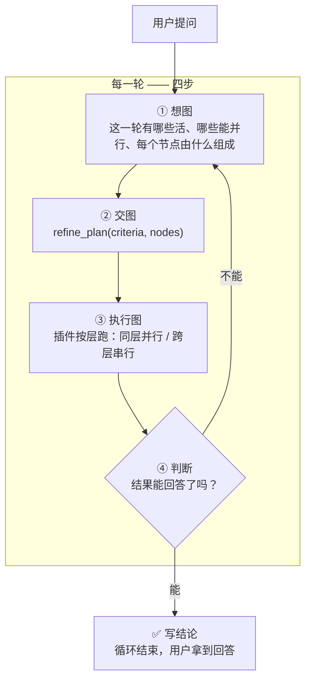
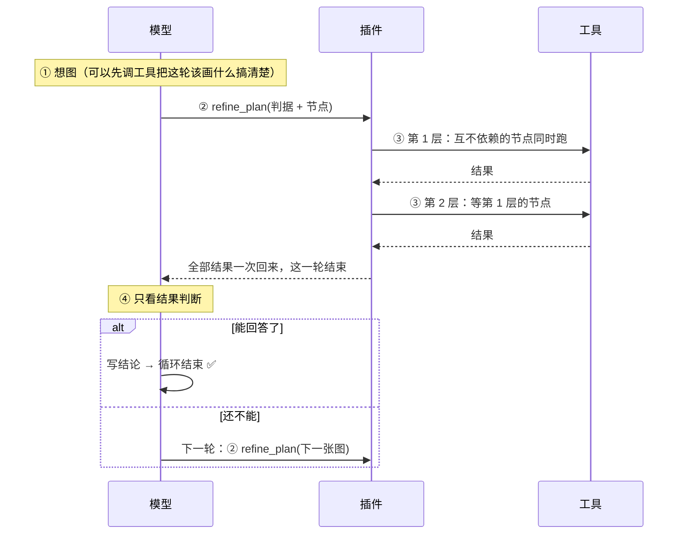
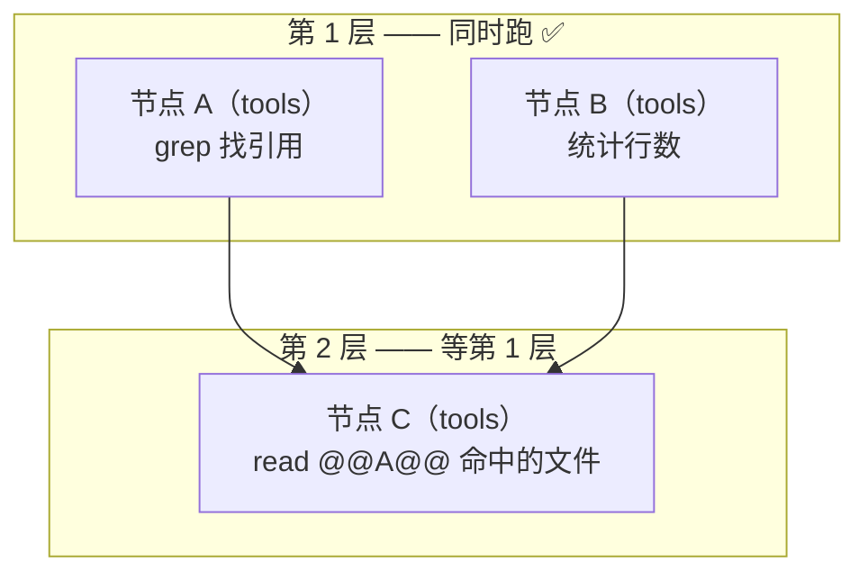

# dsh-refine-loop

**把「想一步、做一步、再看一步」的串行链，换成「每一轮：想图 → 交图 → 跑图 → 判断」。**

---

## 一句话

> 模型不再一步一步地调工具。
> 每一轮它要做的是**画一张图**：这一轮有哪些活、哪些能同时跑、每个节点由什么组成。
> 插件按依赖分层执行这张图 —— **同层并行，跨层串行** —— 把所有结果一起还给模型。
> 然后模型**只看结果做判断**：能回答了，就写结论结束；还不能，就画下一张图。



---

## 每一轮到底发生了什么



**关键点：模型在「判断」这一步**只能做两件事 —— **写结论**，或者**交下一张图**。它不能在这一步继续一个一个地调工具干活。那是图中的活。

---

## 图是什么



| 节点类型 | 里面是什么 | 额外模型调用 | 什么时候用 |
|---|---|---|---|
| **tools** | 一批**事先写死**的调用 | **0** ✅ | 参数现在就能写死的活 |
| **subagent** | 一个从零开始的子代理 | 一份上下文 + 一份报告 | 要靠它自己边看边判断的活 |
| **subagent_fork** | 一个继承本对话的子代理 | 同上（每步重发历史） | 活要用到已经读过/说过的内容 |

- 节点用 `after: ["A"]` 声明依赖；**不依赖任何节点的节点同时跑** ✅
- 下游参数写 `@@A@@`，插件把 A 的整段输出塞进去，并自动算作依赖 ✅
- **子代理之间不能互相依赖** —— 它们是并行分支，依赖另一个子代理的图会被直接拒绝 ✅

---

## 插件强制了什么（这是它区别于「建议」的地方）

提示词写在系统提示词里会被模型当成背景；**插件把三条强制做在机制上**：

| 强制 | 怎么做 | 为什么 |
|---|---|---|
| **每轮开始就想图** ✅ | 每一轮的第 1 步之前，插件把「四步循环」作为**最后一条消息**塞给模型 | 系统提示词在最前面，模型说话前最后读到的才是它真正会照做的东西（实测：改位置没用，改消息有用） |
| **每轮必须交图** ✅ | 一轮结束了却没交图 → 插件把它拽回来（最多 3 次） | 「没有图的一轮」等于用串行链回答了请求 |
| **图跑完只能判断** ✅ | 图跑完之后，模型自己发起的工具调用一律拒绝 | 那是「判断」阶段：要么写结论，要么画下一张图 |
| **派发只能走图** ✅ | harness 自带的 `subagent` / `subagent_fork` 直调被拒绝，并提示改成图里的节点 | 直调会绕过这一轮的图和它的预算 |

> 注意：**规划设计阶段是允许调工具的**。工具调用用来搞清楚「图里的节点该写什么」；不允许的是用工具把活干完、跳过图。

---

## 实测

同一份代码、同一个 profile、同一个模型、同一个任务，只切插件的 `enabled`。
原始记录在 `bench/results/`。

**coverage 场景**（盘点 14 个文件：每个 spec 实测哪个入口、哪些模块没有 spec、最大模块多少行）：

| | 关插件 | 开插件 |
|---|---:|---:|
| 耗时 | 60s | **45s** |
| token | 257k | **171k** |
| 主 agent 步数 | 10 | **6** |
| 图 | — | **3 张**（每轮一张 ✅） |
| 正确性 | 4/5 | 4/5 |

**这一版同一场景的其他几次：**

| 运行 | 耗时 | token | 图 | 编队 | 说明 |
|---|---:|---:|---:|---:|---|
| 最好一次 | 51s | 135k | 2 | 1 | 图跑完后一次直调被拒 → 改交图 |
| 本次 | 45s | 171k | 3 | 1 | 每轮一张图，0 孩子 |
| 派了孩子的 | 137s | 611k | 1 | 3 | 图里放了 2 个子代理 |

> **单次抽样，方差很大。** 图表里放不放子代理、放几个，是模型自己的判断，差别就是几倍。这个插件保证的是「每一轮的形状」，不是「一定更快」。

---

## 改设置

```yaml
- insert:
    - id: refine-loop
      name: '@zyn19940107/dsh-refine-loop'
      config:
        enabled: true                    # 整个插件挂不挂
        maxBatchSize: 8                  # 一张图最多几个节点
        maxBatchTimeoutMs: 900000        # 一张图的时间预算
        maxAgentDepth: 3                 # 最多派到第几层子代理
        agentNodeTimeoutMs: 540000       # 单个子代理节点的预算
        maxRounds: 16                    # 一个请求最多几轮
        respectConcurrencySafety: true   # 认不认工具自己声明的「不能并发」
        concurrentTools: [glob, grep]    # 插件放行的只读工具
        concurrentShell: true            # 只读 shell 命令也可并行
        shellTool: ops_bash
```

| 字段 | 默认 | 说明 |
|---|---|---|
| `maxBatchSize` | `8` | 一张图的节点上限 |
| `maxBatchTimeoutMs` | `900000` | 一张图的时间预算 |
| `maxAgentDepth` | `3` | 子代理还能不能再派子代理 |
| `agentNodeTimeoutMs` | `540000` | 单个子代理节点的预算，超了报这个节点失败，其余结果照常回来 |
| `maxRounds` | `16` | 一个请求最多几轮，用完就停 |
| `respectConcurrencySafety` | `true` | 认不认工具自己声明的独占性 |
| `concurrentTools` | `[glob, grep]` | 纯读工具，随便并行；**写操作永远不要加** |
| `concurrentShell` | `true` | 只读 shell 命令是否并行 |

---

## 并发安全

插件默认认工具自己声明的并发安全性：没声明 `isConcurrencySafe` 的一律独占。

补充判定：`glob` / `grep` 直接放行；shell 命令由插件自己判断 —— 必须是简单命令（无重定向、无管道、无链、无替换），
可执行文件必须在只读白名单里，危险参数（`find -exec`、`grep --pre`、`sort -o` …）单独挡掉。
**判断不了的，排队。** 独占调用是屏障：它前面的先跑完、它自己单独跑、后面的再开始。

---

## 装上

```sh
dsh plugin add /path/to/dsh-refine-loop

# 或打包
pnpm pack
dsh plugin add ./zyn19940107-dsh-refine-loop-0.1.0.tgz
```

装完请开一个新会话 —— 已开着的会话不会刷新模型看到的工具表。

---

## 已知边界

- **不用改 harness 的循环结构**：全部走公开扩展点（`tools/register`、`tools/guard`、`agent/pre-step`、
  `agent/turn-stopping`、`agent/created`、`systemPrompt.section`、`commands/register`）。
- **子代理在前台同步跑**：慢会拖住这一轮，但它有自己的预算（`agentNodeTimeoutMs`）。
- **图里的调用参数可能写错**：图是在跑之前写的，所以调用失败时插件会问模型一次「这条调用应该是什么」，
  用修好的参数重跑那一条（最多两次），其余节点不受影响。
- **图的结果可能装不下**：被截掉的部分在 spill 文件里，下一张图可以读回来。
- **占位符是 `@@节点名@@`**，不是 `{{节点名}}` —— harness 的提示词渲染器把双花括号当变量引用。
- **每轮的「想图」消息会增加 token**：一轮一条消息，换来的是每一轮都有图。

## License

MIT
