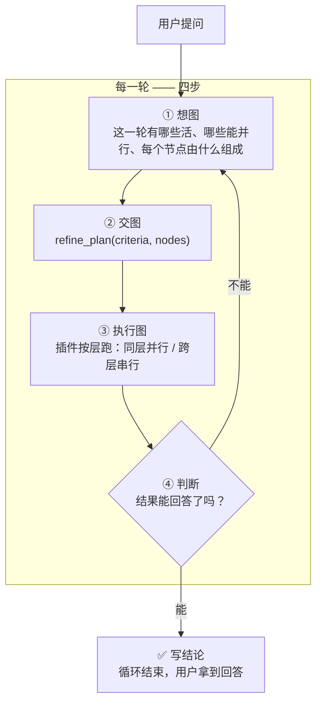
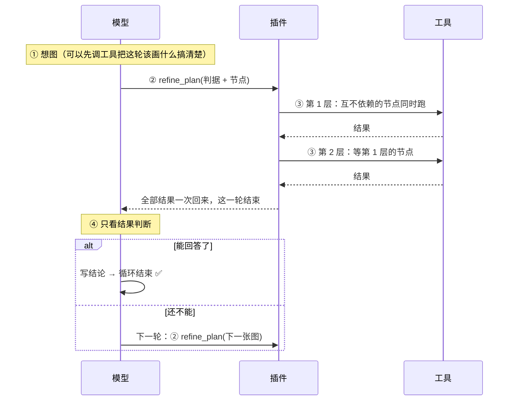
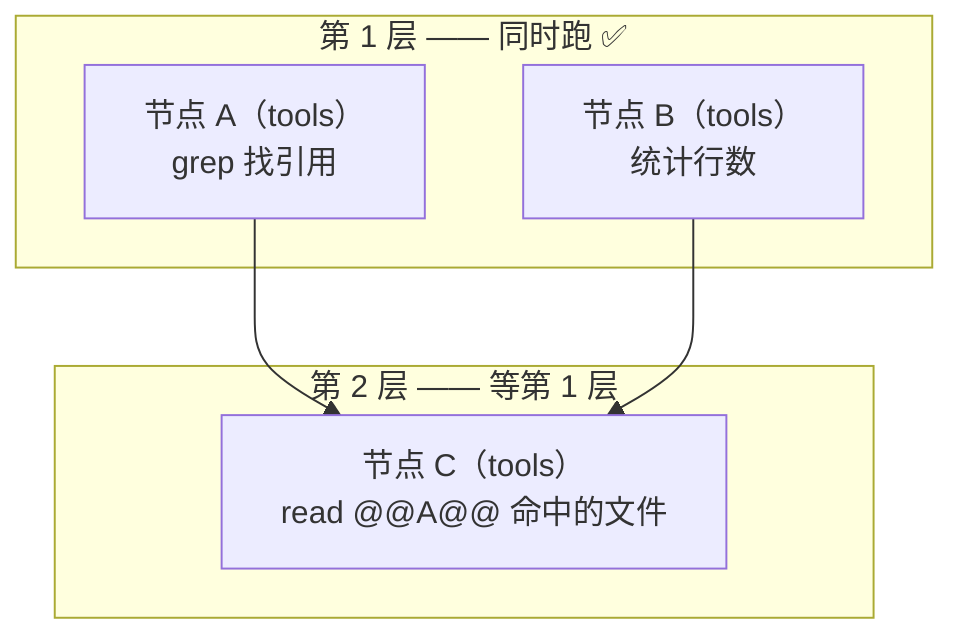
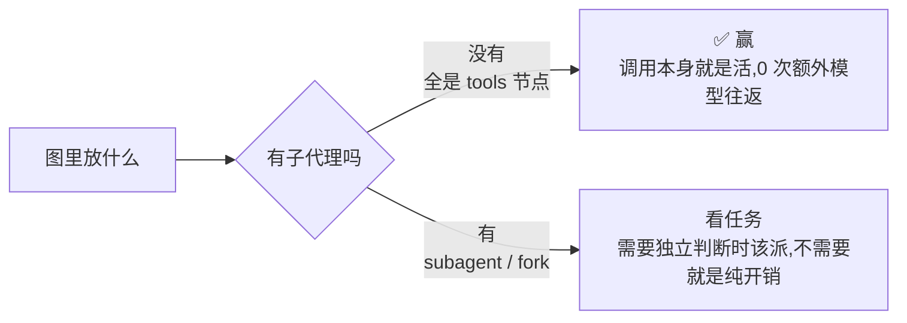

# dsh-refine-loop

**把「想一步、做一步、再看一步」的串行链，换成「每一轮：想图 → 交图 → 跑图 → 判断」。**

---

## 一句话

> 模型不再一步一步地调工具。
> 每一轮它要做的是**画一张图**：这一轮有哪些活、哪些能同时跑、每个节点由什么组成。
> 插件按依赖分层执行这张图 —— **同层并行，跨层串行** —— 把所有结果一起还给模型。
> 然后模型**只看结果做判断**：能回答了，就写结论结束；还不能，就画下一张图。



---

## 每一轮到底发生了什么



**关键点：模型在「判断」这一步**只能做两件事 —— **写结论**，或者**交下一张图**。它不能在这一步继续一个一个地调工具干活。那是图中的活。

---

## 图是什么



| 节点类型 | 里面是什么 | 额外模型调用 | 什么时候用 |
|---|---|---|---|
| **tools** | 一批**事先写死**的调用 | **0** ✅ | 参数现在就能写死的活 |
| **subagent** | 一个从零开始的子代理 | 一份上下文 + 一份报告 | 要靠它自己边看边判断的活 |
| **subagent_fork** | 一个继承本对话的子代理 | 同上（每步重发历史） | 活要用到已经读过/说过的内容 |

- 节点用 `after: ["A"]` 声明依赖；**不依赖任何节点的节点同时跑** ✅
- 下游参数写 `@@A@@`，插件把 A 的整段输出塞进去，并自动算作依赖 ✅
- **子代理之间不能互相依赖** —— 它们是并行分支，依赖另一个子代理的图会被直接拒绝 ✅

---

## 插件强制了什么（这是它区别于「建议」的地方）

提示词写在系统提示词里会被模型当成背景；**插件把三条强制做在机制上**：

| 强制 | 怎么做 | 为什么 |
|---|---|---|
| **每轮开始就想图** ✅ | 每一轮的第 1 步之前，插件把「四步循环」作为**最后一条消息**塞给模型 | 系统提示词在最前面，模型说话前最后读到的才是它真正会照做的东西（实测：改位置没用，改消息有用） |
| **每轮必须交图** ✅ | 一轮结束了却没交图 → 插件把它拽回来（最多 3 次） | 「没有图的一轮」等于用串行链回答了请求 |
| **图跑完只能判断** ✅ | 图跑完之后，模型自己发起的工具调用一律拒绝 | 那是「判断」阶段：要么写结论，要么画下一张图 |
| **派发只能走图** ✅ | harness 自带的 `subagent` / `subagent_fork` 直调被拒绝，并提示改成图里的节点 | 直调会绕过这一轮的图和它的预算 |

> 注意：**规划设计阶段是允许调工具的**。工具调用用来搞清楚「图里的节点该写什么」；不允许的是用工具把活干完、跳过图。

---

## 实测

同一份代码、同一个 profile、同一个模型、同一个任务，只切插件的 `enabled`。
原始记录在 `bench/results/`。**每个场景单次抽样 —— 方差很大，看趋势，不要看小数。**

**profile 只有 harness + 被测插件**（`dsh-sandbox/home/profiles/bench`）。这一点是
硬要求：沙盒里如果还装着别的会注册「派发」工具的插件，被测模型会拿到两套互相竞争的
指令，测出来的就是那个插件的行为，不是这个插件的。

### 时间、步数与编队

| 场景 | 条件 | 耗时 | 主步 | 编队 | 编队步 |
|---|---|---:|---:|---:|---:|
| fanout（5 个文件各读第一行） | off | **12s** | 3 | 1 | 3 |
| fanout | **on** | 16s | **2** ✅ | 1 | **2** ✅ |
| sweep（跨文件扫一个模式） | off | 197s | 10 | 1 | 10 |
| sweep | **on** | **133s** ✅ | **7** ✅ | 1 | **7** ✅ |
| coverage（spec↔模块覆盖盘点） | off | 60s | 13 | 1 | 13 |
| coverage | **on** | **56s** ✅ | **4** ✅ | 1 | **4** ✅ |
| review（评审 5 个文件） | off | 211s | 31 | 1 | 31 |
| review | **on** | **153s** ✅ | **11** ✅ | 1 | **11** ✅ |
| coveragewide（14 个文件全读一遍） | off | **73s** | 11 | 1 | 11 |
| coveragewide | **on** | 99s | **6** ✅ | 1 | **6** ✅ |
| panel（三方独立评审，必须互相看不见） | off | **1235s** | 76 | 4 | 273 |
| panel | **on** | 1326s | **18** ✅ | 6 | **214** ✅ |
| **greenspecs（长程修复：跑→看红→改→再跑，直到全绿）** | off | **82s** ❌ | 18 ❌ | 1 | 18 ❌ |
| **greenspecs** | **on** | 299s | 33 | 1 | 33 |

### token 拆开看

| 场景 | 条件 | 输入 | 缓存输入 | 输出 | 合计 |
|---|---|---:|---:|---:|---:|
| fanout | off | 13k | 20k | 1k | 34k |
| fanout | **on** | 14k | **11k** ✅ | 1k | **27k** ✅ |
| sweep | off | 75k | 354k | 4k | 433k |
| sweep | **on** | 86k | **221k** ✅ | 10k | **317k** ✅ |
| coverage | off | 29k | 248k | 4k | 281k |
| coverage | **on** | 38k | **59k** ✅ | 5k | **103k** ✅ |
| review | off | 74k | 1,427k | 17k | 1,518k |
| review | **on** | 77k | **542k** ✅ | 17k | **636k** ✅ |
| coveragewide | off | 56k | 391k | 7k | 454k |
| coveragewide | **on** | 53k | **108k** ✅ | 10k | **171k** ✅ |
| panel | off | 762k | 31,827k | 222k | 32,812k |
| panel | **on** | 779k | **21,923k** ✅ | 218k | **22,919k** ✅ |
| greenspecs | off | 55k | 660k | 8k | 723k |
| greenspecs | **on** | 123k | 2,060k | 42k | 2,225k |

（`合计` = 输入 + 缓存输入 + 输出。**其中 90% 以上是缓存输入** —— 每一步把变长的
对话重新发一遍，不是新读进来的内容。真正的新输入和输出，on 和 off 几乎一样。）

### 结论

| 指标 | 结果 |
|---|---|
| **缓存输入（最多的一栏）** | **6/6 场景全降** ✅（−31% ~ −76%） |
| **主 agent 步数** | **6/6 全降** ✅ |
| **新输入 / 输出** | 基本持平 ✅（on 略高，是做规划本身的那点开销） |
| **正确性** | 12/13 持平 ✅（只有 `greenspecs` 不同：off 0/1 → on 1/1） |
| **耗时** | 3 个降 ✅（sweep −32%、coverage −7%、review −27%），3 个升或平（fanout +4s、coveragewide +26s、panel +91s） |
| **`greenspecs` 的正确性** | **off 0/1 ❌ → on 1/1 ✅**（唯一一个「任务能不能做成」出现差别的场景） |

原因很直接：一份材料读一次、理解一次、判一次，比「读一点→想一点→再读一点」省 token，
但每轮多一次图的往返。**缓存输入省下来的量等于「少走的步数 × 每步的上下文」**，
任务越大越明显；任务小的时候，这层固定开销会盖过省下来的那点。

> **注意「合计 token」不是「花的钱」。** 缓存输入的价格通常只有新输入的十分之一左右，
> 而输出最贵。按上面的数粗算，review 的真实成本大约降 25%，panel 大约降 20% ——
> 比「合计降 30%~60%」要小，但仍然是真的降。

### 赢和输的分界线



**`tools` 节点是插件最省的形状**：图的节点就是那批调用，结果一次性回来，判断只发生一次。

### 长程任务：插件唯一把「做不成」变成「做成」的场景

`greenspecs` 借的是长程基准的形状 —— [Long-Horizon-Terminal-Bench](https://zli12321.github.io/LHTB/)
把这类任务定义成「跑 → 量 → 调 → 再跑」的反馈循环，瓶颈不是单步能力，而是**能不能坚持到收敛**。
这里把它落到本仓库：一份源码副本里植入 2 个 bug，specs 有 4 个检查红，要求只改 `src/`、不许改
`verify/`、跑到 `all checks passed`。

| | off | on |
|---|---|---|
| 耗时 | **82s** | 299s |
| 主步 | 18 | 33 |
| 结果 | **❌ 提前收工，specs 仍然红** | **✅ all checks passed** |

**off 在第 18 步就收工了**，改了点东西但没让 specs 变绿。**on 被「交图 → 看结果 → 判断能不能给结论」
按在循环里**，一直跑到验证器说全绿。

代价是 3.6 倍时间和 3 倍 token —— 这是唯一一个「多花时间换正确性」的场景，也是插件最该被用的场景。

**`subagent` / `subagent_fork` 只在一种任务上划算：需要多个互相看不见的判断**（`panel`）。
同一个 agent 读两遍同一份代码，第二遍会被第一遍的结论污染 —— 要独立性只能开新上下文。
这也解释了 `panel` 的两种条件：**关插件时 harness 自己也在派 4 个子代理**，开插件只是把
主 agent 的 76 步压到 18 步，正好是插件声称的那件事。

> **单片抽样，方差很大。** 图里放不放子代理、放几个，是模型自己的判断，差别就是几倍。
> 这个插件保证的是「每一轮的形状」，不是「一定更快」。

---

## 公开评测集上的 A/B（HumanEval / QuixBugs）

上面那些场景是手工设计的：题目按插件的形状挑，判据是「答案里有没有这几个字」。
这一节把两件事都换成真的 —— **题目来自公开评测集，判据是跑出来的**。

### 两个沙盒

| profile | bundles | 用途 |
|---|---|---|
| `bench-off` | `dsh-base` + `dsh-headless` | 不带插件 |
| `bench-on` | 同上 + `@zyn19940107/dsh-refine-loop` | 带插件 |

两个 profile 只差一个 bundle —— 这是「带插件 / 不带插件」唯一可测的差别。
`bench-on` 里的插件是**没被改过的原版**，只配了部署参数：`enabled: true`、
`shellTool: pwsh`（基准 profile 里实际的 shell 工具叫 `pwsh`；插件默认写的是 dsh-ops 的
`ops_bash`，不改这一项的话它的只读-shell 规则是空的，每次 shell 调用都独占）。

```sh
node bench/setup-profiles.mjs                  # 建这两个沙盒
node bench/probe-judge.mjs humeval quixbugs    # 先证明判据是对的
node bench/compare.mjs 3 humeval quixbugs      # 跑 A/B（顺序跑，不并行）
node bench/pubeval-table.mjs                   # 出表
```

### 样例从哪来

| 评测集 | 出处 | 取的题 | 判据 |
|---|---|---|---|
| HumanEval | [openai/human-eval](https://github.com/openai/human-eval) | 5 道原题（prompt 与 test 都是数据集原文） | 跑数据集自己的 `check()` |
| QuixBugs | [jkoppel/QuixBugs](https://github.com/jkoppel/QuixBugs)（MIT） | 4 个程序里的 bug | 跑数据集自己的用例 + 3 条留出用例 |

题面和用例**逐字** vendored 在 `bench/data/`（带 sha256），判据脚本从 vendored 副本读，
不从工作区读 —— 改测试不算通过；工作区里的 `check.py` 被指纹记录，改了就判失败。
QuixBugs 的用例本来就是公开的、agent 看得见，所以判据里另外加了 **3 条留出用例**
（留出用例先跟数据集自己的正确程序对过才拿来用），专治「按可见用例硬编码」。

判据本身要先证明是对的：`bench/probe-judge.mjs` 拿一份正确答案、一份错误答案、
一份被改过的判据各跑一遍 —— 正确 5/5、错误 0/5、改判据被抓，三项都过才开始跑模型。

### 结果

#### humeval（5 道互不依赖的实现题）

| 指标 | 关掉插件 | 开着插件 | 变化 |
|---|---:|---:|---:|
| 总耗时(秒) | 164s | 69s | **-58%** |
| 整个编队的 token | 216k | 79k | **-63%** |
| ├ input | 30k | 23k | -22% |
| ├ cacheRead | 186k | 40k | **-79%** |
| └ output | 16k | 14k | -9% |
| 主 agent 的 context（最后一次请求的 prompt） | 30k | 30k | +0% |
| 主 agent 的往返步数 | 10 | 4 | **-60%** |
| 编队步数 | 10 | 4 | -60% |
| 编队人数 | 1 人 | 1 人 | 0% |
| 正确性（通过的判据） | 5/5 | 5/5 | — |

```
 off 1: 81.5s agents=1 tokens=195626 mainCtx=29551 correct=5/5 plan=n
 off 2: 164.1s agents=1 tokens=527582 mainCtx=36090 correct=5/5 plan=n
 off 3: 327.3s agents=1 tokens=215842 mainCtx=26838 correct=5/5 plan=n
 on  1: 111.6s agents=1 tokens=82987 mainCtx=29646 correct=5/5 plan=y
 on  2: 69.0s agents=1 tokens=79084 mainCtx=35233 correct=5/5 plan=y
 on  3: 48.9s agents=1 tokens=73660 mainCtx=24651 correct=5/5 plan=y
```

#### quixbugs（4 个要跑用例才定位的 bug）

| 指标 | 关掉插件 | 开着插件 | 变化 |
|---|---:|---:|---:|
| 总耗时(秒) | 91s | 299s | **+229%** |
| 整个编队的 token | 198k | 191k | -4% |
| ├ input | 15k | 15k | -2% |
| ├ cacheRead | 164k | 153k | -6% |
| └ output | 7014 | 23k | **+225%** |
| 主 agent 的 context（最后一次请求的 prompt） | 24k | 46k | **+87%** |
| 主 agent 的往返步数 | 10 | 7 | -30% |
| 编队步数 | 10 | 7 | -30% |
| 编队人数 | 1 人 | 1 人 | 0% |
| 正确性（通过的判据） | 4/4 | 4/4 | — |

```
 off 1: 90.7s agents=1 tokens=198165 mainCtx=24494 correct=4/4 plan=n
 off 2: 97.9s agents=1 tokens=243519 mainCtx=24566 correct=4/4 plan=n
 off 3: 47.7s agents=1 tokens=179778 mainCtx=21517 correct=4/4 plan=n
 on  1: 298.5s agents=1 tokens=271461 mainCtx=45690 correct=4/4 plan=y
 on  2: 311.6s agents=1 tokens=190861 mainCtx=46604 correct=4/4 plan=y
 on  3: 166.8s agents=1 tokens=132783 mainCtx=34359 correct=4/4 plan=y
```

### 读数

**能事先列全的活，插件省；要跑一遍才知道下一步的活，插件亏。**

- **`humeval`（5 道互不依赖的实现题）**：开着插件**耗时 -58%、总 token -63%、
  缓存输入 -79%、往返步数 -60%**，正确性两边都 5/5。省下来的是缓存输入 —— 少走几步，
  每一步就不用把变长的历史重发一遍；思考量中位数也从 22.6k 字符降到 8.6k。
  主 agent 的 context 没变（30k → 30k）：五个实现的结果最后还是要回到主上下文里，
  这一步省不掉。
- **`quixbugs`（4 个要跑用例才定位的 bug）**：开着插件**耗时 +229%、输出 token +225%、
  主 context +87%**，总 token 只降 4%，正确性两边都 4/4。原因是形状：修 bug 的下一步
  取决于上一步跑出来的输出，所以每一轮都要重新画一张图 —— 开插件的 3 次里
  `refine_plan` 调了 5/2/2 次，思考量中位数从 11.7k 字符涨到 14.2k。
  插件「一轮一图」的纪律在这种形状上，把省下的又花回去了。

**编队人数两个场景都是 1**：模型自己选的节点全是 `tools` 节点，一次也没派子代理。
插件给的「派发」能力在这两个任务上没被用上，所以这里的「编队」测的是**要不要分叉**，
不是分叉之后省了多少。

**正确性两次都没变**：12 次运行（2 场景 × 2 臂 × 3 次）全对。插件改的是代价，
不是能不能做成。

> **单次抽样，方差很大。** `humeval` 关掉插件那三次是 81.5s / 164.1s / 327.3s ——
> 看趋势，不要看小数。每场的原始记录在 `bench/results/`，表是 `bench/pubeval-table.mjs`
> 生成的，不是手打的。

---

## 改设置

```yaml
- insert:
    - id: refine-loop
      name: '@zyn19940107/dsh-refine-loop'
      config:
        enabled: true                    # 整个插件挂不挂
        maxBatchSize: 8                  # 一张图最多几个节点
        maxBatchTimeoutMs: 900000        # 一张图的时间预算
        maxAgentDepth: 3                 # 最多派到第几层子代理
        agentNodeTimeoutMs: 540000       # 单个子代理节点的预算
        maxRounds: 16                    # 一个请求最多几轮
        respectConcurrencySafety: true   # 认不认工具自己声明的「不能并发」
        concurrentTools: [glob, grep]    # 插件放行的只读工具
        concurrentShell: true            # 只读 shell 命令也可并行
        shellTool: ops_bash
```

| 字段 | 默认 | 说明 |
|---|---|---|
| `maxBatchSize` | `8` | 一张图的节点上限 |
| `maxBatchTimeoutMs` | `900000` | 一张图的时间预算 |
| `maxAgentDepth` | `3` | 子代理还能不能再派子代理。**harness 自己有 `subagent.maxDepth`（默认 1）**，两边都放行才真的能派下一层 |
| `agentNodeTimeoutMs` | `540000` | 单个子代理节点的预算，超了报这个节点失败，其余结果照常回来 |
| `maxRounds` | `16` | 一个请求最多几轮，用完就停 |
| `respectConcurrencySafety` | `true` | 认不认工具自己声明的独占性 |
| `concurrentTools` | `[glob, grep]` | 纯读工具，随便并行；**写操作永远不要加** |
| `concurrentShell` | `true` | 只读 shell 命令是否并行 |

---

## 并发安全

插件默认认工具自己声明的并发安全性：没声明 `isConcurrencySafe` 的一律独占。

补充判定：`glob` / `grep` 直接放行；shell 命令由插件自己判断 —— 必须是简单命令（无重定向、无管道、无链、无替换），
可执行文件必须在只读白名单里，危险参数（`find -exec`、`grep --pre`、`sort -o` …）单独挡掉。
**判断不了的，排队。** 独占调用是屏障：它前面的先跑完、它自己单独跑、后面的再开始。

---

## 装上

```sh
dsh plugin add /path/to/dsh-refine-loop

# 或打包
pnpm pack
dsh plugin add ./zyn19940107-dsh-refine-loop-0.1.0.tgz
```

装完请开一个新会话 —— 已开着的会话不会刷新模型看到的工具表。

---

## 已知边界

- **不用改 harness 的循环结构**：全部走公开扩展点（`tools/register`、`tools/guard`、`agent/pre-step`、
  `agent/turn-stopping`、`agent/created`、`systemPrompt.section`、`commands/register`）。
- **子代理在前台同步跑**：慢会拖住这一轮，但它有自己的预算（`agentNodeTimeoutMs`）。
- **图里的调用参数可能写错**：图是在跑之前写的，所以调用失败时插件会问模型一次「这条调用应该是什么」，
  用修好的参数重跑那一条（最多两次），其余节点不受影响。
- **图的结果可能装不下**：被截掉的部分在 spill 文件里，下一张图可以读回来。
- **占位符是 `@@节点名@@`**，不是 `{{节点名}}` —— harness 的提示词渲染器把双花括号当变量引用。
- **每轮的「想图」消息会增加 token**：一轮一条消息，换来的是每一轮都有图。

## License

MIT
