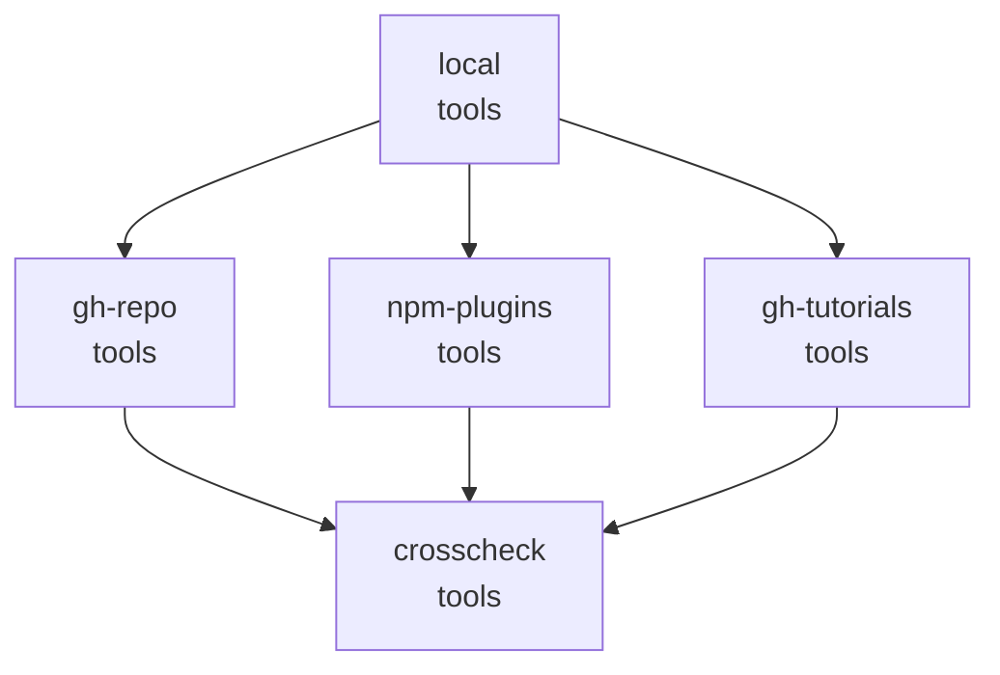

# dsh-refine-loop

给 DeepSeek Harness 用的插件：**把「想 → 做 → 看 → 再想」的串行链，换成「规划一次 → 跑完 → 一次性收 N 个结论」。**

---

## 你在跟一条每步都重新思考的链干活

Agent loop 是个链。每一轮都是一次完整的模型往返：

```
规划 → 做一件 → 看结果 → 再规划 → 再做一件 → 看结果 → …
```

问题不在每一步，而在三件事叠在一起：

1. **每一步都重新规划。** 做第 5 件事的时候，第 1~4 件的结论已经躺在上下文里了，模型却要重新读一遍、重新想一遍「第 5 件该怎么做」。
2. **每一步都是一次往返。** 一次往返 ≈ 一次完整模型调用。5 件独立的事，就是 5 次往返。
3. **每一步都在为前面的历史付钱。** 上下文只涨不缩，第 N 步要重读前 N-1 步留下的全部内容。

这个插件提供另一种形状：**模型不自己调工具** —— 它要做的每一件事都得先画成一张图，
由图去跑，图里能并行的就并行。模型自己决定这一步是画图还是写结论：
画图，图执行完，循环继续；写结论，整个循环结束。

而且**在能强制的地方强制**：模型直接调工具会被拒绝，直到它把活交成一张图。

---

## 对比：开插件 vs 不开插件

同一个二进制、同一份 profile、同一个模型、同一个任务 —— 只差插件自己的 `enabled` 开关。
每个任务每组 3 次，**串行**跑（并行跑测出来的是 provider 的争用，不是插件），取中位数。

三个任务，三种形状：

| 任务 | 形状 |
|---|---|
| `survey` | 五件互不依赖的查找 + 一次评价 |
| `chain` | 三步，每一步都要用上一步的结果 |
| `review` | 三个部分各自独立审查 + 一次汇总 |

### survey

| 指标 | 关掉插件 | 开着插件 | 变化 |
|---|---:|---:|---:|
| 总耗时 | 71s | **48s** | **−32%** |
| 总 token（整个编队） | 138,512 | **73,561** | **−47%** |
| ├ input | 17,286 | 22,134 | +28% |
| ├ cacheRead | 117,248 | 45,086 | **−62%** |
| └ output | 5,946 | 6,485 | +9% |
| 主 agent 的 context | 32,251 | 33,401 | +4% |
| 编队人数 | 1 人 | 1 人 | 0% |
| **主 agent 的往返步数** | 7 | **3** | **−57%** |
| **编队总步数** | 7 | **3** | **−57%** |
| 正确性（命中判据） | 6/6 | 6/6 | 持平 |

### chain

| 指标 | 关掉插件 | 开着插件 | 变化 |
|---|---:|---:|---:|
| 总耗时 | 31s | 110s | +257% |
| 总 token（整个编队） | 91,761 | 211,942 | +131% |
| ├ input | 14,972 | 69,183 | +362% |
| ├ cacheRead | 74,496 | 127,427 | +71% |
| └ output | 2,293 | 13,895 | +506% |
| 主 agent 的 context | 24,420 | 23,200 | −5% |
| 编队人数 | 1 人 | 3 人 | +200% |
| **主 agent 的往返步数** | 5 | **3** | **−40%** |
| 编队总步数 | 5 | 10 | +100% |
| 正确性（命中判据） | 4/4 | 4/4 | 持平 |

### review

| 指标 | 关掉插件 | 开着插件 | 变化 |
|---|---:|---:|---:|
| 总耗时 | 71s | 127s | +79% |
| 总 token（整个编队） | 187,875 | 466,050 | +148% |
| ├ input | 28,624 | 115,161 | +302% |
| ├ cacheRead | 151,552 | 305,160 | +101% |
| └ output | 7,699 | 29,633 | +285% |
| 主 agent 的 context | 42,345 | **33,169** | **−22%** |
| 编队人数 | 1 人 | 4 人 | +300% |
| **主 agent 的往返步数** | 6 | **4** | **−33%** |
| 编队总步数 | 6 | 16 | +167% |
| 正确性（命中判据） | 4/4 | 4/4 | 持平 |

**这些数是怎么来的**

- **总耗时** = 从 **DSH 进程启动前**到**进程退出**的墙钟时间 —— 含启动(加载插件、连模型服务)和退出。
  想看不含这段的数,量会话日志的跨度就行:这一批里两者相差约 1.4 秒。
- **总 token** = **整个编队**的 token：主会话加上它派生出的每一个子会话的 `input + cacheRead + output`。
  子代理有自己的会话日志，它的用量**不在**主会话的 `--json` 投影里 —— 只数投影等于漏账。
  这个合计和 harness 自己的投影缓存 `tokenUsage.totals` 逐项相等，两条独立算出来的路给出同一个数。
- **主 agent 的 context** = 主会话最后一次请求读到的全部 token（`input + cacheRead`），
  也就是它最后一轮背着多少上下文。这个数和 harness 的 `contextPressure.pressureTokens` 相等。
- **编队人数** = 这一轮派生出的会话数（主会话 + 子代理）。
- **主 agent 的往返步数** = 主会话自己的模型往返次数。**编队总步数**再加上每个子代理的。
- **正确性** = 任务要回答的事实有没有全部出现在最终回答里。判据是机械的，不是「读起来不错」。

### 结论要照实说

**插件改的是形状，不是账本。**

| | 关掉插件 | 开着插件 |
|---|---|---|
| 主 agent 的这一轮 | 一件事一件事做，N 步 | **3 步**：交图 → 跑图 → 写结论 |
| 整个编队的中位步数 | 5 步 | **3 步** |
| 主 agent 的 context 中位数 | 24,420 | **23,200** |
| 派生出编队的运行 | 1 / 9 | **6 / 9** |
| 正确性 | 42 / 42 | **42 / 42** |

**看得见的效果是步数：主 agent 从 7/5/6 步变成 3/3/4 步，整个编队的中位步数从 5 变成 3。**
每一轮都是一张图 —— ①接收上下文、形成并行的流程图 ②执行流程图。

**上下文没有变大（+4% / −5% / −22%）** —— 图的结果一次性回来，
主 agent 不用每一步都背着越来越长的历史重读一遍。

**token 和耗时看图里放了什么：**

- **survey（图里全是工具调用）**：耗时 −32%、token −47%。一次往返换掉七次。
- **chain / review（图里放了代理节点）**：整队 token +131% / +148%，耗时 +257% / +79% ——
  子代理要从零读一遍，父会话要等它回来。

**所以这个插件不做「让每一轮更省」。它做的是把这一轮怎么切、先做哪件、哪件值得派出去，
交回给模型在动手前决定 —— 省不省，取决于模型决定切多大。**

### 每一次运行

一次运行就是一次抽样，模型的行为方差很大 —— 所以把每一次都列出来：

```
survey  off 1: 71.3s agents=1 tokens=296001 mainCtx=39021 correct=6/6 plan=n/0
survey  off 2: 48.0s agents=1 tokens=138512 mainCtx=28537 correct=6/6 plan=n/0
survey  off 3: 82.0s agents=1 tokens=134126 mainCtx=32251 correct=6/6 plan=n/0
survey  on  1: 48.2s agents=1 tokens= 98045 mainCtx=33401 correct=6/6 plan=y/0
survey  on  2: 48.0s agents=1 tokens= 64059 mainCtx=24325 correct=6/6 plan=y/0
survey  on  3: 64.7s agents=1 tokens= 73561 mainCtx=33793 correct=6/6 plan=y/0
chain   off 1: 59.7s agents=1 tokens= 78142 mainCtx=19377 correct=4/4 plan=n/0
chain   off 2: 24.9s agents=1 tokens= 91761 mainCtx=24420 correct=4/4 plan=n/0
chain   off 3: 30.8s agents=1 tokens=161221 mainCtx=26599 correct=4/4 plan=n/0
chain   on  1: 90.3s agents=3 tokens=211942 mainCtx=26579 correct=4/4 plan=y/2
chain   on  2:110.1s agents=3 tokens=156207 mainCtx=23200 correct=4/4 plan=y/2
chain   on  3:114.5s agents=3 tokens=234615 mainCtx=21969 correct=4/4 plan=y/2
review  off 1:272.6s agents=4 tokens=5233281 mainCtx=85729 correct=4/4 plan=n/0
review  off 2: 59.8s agents=1 tokens=125279 mainCtx=36942 correct=4/4 plan=n/0
review  off 3: 71.1s agents=1 tokens=187875 mainCtx=42345 correct=4/4 plan=n/0
review  on  1:133.4s agents=5 tokens=491432 mainCtx=31190 correct=4/4 plan=y/4
review  on  2: 96.5s agents=2 tokens=168668 mainCtx=37530 correct=4/4 plan=y/1
review  on  3:127.3s agents=4 tokens=466050 mainCtx=33169 correct=4/4 plan=y/3
```

`plan` = 第一个工具调用是不是 `refine_plan`；`plan=y/3` = 是，而且计划里有 3 个代理节点。
**十八次运行，正确性全部拿满。** 最贵的一次是 `review off 1`（关着插件，模型自己派了 4 个 agent，523 万 token）——
**插件开着的时候没有一次比这更贵。**

**开着插件时主会话长什么样**（`review on 1` 的真实轨迹）：

```
步1  glob **/*                      ← 被拒:这一轮的第一个调用必须是图
     read src/plan.ts               ← 被拒:同一句
步2  refine_plan                    ← 图跑完:src(tools:4) + plan(subagent) + gate(subagent) + tool(subagent)
步3  refine_plan                    ← 被拒:这一轮已经交过图了
步4  (写结论)                        ← 这一轮结束
```

**主会话只有 4 步，一张图。** 步数账里那 16 步是子代理自己走的。

复现：`pnpm bench`；原始记录在 `bench/results/`，任务和判据在 `bench/task.mjs`，
会话树的读法在 `bench/sessions.mjs`。
基准要一个**自己的** DSH home（别跟正在用的那个共用 profile）：
`DSH_SANDBOX_HOME=<你的隔离 DSH_HOME> DSH_BENCH_CWD=<任务要读的目录> pnpm bench`。

---

## 开了插件之后，流程图长什么样

模型在**思考里**先把这一轮的形状说出来，再把它交给 `refine_plan` 落成机器可执行的图：


这是那次跑出来的真实计划（完整 JSON 在 [`docs/example-plan.json`](docs/example-plan.json)）：



| 节点 | 类型 | 依赖 | 干什么 |
|---|---|---|---|
| `local` | `tools` | — | 读本地安装，补准确的包名（5 个调用） |
| `gh-repo` | `tools` | `local` | 查 GitHub 上的官方仓库（4 个调用） |
| `npm-plugins` | `tools` | `local` | 查 npm 上的 DSH 插件包（4 个调用） |
| `gh-tutorials` | `tools` | `local` | 查 GitHub 上的教程文章（5 个调用） |
| `crosscheck` | `tools` | 上面三条 | 交叉核对三份调查（2 个调用） |

**三层**：第一层读本地，第二层三条线上调查并行，第三层等齐了交叉核对。

**节点类型是模型自己选的**，判据只有一条：**这个孩子需不需要知道我们刚才说了什么。**
三个调查各自独立、不需要本对话的上下文 → `subagent`；汇总要用到前面三条的结果 → `subagent_fork`。
上面这张图里全是 `tools` 节点 —— 这一次模型判断这些活自己跑更合适，就没派孩子。
**派不派、派几个，是模型的判断，不是插件的规定**：同一批任务换个形状，模型就画出了带 4 个代理节点的图（见下一节）。

---

## 开了插件之后，编队长什么样

**编队多大，取决于模型在图里放不放代理节点。** 同一套插件，上面那张图里模型全用了工具调用，
一个孩子都没派 —— 那一轮就没有编队。换个形状，模型画出了 4 个代理节点，编队就出现了：


图里能直接读出来：谁派生了谁、每个子代理烧了多少上下文（`review-tool` 49.0k，`review-plan` 45.4k）、
跑了多久、走了几步、上下文压力百分之多少。

**主 Agent 自己只走了 4 步** —— 一张图，四条并行的代理节点，加一句汇总。

---

## 插件做了三件事

### 一、`refine_plan`：一次调用带一整张流程图

模型在一个调用里给出**这一轮的全部形状**：

- **判据**（`criteria`）—— 这一轮怎么算成功，每一条都是能对着结果核对的东西
- **节点**（`nodes`）—— 这一轮由哪些节点组成

节点有三种：

| 节点 | 是什么 |
|---|---|
| `tools` | 若干个调用。互相能并发的并发跑，不能并发的排队跑 |
| `subagent` | 一个自包含的任务，交给一个**从零开始**的子代理 |
| `subagent_fork` | 一个任务，交给一个**继承本对话**的子代理 |

**模型自己决定用哪个:**

- **`subagent`** —— 任务**不需要本对话的任何东西**。查一个话题、审一份文件、做一件自成一体的事。
- **`subagent_fork`** —— 任务**要建立在本对话已经说过的内容上**。接着刚才的结论往下分析、对这一轮做个复盘。

判据就一条：**这个孩子需不需要知道我们刚才说了什么。**

节点还能用 `after` 声明**依赖**：

```json
{
  "criteria": ["四个文件都读到了", "peerDependencies 齐了"],
  "nodes": [
    { "id": "scan", "kind": "tools",
      "calls": [
        { "name": "glob", "arguments": { "path": "src", "pattern": "**/*" } },
        { "name": "grep", "arguments": { "path": "src", "pattern": "isConcurrencySafe" } }
      ] },
    { "id": "judge", "kind": "subagent_fork", "after": ["scan"],
      "task": "根据上面读到的内容，判断这个插件的架构是否合理" }
  ]
}
```

执行时：

- **没有依赖的节点一起跑**（`scan` 里的两个调用也一起跑）
- **下一层等上一层**（`judge` 等 `scan`）
- **依赖节点的输出会进到下一个节点**：子代理的 prompt 里会附上前置节点的产出；工具调用的参数里，恰好等于 `@@节点名@@` 的那个字符串会被换成该节点的输出
- **`@@节点名@@` 同时也是一条依赖边**：引用了谁的输出，就得等谁先跑完。引用一个不存在的节点，计划直接报错；**绝不会把字面量 `@@节点名@@` 原样传进工具**
- **所有结果在同一个工具结果里回来** —— 模型下一轮一次就能写完全部结论

> 子代理是**前台**跑的（`run_in_background: false`）：它的结论会回到这个工具结果里，而不是留一个句柄让你以后去收。

### 二、模型不自己调工具

只提供工具，模型会**先埋头干活，再想起来画图** —— 实测中它常常到第 7 步左右才把计划交出来，
前 6 步全是一件事一件事做。那正是这个插件要消灭的形状。

所以规则只有一条：**模型自己不许调工具** —— 它要做的每一件事都得写进图里，由图去跑。

模型每一步自己决定：

```
画图   → 图执行,结果一起回来 → 循环继续,模型再决定
写结论 → 整个循环结束(harness 自己结束这一轮)
```

第一步也可以是结论 —— 闸门只看工具调用，看不到文字，所以它本来就不管这个。

- 模型的工具调用如果**不是** `refine_plan`，它会被拒绝，并被告知：要么画图，要么写结论
- **计划自己发起的调用不受这条约束** —— 那张图里的节点就是它该做的事
- **图之后模型做什么，规则不管** —— 画第二张图也行，写结论也行
- **子代理也吃这一条** —— 它每一轮的工具调用也得在图里。实测差别很大：同一个审查任务,
  子代理从 23/32/12 步降到 4/4/4 步（每个子代理自己画一张图，6 个文件一次读完），
  整轮墙钟 346 秒 → 169 秒
- **规则会放手**：连着拽还不听，就不再拦了。困住模型的规则比被无视的规则更糟

实测一轮的形状（headless 跑同一个任务）：

```
步1  glob          ← 被拒:模型不自己调工具
步2  refine_plan   ← 图跑完:4 个节点的调用一起跑,结果一起回来
步3  refine_plan   ← 图跑完:模型又画了一张
步4  (没有调用)    ← 模型写结论,整个循环结束
     TURN END
```

模型被逼着枚举的那份清单，**就是它思考里的流程图** —— 先「读源码 / 独立调研 / 基于前面结果做评审」，
再一层层等下去。

开关：`requirePlan`（默认开）、`planPullbacks`（默认 2）。

### 三、按会话开关

`/dsh-refine-loop off` —— 这个会话里 `refine_plan` 从工具表消失，提示词里的说明跟着消失，这一轮的第一个调用也不再被拦。
`/dsh-refine-loop on` —— 装回去。

**一条会话关掉，不影响别的会话。** 新会话默认是开的。

---

## 改设置

**在 `cordis.patch.yml` 里改**：

```yaml
- insert:
    - id: refine-loop
      name: '@zyn19940107/dsh-refine-loop'
      config:
        enabled: true                    # 整个插件挂不挂
        maxBatchSize: 8                  # 一轮最多几个节点
        maxBatchTimeoutMs: 600000        # 一轮的时间预算
        maxAgentDepth: 1                 # 计划里最多可以派到第几层子代理
        agentNodeTimeoutMs: 300000       # 单个子代理节点的预算
        respectConcurrencySafety: true   # 认不认工具自己声明的「不能并发」
        concurrentTools:                  # 插件放行的工具:只读的,随便跑
          - glob
          - grep
        concurrentShell: true             # 只读的 shell 命令也可以并行
        shellTool: ops_bash               # 上面那条规则管的是哪个工具
```

几个字段的意思：

| 字段 | 默认 | 什么时候改 |
|---|---|---|
| `maxBatchSize` | `8` | 一轮的节点数上限。节点太多，工具结果也太大，读起来反而费劲 |
| `maxBatchTimeoutMs` | `600000` | 一轮的时间预算。**子代理在前台跑，所以这个预算也管着子代理** |
| `maxAgentDepth` | `1` | `1` = 本对话可以派子代理，子代理里不能再派。调到 `2` 允许孙子代理 |
| `agentNodeTimeoutMs` | `300000` | 单个子代理节点的预算。超了就报这个节点失败，**其余节点的结果照常拿回来** |
| `requirePlan` | `true` | 一轮必须以一张图开始、也以一张图结束。关掉它，插件退回到「只提供能力，不强制形状」 |
| `planPullbacks` | `2` | 图还没交出来之前，最多被拽回几次。拽不动就放手 |
| `respectConcurrencySafety` | `true` | 改成 `false` = 连工具自己声明「不能并发」的调用也一起跑。**只在确认这些工具彼此安全时才改** |
| `concurrentTools` | `[glob, grep]` | 纯读的工具。写操作的工具**永远不要加进来** |
| `concurrentShell` | `true` | 只读 shell 命令是否并行。改成 `false` = shell 一律排队 |
| `shellTool` | `ops_bash` | 上面那条规则管的是哪个工具 |

> `enabled` 在插件加载时读一次，改了要重载才生效。其余字段是活的，改完刷新页面就能看见。

---

## 关于并发安全，说明白

插件**默认认**工具自己声明的并发安全性。harness 的判定在 `packages/core/tools/src/index.ts`：

```ts
executionMode(exec) {
  const tool = this.resolveExecution(exec.name, exec.agent, ...)
  if (!tool?.isConcurrencySafe) return { kind: 'exclusive' }   // 没声明 → 独占
  ...
}
```

没声明 `isConcurrencySafe` 的工具一律独占。插件对此加了一层自己的判定，分两种：

### 纯读工具 —— 风险几乎为零

`glob` 和 `grep` 各自 spawn 一个子进程、返回找到的东西，**没有任何共享的可变状态**。插件直接放行。

> 同一批改动也补在了 harness 源码里（`packages/fs/tool-fs-search/src/glob.ts` 和 `grep.ts` 各加一行 `isConcurrencySafe: () => true`）。那是更正确的位置 —— 但 **harness 的改动要等发版才生效**，所以运行时的效果来自插件这一层。

### shell 命令 —— 风险集中在这里

shell 的命令可能是任何东西，所以插件**自己判断命令**：

- 必须是一个简单命令：没有重定向、没有链、没有管道、没有替换
- 引号按 shell 的规则解析：**引号里的 `>`、`|` 是字面量**，不危险；但双引号里的 `$` 和反引号仍会展开，遇到就拒绝
- 可执行文件必须在只读命令白名单里（`ls` `cat` `grep` `find` `head` `tail` `wc` `stat` …）
- 白名单命令的危险参数要单独挡掉（`find -exec`、`find -delete`、`grep --pre`、`sort -o`、`tail -f` …）

**判断不了的，就老老实实排队。** 这条规则宁可放过也不放过 —— 一个被误判成只读的命令，如果同时跑了两份，损坏是静默的，没有任何报错。

批次结果里会写清楚每一项是 `concurrent` 还是 `serial`，以及整批的 `schedule` 是 `concurrent` / `mixed` / `serial`。**这是可观测的 —— 不用猜。**

### 顺序也是保证

独占的调用是**屏障**：它前面的调用先跑完，它自己单独跑，它后面的调用再开始。`[A(并发), B(独占), C(并发)]` 的执行顺序就是 A → B → C，和 harness 自己的调度器一致。

---

## 装上

```sh
# 从本地装
dsh plugin add /path/to/dsh-refine-loop

# 或者打包
pnpm pack
dsh plugin add ./zyn19940107-dsh-refine-loop-0.1.0.tgz
```

**装完请开一个新会话** —— 已经开着的会话不会刷新模型看到的工具表。

---

## 自己改代码

```sh
pnpm install
pnpm build        # 打包
pnpm typecheck    # 类型检查
pnpm specs        # 跑测试
```

规格里有两条是真的在测并发：一条看三个调用的**时间窗有没有重叠**，一条看计划的**层与层的顺序** —— 不是看摘要，是看事实。

---

## 已知边界

- **插件不改变 harness 的循环结构。** 它是一个插件，用的是公开扩展点（`tools/register`、`tools/execute`、`agent/pre-step`、`systemPrompt.section`、`commands/register`）。harness 自己的 `agent-loop` 一行没动。
- **子代理在前台同步跑。** 一个跑得慢的子代理会拖住这一轮 —— 但它有**自己的预算**（`agentNodeTimeoutMs`），超了就报这个节点失败，其余节点的结果照常拿回来。整轮还有一个总预算 `maxBatchTimeoutMs`。
- **计划里的子代理消耗和主会话一样的预算**，但它的中间过程不进主上下文 —— 你只看得到结论。
- **批次里的子调用不进 session 日志的 `tool/call` 事件。** 它们的内容在 `refine_plan` 自己的工具结果里，所以模型看到的东西是可重建的，但逐项的调用记录不在。
- **`maxBatchTimeoutMs` 在插件加载时读一次。** 改它要重载。
- **「模型不自己调工具」是会拦的** —— 模型的每一次直接工具调用都被拒绝（拽 `planPullbacks` 次就放手）。这是这个插件唯一的强制点：拦的是执行，不是提示。图之后模型做什么，规则不管。
- **画图的时候参数只能靠猜。** 一张图是在任何东西跑过之前写下的，所以节点里的相对路径是猜的 —— 猜错了整张图就空着，模型得自己重来一遍。提示词里因此写明「节点里的调用用绝对路径」。
- **图的结果可能装不下。** 一张图的结果太大时会被截断，被截掉的部分模型看不见。截掉的部分在 spill 文件里，下一张图可以把它读回来。
- **harness 保留双花括号。** 它的提示词渲染器把 `{{name}}` 当变量引用，名字不合规就直接抛异常、把整段渲染炸掉。所以：插件的占位符是 `@@节点名@@` 而不是 `{{节点名}}`，指导文本里也不允许出现 `{{`（插件加载时就会检查并拒绝启动）。**改提示词文案时别把双花括号写回去。**

## License

MIT
